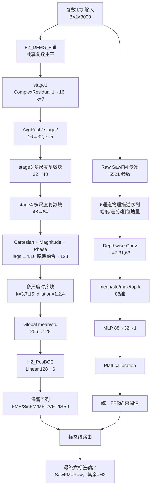
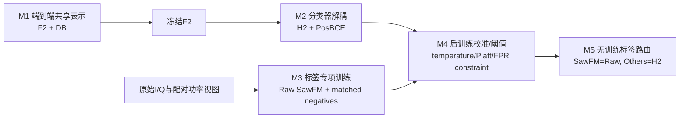

# 路线 A 当前实验状态、网络体系与长线研究规划报告

日期：2026-07-26  
项目：`C:\LJQ_code\CJ_Imbalance_0716`  
环境：`D:\anaconda3\envs\PY10\python.exe`  
状态：development 候选已冻结，locked test 未使用

## 1. 执行摘要

路线 A 已从单一共享六类网络演进为“共享主干与标签专项证据解耦”的系统。当前共享主干为 F2_DFMS_Full：它通过复数 I/Q 延迟融合、四级多尺度复数编码、Cartesian/幅度/多滞后相位晚期融合和无注意力 mean/std 池化产生128维共享表示。冻结该表示后，H2_PosBCE 负责六类基础分类；最终系统保留 H2 的 FMB、SinFM、MFT、VFT、ISRJ 五列，同时使用5521参数的 Raw SawFM 专家替换 H2 的 SawFM 列。Raw 专家从原始 I/Q 构造幅度、幅度变化和相邻相位增量描述量，通过7/31/63多尺度局部卷积及mean/std/max/top-k统计输出SawFM logit，再经ordinary calibration上的Platt校准和跨ordinary/40/45/50 dB统一FPR约束阈值完成决策。

五种子development中，该标签路由使macro-AUPR由0.8667提高至0.9001，macro-F1由0.7573提高至0.8027，SawFM recall由0.4870提高至0.8813，其他五类FPR完全不变；5/5 seeds通过路由门禁。当前主要风险是seed 2039 ordinary early FPR达到0.2806，以及两组Raw checkpoint训练角色抽样协议不同。现阶段最合理决策是冻结当前版本并申请一次性locked test，而不是继续修改主干、融合或阈值。

## 2. 当前网络结构

### 2.1 F2_DFMS_Full

| 层级 | 结构 | 输出/作用 |
|---|---|---|
| 输入 | complex RMS normalized I/Q | `[B,2,3000]` |
| stage1 | ComplexResidualBlock，1→16，kernel 7 | 保留实部/虚部，长度3000 |
| 下采样 | AvgPool1d，kernel/stride 2 | 长度1500 |
| stage2 | ComplexResidualBlock，16→32，kernel 5 | `[B,32,1500]` real/imag |
| stage3 | 复数多尺度残差，kernels 3/7/15，dilations 1/2/4，32→48 | 长度约750 |
| stage4 | 复数多尺度残差，48→64 | 长度约375 |
| 晚期融合 | Cartesian、稳定幅度、lag 1/4/16相位 | 128通道 |
| 时序块 | depthwise多尺度残差，kernels 3/7/15 | 局部、中程、长程证据 |
| 池化 | 无注意力global mean/std | 256维 |
| 投影 | Linear + LayerNorm + GELU + dropout | 128维共享特征 |
| 原分类器 | Dropout + Linear(128,6) | 结构筛选时使用 |

F2包含原六标签头时约257511参数。它解决了PAM-IQ的I/Q过早融合、浅层复数建模和共享注意力抑制问题，但没有单独解决SawFM弱证据。

### 2.2 H2_PosBCE

H2完全冻结F2，只训练`Linear(128,6)`，共774参数。它负责形成稳定的共享六类边界，但当前最终方法只使用其中五个非SawFM标签。H2的SawFM列保留为对照，不再作为最终SawFM决策。

### 2.3 RawStage1SawFMFrontend

当前仅启用`mode=raw`：

1. 从raw real/imag计算6通道序列：magnitude mean、max、std、相邻幅度差、相邻归一化相位cos和sin；
2. `Conv1d(6,16,1)+GroupNorm(4)+SiLU`；
3. 三个16通道depthwise分支，kernel为7、31、63；
4. 拼接48通道，经1×1卷积融合回16通道；
5. AvgPool 4倍；
6. 编码特征计算mean/std/max/top-k mean，得到64维；原始6通道描述量同样统计得到24维；
7. 合并88维，经`Linear(88,32)→GELU→Dropout(0.1)→Linear(32,1)`输出SawFM logit。

Raw前端参数量5521。完整/phase-only/envelope-only/time-shuffled机制结果约为0.999/0.995/0.749/0.711 development AUROC，证明有效信息主要来自相位与局部时间结构。

### 2.4 校准和路由

Raw网络冻结后，仅在ordinary calibration上拟合一维Platt模型。阈值在ordinary threshold和40/45/50 dB power threshold上共同选择，要求各域负样本FPR不超过0.20。最终只替换SawFM概率和阈值，不训练gate、不加权融合、不读取真实功率。

## 3. 超参数与损失函数

| 模块 | 数据 | 损失/方法 | 优化器 | lr / wd | batch | epochs / patience | 选点规则 |
|---|---|---|---|---|---:|---|---|
| F2 | label-LT 2400 | Distribution-Balanced Loss | AdamW | 3e-4 / 1e-4 | 64 | 20 / 20 | development macro-AUPR |
| H2 | F2冻结特征，fit/val=1920/480 | pos-weight BCE | AdamW | 1e-3 / 1e-4 | 256 | 60 / 12 | macro-AUPR，weak AUROC次选 |
| Raw | root+40/45/50 dB组合匹配正负 | BCEWithLogits | AdamW | 3e-4 / 1e-3 | 64 | 40 / 8 | power validation mean AUROC，AUPR次选 |
| Platt | ordinary calibration | LogisticRegression，C=1 | LBFGS | — | 全量 | max_iter=1000 | 无神经网络更新 |
| Raw阈值 | ordinary+power threshold | 0.01网格，FPR约束 | — | — | — | — | power recall→ordinary recall→50 dB recall |

共同训练设置：AMP用于F2，gradient clip为5，Raw top-k为16，Raw dropout为0.1，F2 dropout为0.2。

DB Loss主要参数：`map_alpha=0.1`、`map_beta=10`、`map_gamma=0.2`、`negative_scale=2`、`initial_bias=0.05`、`focal_gamma=2`、`balance=2`。

## 4. M1～M5训练模式

- **M1：共享表征训练。** 使用label-LT和DB Loss训练F2，解决总体频次偏置与复数结构问题。
- **M2：分类器解耦。** 冻结F2，用PosBCE重建六类边界，验证弱证据存在但原边界未充分利用。
- **M3：标签专项训练。** Raw专家绕开共享128维瓶颈，使用组合匹配hard negative学习SawFM局部证据。
- **M4：后训练决策。** calibration、threshold、evaluation角色分离，不更新神经网络。
- **M5：隔离路由。** 仅替换SawFM列，将专项增益传递到六标签指标。

## 5. 五种子正式development结果

### 5.1 Raw+Platt

| 指标 | 均值±标准差 | bootstrap 95% CI |
|---|---:|---:|
| ordinary AUROC | 0.9384±0.0126 | [0.9276,0.9473] |
| ordinary AUPR | 0.9547±0.0102 | [0.9458,0.9621] |
| ordinary recall | 0.8813±0.0299 | [0.8576,0.9049] |
| ordinary FPR | 0.1960±0.0554 | [0.1535,0.2444] |
| without-swept recall | 0.8653±0.1054 | [0.7798,0.9447] |
| power mean recall | 0.9879±0.0138 | [0.9766,0.9980] |
| 50 dB recall | 0.9758±0.0252 | [0.9553,0.9941] |
| max power FPR | 0.0760±0.0502 | [0.0391,0.1139] |
| Brier | 0.0977±0.0119 | [0.0898,0.1079] |
| ECE | 0.0504±0.0146 | [0.0374,0.0607] |

预注册要求至少4/5 seeds通过九项门禁，实际为4/5。seed 2039的唯一失败项是ordinary early FPR=0.2806。

### 5.2 六类标签路由

| 指标 | H2All | RawSaw+H2Others | 配对增量 |
|---|---:|---:|---:|
| macro-AUPR | 0.8667 | 0.9001 | +0.0334，CI [0.0281,0.0384] |
| micro-AUPR | 0.8661 | 0.9022 | +0.0361 |
| macro-F1 | 0.7573 | 0.8027 | +0.0454，CI [0.0418,0.0495] |
| Hamming loss | 0.2307 | 0.1959 | -0.0348 |
| SawFM recall | 0.4870 | 0.8813 | +0.3943，CI [0.3542,0.4344] |
| exact match | 0.2280 | 0.2747 | +0.0467，CI [0.0400,0.0513] |
| 其他五类最大FPR变化 | — | — | 0 |

路由在5/5 seeds上通过全部门禁。以上均为development结果，`locked_test_used=false`。

## 6. 试验演进

| 阶段 | 方法 | 关键结果 | 结论 | 晋级状态 |
|---|---|---|---|---|
| 频次基线 | Base-DB | 相对Base-ASL，18组尾类旋转macro-AUPR均提升 | DB是频率长尾主基线 | 保留 |
| 损失混合 | ASL-DB Mix75/90 | SawFM提高但macro-AUPR下降约0.047～0.049 | 总体与尾类Pareto冲突 | 停止 |
| 原结构 | PAM-IQ | 显著/局部模式强，弱证据受共享注意力抑制 | I/Q过早融合和单全局池化有缺陷 | 被F2替代 |
| 主干升级 | F2_DFMS_Full | macro-AUPR 0.8562，Hamming 0.2485 | 延迟融合和多滞后相位有效 | 晋级共享主干 |
| 分类器解耦 | H2_PosBCE | macro-AUPR约0.8670，weak AUROC约0.6524 | 分类边界是重要瓶颈 | 晋级基线头 |
| Stage2专项 | teacher/hard-negative S2 | 局部排序改善但跨development稳定性不足 | Stage2信息不够稳健 | 停止回接 |
| 固定融合 | C2 | SawFM排序改善，统一阈值50 dB召回失败 | 排序改善不等于可用决策 | 停止 |
| 可见度校准 | A0/A2/Selective | 能预测可见度但不能稳定区分弱正与hard negative | 共享可见度偏置机制错误 | 停止 |
| Raw残差 | H2+bounded Raw residual | ordinary/50 dB召回仅约0.055/0.100 | 分数几何不兼容 | 0/3，停止 |
| Raw独立决策 | Raw+Platt | ordinary AUPR约0.955，power recall约0.988 | Raw证据有效，失败来自融合方式 | 4/5晋级 |
| 标签路由 | RawSaw+H2Others | macro-AUPR +0.0334，Saw recall +0.3943 | 隔离替换有效 | 5/5晋级 |

## 7. 事实、假设与负结果

### 7.1 已验证事实

1. 0716根数据平衡；长尾结论必须绑定manifest。
2. F2的延迟复数融合优于原PAM-IQ总体结构。
3. F2的多滞后相位支路对多个标签有效，但SawFM是例外。
4. F2冻结特征中仍保存弱证据；扩大普通分类器容量不是主要答案。
5. Raw显式相位/局部时间描述对SawFM具有高可分性。
6. Raw能力同时存在于普通六类分布、with-swept和without-swept子群。
7. Raw作为小残差失败、作为独立分类器成功，证明接入方式决定能否利用证据。
8. 标签路由在五种子上提高总体指标，且不改变其他五类FPR。

### 7.2 尚未验证假设

1. 当前改进能在locked test复现。
2. Raw结构可推广到第二个以上干扰标签。
3. seed 2039的FPR波动主要来自有限样本或校准漂移。
4. 统一Raw训练角色协议能降低阈值和FPR方差。
5. DB频次机制与Raw可见度机制具有稳定可分离的因果交互。

### 7.3 历史负结果

- Route B semi-supervised/power-SSL未超过监督基线；
- ASL-DB混合牺牲总体性能；
- 普通MLP分类头没有稳定超越线性probe；
- Stage2 teacher-student和可见度仿射不能形成稳定决策；
- ordinal visibility anchor即使有oracle power也未达到结构上限门；
- selective unknown没有解决核心决策问题；
- Raw→H2有界残差不能利用Raw强排序。

## 8. 当前目标差距

| 目标 | 当前状态 | 差距 | 主要瓶颈 | 所需证据 |
|---|---|---|---|---|
| 最终测试泛化 | 仅development | locked test未使用 | 测试治理 | 冻结后一次性测试 |
| ordinary FPR稳定≤0.20 | 五seed均值0.196 | seed2039高0.0806 | threshold→early漂移 | 新development cross-fit审计 |
| Raw训练协议统一 | 两组已审计协议 | 尚非完全同协议5次重复 | 抽样角色差异 | 同协议五seed复现 |
| 通用弱标签方法 | 只验证SawFM | 至少缺2个新增标签 | 标签物理机制不同 | oracle可辨识性+正式专家 |
| 双轴长尾创新 | DB与Raw分别有效 | 缺完整因子交互 | 两轴证据未统一 | 2×2 factorial |
| 未见组合泛化 | 尚未正式评估 | LOCO/LSCO缺失 | 组合捷径风险 | 组合外推实验 |
| 域外泛化 | 单一0716数据族 | 外部数据缺失 | 生成分布依赖 | 新批次/外部数据 |
| 部署证据 | 参数量已知 | MACs/时延/触发成本缺失 | 双分支推理成本 | 效率与触发策略实验 |

## 9. 两项关键风险专项分析

### 9.1 seed 2039 FPR

seed 2039阈值角色满足FPR约束，但ordinary early FPR升至0.2806；与此同时AUPR为0.9558、recall为0.9130、power mean recall和50 dB recall均为1.0。这说明排序并未崩溃，问题集中在概率/阈值跨角色迁移。不能在early上重新调阈值，否则会形成开发集泄漏。

合理验证是新development上的cross-fitted Platt、风险控制阈值或共享阈值对照；若这些方法不能在不损失超过0.02 recall的情况下稳定FPR，就应保留当前简单Platt并把风险写入论文。

### 9.2 Raw checkpoint协议差异

2039/2040来自`R0_FullPhysics`新split协议，2041～2043来自`N0_RawOnly`原协议。网络、优化器、训练轮数一致，但身份抽样和fit/validation角色并非完全相同。因此当前五种子结论可证明“跨两个已审计协议均有效”，但不能被描述成完全同协议五次独立重复。

该问题影响复现性表述，不否定当前效果。长线实验应以完全相同角色协议重新训练五seed，比较性能均值、初始化方差、阈值方差和最差seed。

## 10. L0～L7长线实验路线

| 阶段 | 科学问题 | 主要对照 | 晋级门 | 失败停止规则 | 主要产物 |
|---|---|---|---|---|---|
| L0 | 当前版本是否已可最终确认 | H2All vs冻结路由 | 审计无漂移；用户明确授权 | 未授权即停止 | locked-test预注册包 |
| L1 | FPR波动能否在不损失召回下减小 | 当前Platt、cross-fit、共享阈值、risk-control | 4/5 FPR≤0.20；recall下降≤0.02 | 无法降低波动则保持Platt | calibration/threshold稳定性报告 |
| L2 | Raw协议差异是否影响稳定性 | heterogeneous vs统一协议 | AUPR≥0.93；power recall≥0.95；方差下降 | 方差不降则不包装新方法 | 五seed统一checkpoint |
| L3 | 专项证据能否推广到其他标签 | Raw/F2 stage1/stage2/global oracle probe | 至少2个新增标签正式增益 | oracle AUROC<0.70即停止该标签 | 标签可辨识性矩阵 |
| L4 | 频次与可见度是否为可分离双轴 | DB off/on × Raw expert off/on | 两主效应及交互方向稳定 | 无交互则收缩论文表述 | 2×2因子证据 |
| L5 | 能否泛化到未见组合/域 | LOCO、LSCO、未见功率、新批次 | worst-group和校准退化受控 | 明显组合捷径则停止泛化声明 | 域外与组合报告 |
| L6 | 双分支是否可部署 | H2-only、always-Raw、confidence-trigger | 成本下降且Saw recall损失可控 | 漏触发不可接受则always-Raw | MACs/时延/显存表 |
| L7 | 是否形成SCI闭环 | 全基线、结构/训练/校准消融 | 五seed+外推+一次性测试 | 缺关键证据则限定创新范围 | 论文主表和附录 |

### L1建议参数

- 保持Raw网络与数据角色冻结；
- K-fold仅作用于ordinary calibration，不接触ordinary early；
- 阈值网格仍为0.01，FPR门仍为0.20；
- 比较Brier、ECE、threshold标准差、worst-seed FPR；
- 不增加神经网络参数。

### L2建议参数

- 五seed统一使用相同身份选择函数；
- Raw：lr=3e-4、wd=1e-3、batch=64、epochs=40、patience=8；
- 每seed至少2个初始化；
- checkpoint只能由原validation选择；
- 不使用ordinary early挑选初始化。

### L3可证伪预测

若显式物理描述+matched negative是通用框架，则至少两个新增标签的独立development AUROC应超过0.70，且正式路由能在FPR约束下提高recall。如果oracle probe已失败，应立即停止该标签专家，不进行正式网络训练。

### L4因子设计

| 频次机制 | 可见度机制 | 系统 |
|---|---|---|
| off | off | BCE/ASL + H2All |
| on | off | DB + H2All |
| off | on | BCE/ASL + RawSaw路由 |
| on | on | DB + RawSaw路由 |

必须在balanced-root、label-LT、combo-LT和joint-LT上分别报告，不能把power views称作独立长尾样本。

## 11. SCI创新性与证据链

### 11.1 可作为主创新

1. **共享复数表征与标签专项物理证据的解耦。** F2处理总体复合干扰结构，Raw专家绕过共享128维瓶颈处理SawFM局部弱证据。
2. **显式复数局部描述与多尺度统计前端。** 幅度、幅度差和相位增量结合7/31/63卷积与top-k证据统计。
3. **组合匹配hard negative监督。** 正负样本除目标标签外组合一致，降低背景标签捷径。
4. **隔离式标签路由。** 只替换SawFM列，保证其他五类完全不受影响。

### 11.2 支撑机制

- PAM-IQ→F2说明延迟复数融合有效；
- envelope/phase/time-shuffle说明Raw主要依赖相位和时间结构；
- residual失败→independent成功说明分数几何和接入方式是关键；
- with/without-swept子群说明不是扫频背景捷径。

### 11.3 负结果价值

Stage2不稳定、可见度偏置失败、selective unknown失败和有界残差失败共同界定了哪些机制不能把排序能力转化为可靠决策。这些结果可用于论文机制分析或附录，但不能作为有效主方法。

### 11.4 当前SCI证据缺口

- locked test；
- 统一协议五seed Raw复现；
- 第二个以上标签；
- 双轴2×2交互；
- LOCO/LSCO和外部数据；
- 效率和最新方法同协议比较。

因此现阶段最稳妥论文表述是“面向SawFM弱可见度的标签专项复数证据与隔离路由”，而不是“通用六类弱分量解决方案”。

## 12. 风险清单

| 风险 | 表现 | 审计方法 |
|---|---|---|
| identity泄漏 | 同一receiver_noise_seed跨角色 | 保存身份manifest并检查交集为0 |
| power伪样本膨胀 | 多功率视图被当独立样本 | 按identity统计与配对 |
| checkpoint选择混杂 | 使用early选模型 | 只允许原validation选点 |
| 阈值过拟合 | 使用early或test重选threshold | calibration/threshold/evaluation分离 |
| 功率元数据捷径 | 输入JNR、真实功率 | 部署输入审计，禁止生成元数据 |
| seed不稳定 | seed2039 FPR超限 | 报告逐seed和worst-seed |
| 协议异质性 | 两组Raw抽样不同 | `frontend_protocol`逐seed记录 |
| 其他标签被破坏 | SawFM融合影响其余标签 | 只替换一列并逐标签比较 |
| locked-test污染 | 反复查看并调参 | 一次性授权和只读receipt |
| SCI过度表述 | SawFM结果外推到六类 | 明确主张范围和负结果 |

## 13. 最终决策

选择 **A：冻结当前版本并申请一次性locked test**。

理由：

1. Raw五种子确认已按预注册4/5规则通过；
2. 六类标签路由5/5通过；
3. macro-AUPR、macro-F1、Hamming、SawFM recall和exact match同时改善；
4. 其他五类FPR严格不变；
5. 当前继续修改结构会增加选择自由度，并可能把development变成隐性训练集；
6. seed2039风险已知且已披露，不应通过事后调阈值掩盖。

本决策仅表示“申请测试”是下一步，不构成读取测试集的授权。在用户明确批准前，必须保持locked test冻结。

## 14. 关键产物

- 最新Prompt：`docs/prompts/route_a_current_network_training_and_long_horizon_research_prompt_20260726.md`
- 本报告：`docs/reports/route_a_current_experiment_status_and_long_horizon_plan_20260726.md`
- 五种子结果：`docs/results/route_a_raw_platt_five_seed_label_routing_results_20260726.md`
- 正式summary：`outputs/tapc/route_a_raw_platt_five_seed_label_routing/route_a_raw_platt_five_seed_label_routing_summary.json`
- summary SHA256：`1C456FF579F0FA2EFCCBA202152F5F2CA117CA215A7D84131447D4086D491EFC`
- locked-test申请：`docs/plans/route_a_raw_saw_label_routing_locked_test_request_20260726.md`

