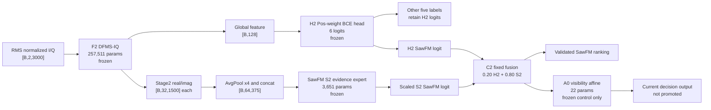

# 路线 A 当前研究状态、目标差距与未来试验规划

日期：2026-07-25  
项目：`C:\LJQ_code\CJ_Imbalance_0716`  
环境：`D:\anaconda3\envs\PY10\python.exe`  
数据：`C:\LJQ_code\干扰数据\复合干扰数据0716`  
当前证据范围：development，主要为 seeds 2041/2042/2043；`locked_test_used=false`

## 1. 执行摘要

路线 A 已形成三段相互独立的有效证据：Base-DB 确立了六类标签频率长尾主基线；F2 延迟复数融合与 H2 正样本加权分类头将 development macro-AUPR 提高到 0.8670，并证明大部分弱证据仍保留在冻结表示中；SawFM 专项 S2 通过同身份 teacher、组合匹配 hard negative 和 stage2 低秩证据头，将 45 dB 匹配子域 AUROC 提高到 0.7972，固定融合 C2 在 35/40/45/50 dB 上取得 0.7638 的平均 AUROC。当前主要差距不再是 SawFM 排序能力，而是统一阈值下的可靠决策：A0/V2 三档平均召回为 0.4724，50 dB 仅 0.1668；有序三锚点虽学会可见度顺序，却使召回降至 0.0721。现阶段不应解冻主干，应首先验证 `positive / negative / unknown` 选择性决策；若失败，再训练 stage2 标签条件的“证据存在/证据可靠”双头。

## 2. 研究问题与数据协议

### 2.1 研究问题

六类复合干扰识别同时存在两个不同机制：

1. **频率偏置**：标签频次、组合共现频次和训练先验不均衡；
2. **可见度退化**：标签真实存在，但因相对功率、噪声或其他干扰掩蔽而难以观测。

二者不能混为一个“长尾”。DB Loss、重采样和先验校正主要处理频率偏置；同身份多功率监督、局部弱证据提取和条件决策主要处理可见度退化。

### 2.2 强制数据约束

- 六类顺序固定为 `[FMB, SawFM, SinFM, MFT, VFT, ISRJ]`。
- 输入为 RMS 归一化真实复数 I/Q：`[B,2,3000]`。
- 0716 根数据本身平衡；任何长尾结论必须绑定 hash 记录的 LT manifest。
- 当前 Route A label-LT 训练清单为 2400 样本，标签计数约为 `1600/1213/919/696/528/400`。
- 多功率视图通过 `receiver_noise_seed` 绑定，是同一样本身份的不同观测，不能计为独立样本。
- 训练、专家选择、校准、阈值选择和 early-development 必须身份互斥。
- 当前所有结果均为 development 证据；locked test 尚未使用，不能表述为最终测试性能。

## 3. 前几轮试验演进

不同阶段的数据角色和评价子集并不完全相同，表中指标只能在对应配对协议内比较，不能把所有数值视为同一排行榜。

| 阶段 | 方法 | 核心结果 | 验证结论 | 状态 |
|---|---|---|---|---|
| 六类损失基线 | Base-DB | macro-AUPR 0.826986；SawFM AUPR 0.736400；相对 Base-ASL 的18组尾类旋转 macro-AUPR +0.017870，18/18获胜 | DB 是六类频率长尾的可靠主基线 | 保留为论文主对比 |
| 损失混合 | Mix75/Mix90 | SawFM AUPR约 +0.068～0.069；macro-AUPR约 -0.047～-0.049 | 提升尾类会破坏总体结构，形成明显 Pareto 冲突 | 不晋级 |
| 结构筛选 | F2_DFMS_Full | macro-AUPR 0.8562；Hamming 0.2485；weak AUROC 0.5886；弱召回0.3586 | 延迟 I/Q 融合和多滞后相位有效，但未解决工作点弱召回 | 结构候选晋级，决策未完成 |
| 冻结头 | H2_PosBCE | macro-AUPR 0.8670；weak AUROC 0.6524；弱召回0.3774；FPR 0.1875 | F2 已保留弱证据，原联合 DB 分类边界是重要瓶颈 | 当前总体冻结基线 |
| 特征充分性 | G/T/S2/F oracle probe | 总体 weak AUROC均未超过H2；SawFM stage2相对H2约 +0.0382但不稳定 | 不应继续盲目扩宽主干；SawFM需要定向早期层监督 | `stop_before_unfreeze` |
| SawFM专项头 | S2_TeacherHardNeg | 45 dB AUROC 0.7972，AUPR 0.7949，泛化落差0.0097 | stage2存在稳定可提取的SawFM弱证据；组合匹配hard negative是主要贡献 | 专家机制通过 |
| 小残差接入 | bounded residual | AUROC仅 +0.00219 | 专家是新边界而非对H2的小修正；接入强度不足 | 不晋级 |
| 专家融合 | R2/C2固定融合 | 普通macro-AUPR 0.8749；SawFM AUPR 0.8179；四档平均AUROC 0.7638，较H2 +0.2972 | 专家主导的固定融合可稳定改善普通域与跨功率排序 | 排序结构晋级 |
| 路由 | 9参数样本门控 | 性能改善，但普通/弱域gate差仅0.013 | 路由实际近似固定融合，没有学到可见度机制 | 机制门失败 |
| 标量校准 | 双域Platt/统一阈值 | 为控制FPR，40/45/50 dB召回接近0 | 跨功率分数平移不能由一个标量映射吸收 | 不晋级 |
| 可见度校准 | A0/V2 22参数仿射 | 普通召回/FPR 0.7230/0.2048；40/45/50 recall 0.7101/0.5403/0.1668 | 单视图内部统计能改善40/45 dB，但50 dB仍失败 | 当前冻结决策对照，未晋级 |
| 有序可见度 | A2三锚点 | early排序准确率0.9755、tau 0.9511；三档平均召回0.0721 | 可见度顺序能学会，但共享正偏置压缩正负间隔 | 明确停止 |
| 功率oracle锚点 | A3 | 三档平均召回0.4074，50 dB 0.2509 | 即使知道功率，三锚点统一阈值结构上限仍不足 | 结构否决 |

## 4. 当前网络体系

当前并不存在一个已经整体晋级的“最终网络”。应区分六类主干、冻结分类头、SawFM专项专家、排序融合和未晋级决策层。



### 4.1 F2：延迟融合多尺度复数主干

| 层级 | 结构 | 输出 |
|---|---|---|
| 输入 | real/imag 两通道复数 I/Q | `[B,2,3000]` |
| block1 | ComplexResidualBlock，1→16，kernel 7 | real/imag `[B,16,3000]` |
| 下采样 | AvgPool，stride 2 | `[B,16,1500]` |
| block2/stage2 | ComplexResidualBlock，16→32，kernel 5 | real/imag `[B,32,1500]` |
| stage3 | 三分支complex conv，kernel 3/7/15，dilation 1/2/4 | real/imag `[B,48,750]` |
| stage4 | 三分支complex conv，kernel 3/7/15，dilation 1/2/4 | real/imag `[B,64,375]` |
| 晚期融合 | Cartesian + magnitude + lag 1/4/16 phase residual | `[B,128,375]` |
| 时序增强 | depthwise多尺度残差块 | `[B,128,375]` |
| 安全池化 | 无注意力mean/std | `[B,256]` |
| 投影 | Linear + LayerNorm + GELU + dropout | `[B,128]` |
| 分类 | 六标签线性头 | `[B,6]` |

F2 的重要机制是 I/Q 在深层复数 stage 之前不做破坏性融合，并保留无注意力全局统计安全路径。多滞后相位残差被3/3种子稳定使用，但对SawFM仍存在标签特异冲突。

### 4.2 H2：冻结F2后的六标签线性头

H2仅重新训练128维全局特征上的六标签线性边界。它没有增加非线性容量，却使 weak AUROC 从联合原头的0.5886提高到0.6524，说明剩余问题主要是强正主导的分类目标和阈值，而不是F2完全缺少弱证据。

### 4.3 S2：SawFM stage2专项证据头

S2从F2早期stage2分叉：

- 输入 `[B,64,375]`；
- GroupNorm后使用rank-8低秩adapter；
- `1×1 Conv 64→32 → depthwise Conv(k=15) → 1×1 Conv 32→1`；
- 对每个样本的时间证据图做零均值、单位方差归一化；
- 池化为 `topk_mean(k=16)+0.25×max`；
- 使用正尺度和bias输出一个SawFM logit。

其优势来自“相同其他标签组合、仅SawFM存在性不同”的hard negative，而不是单纯增加参数。

### 4.4 C2与A0

- C2只修改SawFM：`z_C2=0.20 z_H2+0.80 z_S2`；其他五类保持H2。
- C2已通过排序、普通域非劣和跨功率稳定性验证。
- A0根据10维内部统计输出条件scale和bias，共22参数，但只作为冻结决策对照。
- A2有序锚点已被否决，不属于当前网络。

## 5. 超参数和损失函数

| 模块 | 优化器 | LR / WD | Batch | Epoch / Patience | 损失 | 检查点选择 | 阈值 |
|---|---|---|---:|---|---|---|---|
| F2 | AdamW | `3e-4 / 1e-4` | 64 | `20 / 20` | Distribution-Balanced Loss | development macro-AUPR | 后续单独校准 |
| H2 | AdamW | `1e-3 / 1e-4` | 256 | `60 / 12` | pos-weight BCE | macro-AUPR；weak AUROC破同分 | 每标签温度；negative FPR≤0.20 |
| S2 | AdamW | `3e-4 / 1e-4` | 64 | `30 / 8` | BCE + teacher + score distill + map consistency + matched rank | 45 dB validation AUROC；AUPR破同分 | 专家分数先Platt校正 |
| C2 | 不训练主干 | 固定 `alpha=0.80` | — | — | 无新增训练损失 | alpha预注册，不按结果重选 | 决策层另行拟合 |
| A0/V2 | AdamW | `1e-2 / 1e-3` | 全量低维统计 | `300 / 50` | 普通/root/40/45/50域等权BCE | power-threshold受约束召回 | 普通和三功率共用一个阈值，FPR≤0.20 |
| A2 | AdamW | `1e-2 / 1e-3` | 全量低维统计 | `300 / 50` | BCE + ordinal pairwise | 同A0 | 已否决 |

### 5.1 F2的Distribution-Balanced Loss

默认参数：

- `map_alpha=0.1`；
- `map_beta=10.0`；
- `map_gamma=0.2`；
- `negative_scale=2.0`；
- `initial_bias=0.05`；
- `focal_gamma=2.0`；
- `balance=2.0`。

DB Loss缓解标签频率差异，但不会区分同一标签内部的强正和弱正。SawFM强正样本仍可主导分类边界，因此DB不能单独解决可见度退化。

### 5.2 H2的正样本加权BCE

每标签权重为：

`pos_weight_k = N_negative,k / max(N_positive,k,1)`

相比冻结DB头，它进一步提高总体weak AUROC约0.0127，但SawFM AUPR略有下降，说明频率再加权并不自动等价于功率弱正优化。

### 5.3 S2的组合损失

`L_S2 = L_cls + L_teacher + L_score + L_map + L_rank`

- `L_cls`：40/50 dB弱正与匹配负样本的BCE；
- `L_teacher`：10 dB高可见度正样本BCE，权重0.5；
- `L_score`：student与teacher logit Smooth-L1，权重0.25；
- `L_map`：student与teacher evidence map余弦一致性，权重0.1；
- `L_rank`：匹配正样本高于hard negative的softplus排序，权重0.25，margin 0.5。

消融显示，teacher一致性单独不稳定；组合匹配hard negative使S2相对S1的AUROC提高0.1739，3/3种子为正，是当前最强机制证据。

## 6. 已验证事实

1. Base-DB在六类标签频率长尾协议中稳定优于Base-ASL，应长期保留。
2. 原PAM-IQ的I/Q过早融合确实是总体结构问题之一；F2的延迟融合改善macro-AUPR和Hamming。
3. F2多滞后相位分支对MFT、VFT、ISRJ有效，但不能统一解决SawFM。
4. 冻结F2重新训练线性头即可显著提高weak AUROC，说明分类边界而非分类器容量是主要矛盾。
5. 全标签简单global/temporal/stage2统计oracle没有超过H2，不支持继续盲目扩宽主干。
6. SawFM stage2中存在可稳定提取的早期物理证据；rank-8 adapter已经足够。
7. 组合匹配hard negative比随机负样本或teacher一致性更重要。
8. 固定高权重专家融合能同时改善普通域和跨功率SawFM排序。
9. 旧seed 2043专家失败主要是非凸优化/初始化问题，不是数据seed或stage2表示的必然上限。
10. 单一Platt、统一阈值、单视图可见度仿射和有序三锚点都未完成50 dB可靠决策。
11. A2证明可见度顺序可以预测；A3证明知道功率仍不足以用三锚点统一偏置解决正负判决。
12. 所有上述结论均来自development，locked test仍冻结。

## 7. 失败试验和原因分类

### 7.1 表征结构问题

- 原PAM-IQ过早融合和单一显著性池化偏向强分量；F2已部分修复。
- F2总体特征并非完全不足，但SawFM全局特征仍弱，需要stage2专项支路。

### 7.2 优化稳定性问题

- 原seed 2043 S2显著落后；固定数据和协议，仅改变初始化后，三个新模型四档AUROC均超过0.90。
- 结论是专家需要多初始化、validation-only选择或轻量ensemble，而不是增加路由器掩盖坏checkpoint。

### 7.3 分类边界问题

- F2联合DB原头没有充分使用冻结特征中的弱证据；H2线性头即可改善。
- batch内统一弱排序损失H3伤害SawFM，原因是正样本少、难负不匹配、六类共享margin/权重和选择指标混杂。

### 7.4 专家接入问题

- 0.20受限残差无法跨越H2在SawFM+扫频组合上的错误边界。
- 专家完全替换会损害普通域；0.80固定凸融合提供较好折中。
- 低容量路由虽有效，但gate不区分弱域，不能作为可见度路由机制证据。

### 7.5 校准与决策问题

- 普通域阈值迁移到45/50 dB时召回近零，而AUROC仍较高，说明分数整体下移。
- A0改善40/45 dB，但50 dB正样本和同功率hard negative在10维单视图统计中仍高度重叠。
- A2排序目标与分类目标冲突：低可见度正偏置同时抬高hard negative，为维持FPR，模型压缩分数或提高阈值，导致正负间隔缩小。

### 7.6 指标和阈值放大

- AUROC改善代表排序增强，不代表固定阈值召回可用。
- 直接降低阈值可以提高召回，但会使普通域FPR失控，不能作为方法提升。
- 阈值选择必须在独立threshold role进行，并报告early-development漂移。

## 8. 当前目标差距矩阵

| 目标 | 当前值 | 目标/约束 | 差距 | 主要瓶颈 | 需要的证据 |
|---|---:|---:|---:|---|---|
| 六类总体macro-AUPR | C2 0.8749 | 至少相对H2非劣，建议Δ≥-0.003 | 当前通过 | 后续决策可能反向影响普通域 | 配对种子、逐标签和置信区间 |
| 通用弱分量召回 | H2 0.3774 | 尚无最终冻结目标；建议至少H2+0.03且FPR受控 | 未完成 | 当前专项证据主要集中SawFM | 至少两个新增弱标签的稳定增益 |
| SawFM跨功率排序 | C2平均AUROC 0.7638 | ≥0.65，最差≥0.58 | 已通过 | 决策转换而非排序 | 保留冻结C2对照 |
| 三功率平均召回 | A0 0.4724 | ≥0.50 | -0.0276 | 50 dB下分数尺度与负样本重叠 | 新决策规则独立验证 |
| 40 dB召回 | 0.7101 | ≥0.35 | +0.3601 | 已满足 | 非劣保持 |
| 45 dB召回 | 0.5403 | ≥0.35 | +0.1903 | 已满足 | 非劣保持 |
| 50 dB召回 | 0.1668 | ≥0.35 | -0.1832 | 极弱正与hard negative难以二选一 | unknown或证据可靠性建模 |
| 功率hard-negative FPR | 最大0.1176 | ≤0.20 | 通过 | 不能通过降阈值换召回 | 同FPR预算比较 |
| 普通SawFM FPR | 0.2048 | 绝对约0.20；相对V0增量≤0.02 | 绝对+0.0048；相对超0.0062 | 校准抬分影响普通负类 | 置信上界阈值/选择性决策 |
| 平均oracle gap | 0.3123 | ≤0.15 | +0.1623 | 排序未转化为统一决策 | coverage-risk和条件判决 |
| 单种子全门通过 | 0/3 | ≥2/3 | 缺2个种子 | 50 dB及普通FPR | 三种子预注册复验 |
| 最终测试证据 | 0次locked test | 方法冻结后一次性测试 | 完全缺失 | 方法尚未晋级 | 五种子开发确认后授权测试 |

## 9. SCI创新性审视

### 9.1 已具备创新潜力的部分

1. **DFMS-IQ延迟复数融合**：通过早期融合对照、无相位消融和多滞后相位消融，已有较完整的结构机制证据。
2. **组合匹配的SawFM弱证据学习**：同身份多功率teacher/student、标签组合完全匹配hard negative、stage2低秩证据头构成了较清晰的物理与监督创新。
3. **专家主导的受限融合**：固定0.80融合在普通域和四功率排序上均有一致增益，可以作为专项专家接入的工程机制。
4. **频率偏置与可见度退化的分离分析**：如果最终补齐可靠决策和多标签扩展，可成为论文问题定义的重要贡献。

### 9.2 目前只能作为负结果或机制分析的部分

- ASL-DB混合：尾类提升与总体退化的Pareto冲突。
- batch内统一排序损失：负样本构造与标签共享超参数失败。
- 共享深层去相位专家：不是独立表示，贡献接近零。
- 小残差回接：接入强度与边界错配。
- 低容量路由：性能有效但机制不可识别。
- 有序三锚点：顺序学习成功，概率映射失败。

### 9.3 形成SCI完整证据链仍缺少

1. 一个真正通过预注册决策门的完整冻结方法；
2. 至少五种子开发确认或更强统计置信区间；
3. 方法冻结后一次性locked-test确认；
4. 逐标签、逐组合规模、逐共存类型和最差种子的稳定性；
5. 参数量、FLOPs、推理延迟和checkpoint ensemble成本；
6. 若主张通用框架，需要至少两个额外弱标签的成功扩展；
7. 若只保留SawFM，应把论文表述限定为SawFM弱可见度专项方法。

## 10. 三阶段未来试验路线

### 阶段I：选择性unknown决策

唯一目标：判断极弱分量是否应暂缓决策，而不是强制判负。

| 项目 | 设计 |
|---|---|
| 冻结模块 | F2、H2、S2、C2、A0全部冻结 |
| 候选 | U0 A0单阈值；U1统一双阈值；U2风险约束双阈值；U3 oracle分功率双阈值上限 |
| 拟合角色 | power-threshold及ordinary-threshold，身份互斥 |
| 最终评价 | ordinary early + 40/45/50 dB early-development |
| 核心指标 | confirmed-positive recall/FPR、confirmed-negative false omission、unknown coverage、selective risk、coverage-risk |
| 成功预测 | 若低分弱正应视为unknown，则50 dB被错误判负比例显著下降，且FPR不升高 |
| 失败判据 | 只能通过把大多数样本变为unknown通过约束，或confirmed-negative仍大量包含真实正样本 |
| 失败后动作 | 不调阈值，进入阶段II |

### 阶段II：stage2标签条件证据存在/可靠性双头

唯一目标：区分“弱但存在SawFM”和“同功率下SawFM真实缺失”。

建议结构：

- 输入S2 normalized evidence map和F2 stage2特征；
- 标签条件时间query搜索SawFM局部证据；
- 无注意力mean/std、top-k/max作为安全旁路；
- 输出 `z_exist=P(Saw present|evidence)` 和 `z_reliable=P(evidence reliable|view)`；
- 决策逻辑只在可靠时使用exist头，否则输出unknown；
- 正负仍使用组合匹配身份，不能退回随机负样本。

对照：S2单头、A0统计、exist-only、reliability-only、双头、oracle可靠性上限。

成功预测：在相同FPR与coverage下，50 dB confirmed-positive recall或recoverable-positive coverage提高，且hard negative不会同步抬高。若exist与reliable输出高度相关、oracle可靠性也无上限增益，应停止此结构。

### 阶段III：最后stage小学习率联合微调

仅在阶段I或II的冻结方案通过全部门槛后启动。

- stage1～stage3冻结；
- 最后stage学习率≤`1e-5`；
- 专家/决策头学习率约`1e-4`；
- 使用L2-SP或参数漂移约束；
- 保留完全冻结候选作为并行对照；
- 每个评价点同时监控macro-AUPR、weak AUROC、跨功率AUROC、50 dB decision metrics、FPR和representation drift；
- 两个连续评价点未超过冻结候选即停止。

## 11. 首选下一试验：Selective Unknown预注册方案

### 11.1 研究假设

H1：50 dB下存在一批“证据不足但不能判负”的SawFM正样本。双阈值选择性决策应将这些样本从错误负类移入unknown，同时保持confirmed-positive FPR不高于0.20。

H0：弱正与hard negative无法通过当前分数分离；任何表面改善只能通过把绝大多数样本拒判获得。

### 11.2 变体

| 变体 | 分数 | 决策 | 作用 |
|---|---|---|---|
| U0_SingleThreshold | A0 probability | 单阈值正/负 | 当前对照 |
| U1_C2_DualThreshold | calibrated C2 | 统一`t_neg/t_pos` | 判断A0是否必要 |
| U2_A0_Selective | A0 probability | 风险约束统一双阈值 | 唯一晋级候选 |
| U3_OraclePowerSelective | A0 probability | 每功率独立双阈值 | 结构上限，不可部署 |

### 11.3 决策定义

对概率 `p`：

```text
p >= t_pos              -> positive
p <= t_neg              -> negative
t_neg < p < t_pos       -> unknown
约束：0 <= t_neg < t_pos <= 1
```

定义：

- confirmed-positive recall：正样本中判positive的比例；
- confirmed-positive FPR：负样本中判positive的比例；
- positive false-negative rate：正样本中判negative的比例；
- recoverable-positive coverage：正样本中判positive或unknown的比例，即 `1-FN_rate`；
- decision coverage：所有样本中非unknown的比例；
- selective risk：已决策样本中的错误比例；
- unknown positive rate：unknown样本中的真实正比例。

### 11.4 阈值搜索

只在ordinary-threshold和power-threshold角色中搜索，early-development不可参与选择。

建议网格：`0.01,0.02,...,0.99`。对所有 `t_neg<t_pos`：

1. ordinary和40/45/50 dB的confirmed-positive FPR均≤0.20；
2. 三功率positive false-negative rate均≤0.10；
3. ordinary decision coverage≥0.70；
4. 三功率平均decision coverage≥0.40；
5. 在可行集合中依次最大化：最差功率decision coverage、三功率平均coverage、confirmed-positive recall、负selective risk的相反数；
6. 若无可行解，则该种子直接失败，不允许放宽门槛。

第3～4项是本轮新增的防退化约束，目的是排除“全部输出unknown”的平凡解，属于待预注册的新门槛，不是既有验证结论。

### 11.5 正式晋级门

候选U2在独立early-development上必须满足：

1. ordinary及每个功率confirmed-positive FPR≤0.20；
2. 50 dB recoverable-positive coverage≥0.60；
3. 50 dB positive false-negative rate≤0.10；
4. ordinary decision coverage≥0.70；
5. 三功率平均decision coverage≥0.40，50 dB coverage≥0.25；
6. selective risk≤0.15；
7. 50 dB confirmed-positive recall不得低于A0的0.1668超过0.03，即建议下限0.1368；
8. ordinary confirmed-positive recall相对A0下降≤0.05；
9. 至少2/3种子通过；
10. U2优于U1，U3必须给出足够的oracle上限；
11. identity audit、checkpoint hash和`locked_test_used=false`全部通过。

需要注意：`recoverable-positive coverage`不是分类成功率。只有它与decision coverage、selective risk同时通过，才能证明unknown有实际意义。

### 11.6 可执行伪代码

```python
for seed in [2041, 2042, 2043]:
    verify_frozen_source_hashes(seed)
    threshold_data = load_ordinary_and_power_threshold_predictions(seed)
    early_data = load_ordinary_and_power_early_predictions(seed)

    for variant in ["U0", "U1", "U2", "U3"]:
        if variant == "U0":
            threshold = load_a0_single_threshold(seed)
        else:
            candidates = []
            for t_neg in grid(0.01, 0.99, 0.01):
                for t_pos in grid(t_neg + 0.01, 0.99, 0.01):
                    metrics = selective_metrics(
                        threshold_data, t_neg, t_pos,
                        oracle_power=(variant == "U3")
                    )
                    if satisfies_preregistered_constraints(metrics):
                        candidates.append((lexicographic_key(metrics), t_neg, t_pos))
            if not candidates:
                mark_seed_failed("no_feasible_threshold_pair")
                continue
            threshold = max(candidates)

        early_metrics = evaluate_selective_decision(early_data, threshold)
        save_predictions_metrics_search_and_receipt(seed, variant, early_metrics)

aggregate_three_seeds()
evaluate_promotion_gate_without_locked_test()
```

### 11.7 建议输出目录

```text
outputs/tapc/route_a_selective_unknown_decision/
├── protocol.json
├── route_a_selective_unknown_decision_summary.json
├── seed_2041/
│   ├── source_audit.json
│   ├── identity_audit.json
│   ├── threshold_search.json
│   ├── U0_SingleThreshold/
│   │   ├── predictions.npz
│   │   ├── metrics.json
│   │   └── run_receipt.json
│   ├── U1_C2_DualThreshold/
│   ├── U2_A0_Selective/
│   └── U3_OraclePowerSelective/
├── seed_2042/
└── seed_2043/
```

### 11.8 Summary JSON关键字段

```json
{
  "status": "completed",
  "protocol": {
    "seeds": [2041, 2042, 2043],
    "levels": [40, 45, 50],
    "variants": [],
    "threshold_grid_step": 0.01,
    "max_confirmed_positive_fpr": 0.20,
    "max_positive_false_negative_rate": 0.10,
    "locked_test_used": false
  },
  "source_hashes": {},
  "identity_audits": [],
  "per_run": [
    {
      "seed": 2041,
      "variant": "U2_A0_Selective",
      "t_negative": 0.0,
      "t_positive": 0.0,
      "ordinary": {
        "confirmed_positive_recall": 0.0,
        "confirmed_positive_fpr": 0.0,
        "decision_coverage": 0.0,
        "selective_risk": 0.0
      },
      "power": {
        "40": {},
        "45": {},
        "50": {}
      },
      "identity_overlap": 0,
      "locked_test_used": false
    }
  ],
  "aggregate": {},
  "promotion_gate": {
    "checks": {},
    "per_seed": [],
    "passed": false
  },
  "next_decision": ""
}
```

### 11.9 命令模板

建议实现脚本：

`C:\LJQ_code\CJ_Imbalance_0716\experiments\run_route_a_selective_unknown_decision.py`

Smoke：

```powershell
& 'D:\anaconda3\envs\PY10\python.exe' experiments/run_route_a_selective_unknown_decision.py `
  --seeds 2043 `
  --grid-step 0.05 `
  --output-root outputs/tapc/route_a_selective_unknown_decision_smoke
```

正式运行：

```powershell
& 'D:\anaconda3\envs\PY10\python.exe' experiments/run_route_a_selective_unknown_decision.py `
  --seeds 2041 2042 2043 `
  --grid-step 0.01 `
  --max-positive-fpr 0.20 `
  --max-positive-fn 0.10 `
  --output-root outputs/tapc/route_a_selective_unknown_decision
```

本节目前是预注册设计，尚未实现和执行，不能写入已验证结果。

## 12. 风险与审计清单

| 风险 | 表现 | 审计方法 |
|---|---|---|
| 配对身份泄漏 | 同一receiver_noise_seed跨角色出现 | 保存各角色identity hash并计算交集 |
| checkpoint选择混杂 | early结果参与模型或初始化选择 | receipt记录selection role，禁止early选择 |
| 功率元数据捷径 | 输入真实dB/JNR/raw RMS | 特征清单审计；真实功率只允许oracle |
| seed不稳定 | 均值通过但单种子失效 | 报告逐seed、最差seed和多初始化方差 |
| 阈值过拟合 | threshold role好、early崩溃 | 分角色报告并记录阈值迁移差 |
| unknown平凡解 | 大部分样本拒判导致低错误率 | 同时约束coverage、risk和confirmed recall |
| 指标混淆 | AUROC提升被写成召回提升 | 排序指标与决策指标分表 |
| 协议横比错误 | 不同子集指标直接比较 | 每个表注明数据角色与样本构造 |
| 长尾概念混淆 | 将功率退化称为样本频率长尾 | 分别报告frequency和visibility机制 |
| locked-test污染 | 反复测试并调参 | 默认`allow_locked_test=false`，授权后一次性运行 |
| SCI过度表述 | SawFM专项被宣称六类通用 | 至少扩展两个标签，否则限定论文范围 |
| 历史代码覆盖 | 修改原始程序或数据 | 原数据和历史程序只读，新实验独立目录 |

## 13. 最终决策

当前选择：**A. 继续冻结并执行 selective unknown。**

证据是：

1. F2/H2/S2/C2已分别证明表征、分类头和SawFM排序有效，没有依据重新扩宽或解冻主干；
2. A0的50 dB oracle recall仍约0.70，但固定阈值recall仅0.1668，说明一部分信息存在但不适合强制二元决策；
3. A2成功学习可见度顺序却破坏分类，证明继续做共享偏置校准价值低；
4. unknown可以直接检验“低分是不可见而非不存在”的核心假设，且不改变任何已验证表征；
5. 该验证成本最低、归因最清楚，并能决定是否有必要进入stage2证据可靠性双头。

决策树：

```text
Selective unknown通过
    -> 冻结候选扩展到5 seeds
    -> 逐组合和计算成本确认
    -> 最后stage小学习率微调对照
    -> 方法完全冻结后申请locked test

Selective unknown失败，但oracle selective通过
    -> 训练stage2标签条件exist/reliability双头

Selective unknown和oracle selective都失败
    -> 停止校准/拒判路线
    -> 保留C2作为排序结果，H2/Base-DB作为最终决策系统
```

在selective unknown正式结果产生之前，不自动进入下一阶段。
