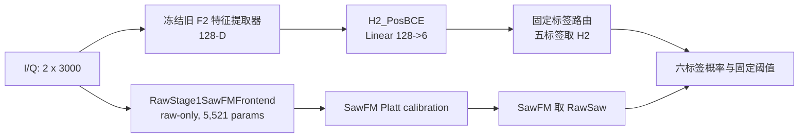
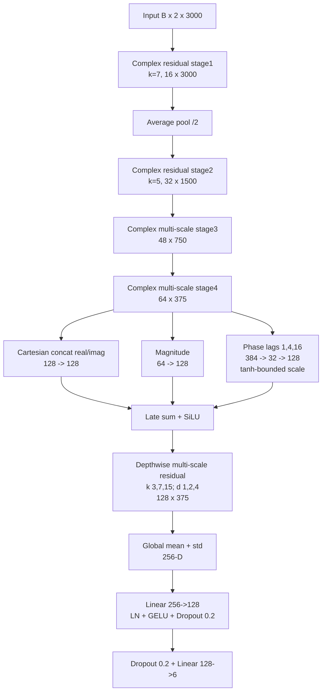
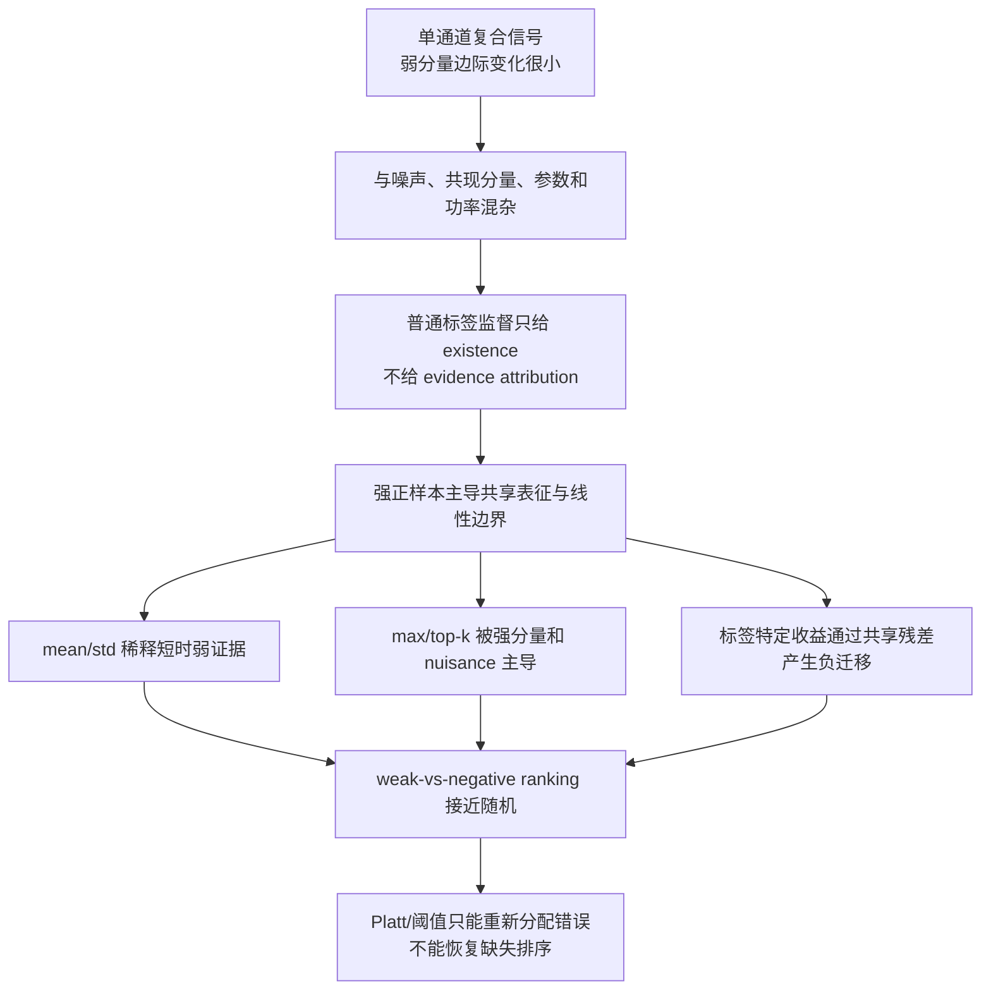
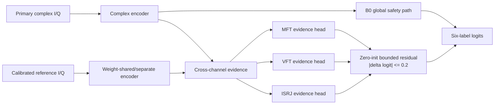

# Route A 当前实验进展、技术状态、失败复盘与长线研究规划

日期：2026-08-07  
项目：`E:\LJQ_code\CJ_Imbalance_0716`  
运行环境：`D:\anaconda3\envs\PY10\python.exe`  
报告性质：现有证据审计与后续研究规划；本报告未启动新训练、未读取 test-v3。

## 1. 执行摘要

当前 Route A 已经获得一个具有一次性独立测试证据的、但仅部分解决六类弱分量问题的系统：
`RawSawCrossSeedFPR15+H2Others`。[F] 它在已消费的 locked test 上将 macro-AUPR 从 `0.861894` 提高到 `0.893382`，
macro-F1 从 `0.755500` 提高到 `0.796137`，SawFM 弱正召回从 `0.155255` 提高到 `0.512175`，同时将 SawFM FPR 从
`0.190661` 降到 `0.135177`。这构成了目前最扎实的系统级正证据，但其主要增量来自 SawFM 标签特定的 RawSaw 前端；
MFT、VFT、ISRJ 的弱正召回仍只有 `0.2970/0.3088/0.3177`，exact match 只有 `0.2680`。因此它不是“六类弱分量问题已解决”的证据。

当前用于继续研究的正式锚点是从随机初始化训练的 `B0_F2_DFMS_Full`。[A] 它在新的 backbone-development-v1 上取得
macro-AUPR `0.843746`，但 MFT/VFT/ISRJ 平均弱正 AUROC 只有 `0.555864`、弱正召回只有 `0.237524`，而强正召回为
`0.771434`。它说明主干能够学习常规类别与强正模式，却没有形成稳定、可归因的弱分量排序。

M1-M4 四种主干增强——抗混叠、跨层金字塔、超长感受野和 max/top-k 局部统计——全部未过预注册的弱指标门槛。[N]
IP-CVE 的同 identity high/low/absent 数据合同顺利通过，但冻结 B0 的 P0 可辨识性没有战胜控制，P1 因此按规则未运行。[N]
这把根因从“网络不够宽/池化不够复杂”进一步收敛到三点：

1. 单通道复合观测中，弱目标分量相对 nuisance 的边际信息可能本身不足或不稳定；
2. 当前 BCE/Focal/DB 只监督标签存在，不监督弱分量的证据位置、来源和相对背景；
3. 少量标签特定结构即使有效，也容易通过共享表征和共享损失对其他标签产生负迁移。

当前科学决策是：停止无机制的通用 backbone 堆叠，保留 B0 作为正式开发锚点，保留 RawSaw 作为 SawFM 的已验证标签特定组件，
保留 aligned periodicity 作为 ISRJ 的窄范围组件证据。下一项高信息增益工作必须是引入非 oracle、可部署的新物理观测，先做零训练可辨识性准入；
如果无法取得新观测，应主动缩小论文主张，而不是继续在同一单通道数据上用损失、阈值或注意力模块制造表面增益。

## 2. 范围、状态与证据边界

### 2.1 证据标记

| 标记 | 含义 | 可用于何种表述 |
|---|---|---|
| [F] | 冻结、预注册或一次性独立测试支持 | 可作为当前最强事实，但不得复用测试集继续筛选 |
| [A] | 开发集、标签局部、生成器局部或边界性证据 | 可说明机制线索，不能直接泛化到统一模型或真实系统 |
| [N] | 未过门槛、被反证、停止或禁止继续 | 必须保留为负结果，不得换名后继续调参 |
| [U] | 仍在运行、缺少 terminal receipt 或证据不完整 | 不得汇总为已完成结果 |
| [T] | proposed/not validated | 仅作为下一阶段方案 |

### 2.2 数据与测试治理

- 根 0716 数据在六个标签上是平衡的。所有“频次长尾”结论必须依赖派生并记录 SHA 的 label-LT/combination-LT manifest。
- 同一 `receiver_noise_seed` 的不同功率视图不是独立身份，必须进入相同数据角色。
- 历史 locked test 已于 2026-07-26 使用一次；test-v2 也已消费。二者不得再用于筛选、校准、阈值选择或模型拼接。
- test-v3 继续保持 `access_authorized=false`、`analysis_allowed=false`、`used=false`。本报告未读取其样本、标签、预测或指标。
- Route B 的参数估计/半监督问题与 Route A 的六类识别问题保持独立。本报告不把 Route B 的 C2 等结果并入 Route A 创新证据。

### 2.3 两个不可混淆的“当前系统”

| 系统 | 科学角色 | 数据角色 | 当前状态 |
|---|---|---|---|
| `RawSawCrossSeedFPR15+H2Others` | 历史冻结系统候选；五标签 H2 + SawFM RawSaw 标签路由 | 已消费 locked test | [F] 有系统级正证据；禁止继续调参 |
| `B0_F2_DFMS_Full` | 当前 backbone、损失和新机制研究的正式锚点 | fresh backbone-development-v1 | [A] 开发基线；不是新 final candidate，未使用 test-v3 |

历史候选中的 F2 特征提取器参数为 `256,737`；当前 B0 报告的 `257,511` 包含 774 参数的六类分类器。
二者具有同一设计谱系，但不是可以互换结果的同一训练 checkpoint。

## 3. 实验进展总览

| 阶段 | 研究问题 | 主要结果 | 状态与结论 |
|---|---|---|---|
| Base-DB vs Base-ASL | 标签频次/共现长尾 | Base-DB macro-AUPR `0.826986`；相对 Base-ASL 的 18 个 tail rotation 平均 `+0.017870`，18/18 为正 | [A] Base-DB 是六类频次长尾主基线；DB 不解决标签内部 weak/strong |
| PAM-IQ -> F2 | I/Q 融合和共享注意力是否抑制弱证据 | F2 改为延迟复数融合、多 lag 相位与无注意力 mean/std 安全路径 | [A] 结构设计更合理，但弱分量瓶颈仍存在 |
| H2 frozen head | 分类边界是否也是瓶颈 | 相对联合训练 J0：macro-AUPR `+0.01082`，弱 AUROC `+0.06378`，弱 recall `+0.01878` | [A] 分类边界确有贡献；不能恢复已被表征丢弃的信息 |
| H3/H4 | 弱排序头、共享 Saw 专家 | 未形成稳定统一收益 | [N] 仅换头或共享专家不足 |
| RawSaw | SawFM 是否存在独立原始时序证据 | raw/full AUROC 约 `0.9997`；phase-only `0.9954`；envelope-only `0.7487`；time-shuffled `0.7109` | [A] 主要机制为局部相位演化与时间顺序，不是总功率 |
| RawSaw locked test | 标签特定专家能否形成系统增益 | macro-AUPR `+0.031488`；SawFM weak recall `+0.356920`；10/10 门槛通过 | [F] 当前最强系统级证据；测试已经消费 |
| GradientContrast | visibility-aware 梯度能否形成双轴收益 | test-v2 上 macro-AUPR `+0.00648`、macro-F1 `+0.01390`、weak recall `+0.03048`，5/5 正向 | [F]/[N] 数值结果冻结；后续 specificity/equal-capacity 审计未建立目标机制，不能宣称统一双轴方法 |
| ISRJ periodicity | 周期性是否提供标签局部证据 | B2 vs B0：ISRJ AUPR `+0.020881`、weak recall `+0.092397`、weak AUROC `+0.070336` | [A] 窄范围 aligned-periodicity 有效；统一 OOD 候选 H5o 失败 |
| MFT physical H0 | 固定物理统计是否可观测 | 1 ms separated replicas 下 fixed LFM physical AUROC 相对 phase control `+0.407805` | [A] 可观测；学习 residual 失败，B0 在该源近饱和且伤害非目标 |
| VFT physical H0 | staggered PRI 是否可观测 | fixed statistic 对 all-background control AUROC `+0.115471` | [A] 可观测；学习模型相对 equal-capacity 几乎无增益并降低 macro-AUPR |
| M1 anti-alias | 抗混叠能否保留弱证据 | macro-AUPR `+0.004655`，弱 AUROC `-0.000354` | [N] 改变频谱偏好，SinFM/VFT 受损 |
| M2 cross-stage pyramid | 早层复数信息是否被过度丢弃 | macro-AUPR `-0.000002`，弱 AUROC `+0.000447` | [N] 残差被优化到近零；当前监督没有利用早层证据 |
| M3 evidence block | 超长感受野能否恢复弱结构 | macro-AUPR `-0.000375`，弱 AUROC `+0.006936`，弱 recall `+0.008218` | [N] 有 VFT/ISRJ 标签线索，但 FMB 退化，未过统一门槛 |
| M4 local stats | max/top-k 能否保留短时弱证据 | macro-AUPR `-0.000404`，弱 AUROC `-0.000018`，弱 recall `-0.003301` | [N] 4/5 seed 学到负局部残差，峰值被强分量/nuisance 支配 |
| IP-CVE Stage 0 | 同 identity high/low/absent 数据合同 | 2,400 triples、7,200 views，所有身份和角色合同通过 | [A] 数据工程通过，不等于机制通过 |
| IP-CVE P0 | 冻结 B0 表征能否识别 matched marginal evidence | matched weak AUROC `0.550727`；相对 strongest control `-0.007937`；0/5 seed 正向 | [N] 三目标均失败；P1 禁止运行；本地单通道机制族关闭 |

## 4. 历史冻结候选：RawSawCrossSeedFPR15+H2Others

### 4.1 系统结构

五个非 SawFM 标签使用冻结 F2 上重新训练的 H2_PosBCE 线性头；SawFM 使用独立 raw I/Q 前端、Platt 校准和预先冻结的跨 seed LOSO 路由。
系统参数账本为：F2 `256,737` + H2 `774` + RawSaw `5,521` + Platt `2` = `263,034`。

### 4.2 H2_PosBCE 分类头

- 输入/输出：`Linear(128,6)`，共 774 参数。
- 表征：F2 完全冻结；分类头随机初始化。
- 损失：`BCEWithLogitsLoss(pos_weight_k=Nneg_k/Npos_k)`。
- 优化：AdamW，lr `1e-3`，weight decay `1e-4`，batch `256`，最多 60 epoch，patience `12`。
- 选择：head-validation macro-AUPR；弱正对负样本 AUROC 作 tie-break。

这条结果证明共享表征仍保留了一部分可由新边界提取的信息，但它不证明弱证据已在表征中充分保存。

### 4.3 Raw SawFM 前端

输入 raw I/Q 先做 RMS 归一化，构造 magnitude mean/max/std、幅度一阶差分绝对值、相位增量 cos/sin 等六类描述。
`6 -> 16` pointwise stem 后使用 GroupNorm(4)+SiLU；三个 depthwise 时序分支 kernel 为 `7/31/63`，拼接后由 `48 -> 16`
的 1×1 卷积融合，再以 kernel/stride `4/4` 降采样。编码特征与原始描述分别统计 mean、std、max、top-16，形成 88 维输入，
经 `Linear(88,32)-GELU-Dropout(0.1)-Linear(32,1)` 输出 SawFM logit。

训练参数：AdamW，lr `3e-4`，weight decay `1e-3`，batch `64`，最多 40 epoch，patience `8`。

机制消融表明 full/raw AUROC 约 `0.9997`，phase-only `0.9954`，envelope-only `0.7487`，time-shuffled `0.7109`。
因此允许的机制表述是：SawFM 在当前生成协议中具有强烈的局部相位演化和时间顺序证据。不能把该结论扩展为“所有弱分量都可由 raw phase 专家解决”。

### 4.4 一次性 locked-test 结果

locked test 含 25,200 个样本，数据 SHA 为
`261650367d30ed182c37e3bd430136e2a8190aa407b523d6825114fe2366f105`；五个独立 seed 单独评价，不使用 ensemble。

| 指标 | H2 基线 | 候选 | 差值 |
|---|---:|---:|---:|
| macro-AUPR | 0.861894 | 0.893382 | +0.031488 |
| macro-F1 | 0.755500 | 0.796137 | +0.040636 |
| Hamming loss | 0.231462 | 0.199813 | -0.031649 |
| exact match | 0.224095 | 0.267960 | +0.043865 |
| all-label weak recall | 0.347290 | 0.406554 | +0.059264 |
| SawFM AUPR | 0.759798 | 0.948725 | +0.188927 |
| SawFM recall | 0.515078 | 0.835172 | +0.320094 |
| SawFM weak recall | 0.155255 | 0.512175 | +0.356920 |
| SawFM FPR | 0.190661 | 0.135177 | -0.055484 |
| SawFM ECE | 0.136216 | 0.028077 | -0.108139 |

十项预注册门槛全部通过。[F] 但 MFT/VFT/ISRJ 弱召回仍为 `0.2970/0.3088/0.3177`，ISRJ FPR 为 `0.2092`，
exact match 为 `0.2680`。因此最强结论是“标签特定 SawFM 原始时序专家可安全改善冻结六类系统”，不是“统一弱分量网络已完成”。

## 5. 当前研究锚点：B0_F2_DFMS_Full

### 5.1 数据协议

- 数据源共 25,200 个样本和 25,200 个 unique receiver identity，每个 receiver 最多一个视图。
- 数据 SHA：`c4122ffae67de855f97a74b42c17ef3df824fad31888dcd6e9dd28b9952c00ac`。
- 全数据六标签正样本数均为 12,800；各标签弱正约 2,814-2,905。
- 每个 seed 的正式角色：fit 1,920、validation 480、early 2,520、calibration 2,520、threshold 2,520；receiver/sample 互斥。
- fit 使用 label-LT manifest，标签正计数为 `[1600,400,1213,919,696,528]`；这是多标签计数，不能与样本数直接相加比较。
- 输入归一化：`complex_rms`。

### 5.2 逐层网络结构

| 模块 | 结构与张量 | 参数量 |
|---|---|---:|
| Complex encoder | I/Q 分离至 stage4；16→32→48→64 通道；时间 3000→1500→750→375 | 128,416 |
| Late fusion | Cartesian `128→128`；magnitude `64→128`；phase lag `(1,4,16)` 的 cos/sin `384→32→128` | 41,793 |
| Temporal backbone | 128 通道 depthwise 多尺度残差，kernel `(3,7,15)`，dilation `(1,2,4)` | 53,376 |
| Feature projection | mean/std 256 维至 128 维，LayerNorm、GELU、Dropout | 33,152 |
| Classifier | `Linear(128,6)` | 774 |
| 合计 | 输出六标签 logits | 257,511 |

默认结构开关为：`include_phase=True`、`phase_lags=(1,4,16)`、`anti_alias=False`、`cross_stage_pyramid=False`、
`evidence_preserving_block=False`、`local_statistics_topk=None`、`attention=False`。这意味着当前 B0 不是 attention pooling 模型；它保留了无注意力 mean/std 安全路径。

估算 conv/linear MACs 为 `211,857,536/sample`。历史机器上 batch-1 CUDA 平均延迟约 `4.056 ms`，峰值 CUDA memory
约 `1,051,499,008 bytes`；二者仅为该硬件/软件栈上的工程测量，不能作为跨平台固定常数。

### 5.3 超参数与训练方式

| 项目 | 设置 |
|---|---|
| 初始化 | 从随机初始化训练 B0，不加载历史 locked candidate 权重 |
| optimizer | AdamW |
| backbone learning rate | `5e-5` |
| classifier learning rate | `5e-4` |
| weight decay | `1e-4` |
| batch size | `64` |
| max epochs / patience | `36 / 8` |
| gradient clipping | `5.0` |
| experiment seeds | `2039, 2040, 2041, 2042, 2043` |
| internal train seed | `seed + 73000` |
| model selection | validation common-label macro-AUPR；tie-break 为三目标 weak-vs-negative AUROC |
| calibration | 每标签 Platt：LogisticRegression，`C=1e6`，`lbfgs`，`max_iter=1000` |
| threshold | `0.05:0.01:0.95`；在 FPR≤0.20 下最大化 weak recall |

五个 seed 的 best epoch 为 `[35,24,33,35,36]`，实际运行 epoch 为 `[36,32,36,36,36]`。
多数 seed 接近训练上限，但末段变化很小；它提示可以进一步审计收敛，却不支持“只要把 epoch 加倍就会解决弱分量”的解释。

### 5.4 损失函数

B0 使用 `MultiLabelClassificationLoss("focal", gamma_pos=0, gamma_neg=3)`。对标签 (y\in\{0,1\})、预测概率
(p=\sigma(z))，元素级损失为：

\[
\ell(y,z)=\operatorname{BCEWithLogits}(y,z)
\left[y(1-p)^{0}+(1-y)p^{3}\right].
\]

总损失为：

\[
\mathcal L=\frac{1}{5}\sum_{k\in\{FMB,SinFM,MFT,VFT,ISRJ\}}\ell_k
+0.2\,\ell_{SawFM}.
\]

`gamma_neg=3` 会降低容易负样本对梯度的支配；SawFM 权重 0.2 用于控制该标签对共享训练的影响。但 `gamma_pos=0` 意味着所有正样本的
focal 因子都是 1：损失不知道某个正样本是 weak 还是 strong，也不知道哪段时间、哪种物理结构属于目标分量。因此它处理负样本难度和标签权重，
不直接处理“标签内部可见性长尾”。Base-DB 同样主要针对标签频次/共现，不会自动提升弱正样本的边际梯度。

### 5.5 校准与阈值

每标签在独立 calibration role 上拟合 Platt 标定，再在独立 threshold role 上搜索阈值。搜索目标不是普通 F1，而是在负样本 FPR 不超过 0.20
的约束下最大化弱正召回。这一设计可以把已有排序转化成更符合弱分量目标的决策点，但不能创造排序信息：如果 weak-vs-negative AUROC 接近随机，
更换 Platt、阈值网格或 F1 目标只能重新分配错误，不能从根本上提升可辨识性。

### 5.6 五 seed 结果

| 指标 | B0 均值 |
|---|---:|
| macro-AUPR | 0.843746，95% CI `[0.839407,0.848450]` |
| macro-F1 | 0.707800 |
| Hamming loss | 0.272130 |
| MFT/VFT/ISRJ mean weak AUROC | 0.555864 |
| 三目标 mean weak recall | 0.237524 |
| 三目标 mean strong recall | 0.771434 |
| 三目标 mean FPR | 0.195215 |

| 标签 | AUPR | weak AUROC | weak recall | strong recall | FPR |
|---|---:|---:|---:|---:|---:|
| MFT | 0.877899 | 0.578229 | 0.236167 | 0.872100 | 0.202097 |
| VFT | 0.800840 | 0.549968 | 0.238309 | 0.658263 | 0.186774 |
| ISRJ | 0.855571 | 0.539394 | 0.238096 | 0.783939 | 0.196774 |

结论：[A] B0 对整体标签存在性和强正模式具有有效表征，但三目标弱正排序仅略高于随机。它是可靠的开发锚点，不是充分解决弱证据的最终主干。

## 6. 失败复盘

### 6.1 PAM-IQ 与过早融合

PAM-IQ 的问题不是简单“卷积层少”，而是 I/Q 过早融合后，ECA、PCAF、GlobalContext 等连续门控与单套全局注意力池化倾向于锁定最强分量。
不同标签本应在不同时间区域寻找证据，却竞争一套显著性权重和一个共享 128 维向量。弱、稀疏、低响应证据一旦在池化前被压低，线性分类头无法恢复。

F2/B0 通过保持 I/Q 分离、延迟 Cartesian/magnitude/phase 融合、使用多 lag 相位和无 attention 的 mean/std 路径修复了这一明显结构风险。
但 B0 的弱 AUROC 仍低，说明“过早融合”是历史问题之一，却不是剩余问题的充分解释。

### 6.2 冻结分类头：边界问题存在，但不是唯一根因

H2 相对联合训练 J0 的 macro-AUPR、弱 AUROC 和弱召回均改善，证明共享训练下的分类边界受到标签频次和强正模式支配。[A]
然而 H3 弱排序头与 H4 共享专家没有形成稳定统一收益，说明分类器只能利用表征中已有的信息；弱证据若未被稳定编码，换头不能完全恢复。

### 6.3 M1-M4：为什么“增强主干”没有成功

| 模块 | 直接现象 | 根因判断 | 已排除的简单解释 |
|---|---|---|---|
| M1 anti-alias | macro 略升、弱 AUROC 不升，SinFM/VFT 退化 | 固定低通重新分配调制频谱偏好，不产生目标归因 | 无新增训练参数，不是参数预算不足 |
| M2 CSFP | 几乎复现 B0，残差接近零 | 早层信息虽接通，但现有标签损失没有奖励其被使用 | 链路、梯度和参数更新已检查，不是实现未接通 |
| M3 long RF | VFT/ISRJ 局部改善，FMB/SinFM 退化 | 长程结构具有标签特异性，共享残差引发负迁移 | 不是六类都缺长感受野；MFT 几乎不受益 |
| M4 max/top-k | 弱召回下降，4/5 seed 为负局部残差 | 最大响应更多来自强分量和 nuisance，缺少 component attribution | 已做固定 top-16 选择；无依据继续 top-k 网格搜索 |

四个方向覆盖了频域保真、早层保留、长程依赖和局部稀疏证据，却都未达到弱 AUROC `+0.020`、弱 recall `+0.025` 的准入门槛。
因此当前不应把失败解释为“还没试到正确的通用模块”。更一致的解释是：输入和监督没有提供稳定、标签归因明确的边际弱证据。

### 6.4 固定物理可观测与可学习增量之间的断层

MFT 的 delay/LFM 固定统计和 VFT 的 staggered-PRI 固定统计均在构造协议中显示明显可分性，但学习型 residual/expert 没有稳定战胜 B0 与 equal-capacity control。
可能原因包括：

1. 固定统计使用了对齐、参数先验或受限背景，信息条件强于部署时的单样本分类；
2. B0 已吸收该源上容易的部分，新增专家只剩很小的可学习余量；
3. 物理统计对标签存在可分，却未必对“低功率目标相对复合背景的边际贡献”可分；
4. 专家接回共享 logits 时产生非目标标签损伤；
5. equal-capacity 控制未被战胜，容量/优化解释仍未完全排除。

所以“物理量可观察”不能直接推导出“端到端网络会产生独立泛化增益”。二者之间必须增加信息破坏、参数扰动、身份互换和外部条件验证。

### 6.5 IP-CVE：为什么 matched counterfactual 仍失败

Stage 0 生成 2,400 个 high/low/absent triples，共 7,200 views；MFT/VFT/ISRJ 各 800 triples，fit/early/eval 为
1,440/480/480。low 为 `-12 dB`，high 为 `0 dB`，相对公共分量为 `20 dB`；数据 SHA 为
`66d7158611e92bc952cbbbd0a9243514d93d101c1297f6841911392c54564fb3`。数据和身份合同全部通过。[A]

P0 冻结 B0，比较 global、temporal-bin8、stage3/4 magnitude-bin8 和固定 64D projection，并使用 StandardScaler+LogReg(C=1.0)；
控制包括 unmatched、component-permuted、time-permuted 和 raw-IQ random projection。最终选择 global_128，但：

- matched weak AUROC `0.550727`；
- 相对 strongest control 的差值 `-0.007937`，95% CI `[-0.014656,-0.002349]`；
- 正向 seed 为 `0/5`；
- identity binding `0.584167 < 0.60`，binding delta `-0.367917`；
- raw-IQ control AUROC `0.558620`、binding `0.952083`；
- MFT 差值 `+0.011047`，但只有 3/5 seed 且 order delta `-0.13`；VFT `-0.037250`；ISRJ `-0.101453`。

三标签 0/3 通过。[N] 因而 P1 adapter、residual、calibration 和 threshold 均被禁止运行。后续生成器审计确认六个相关本地生成器没有非 oracle 第二通道，
MFT delay/LFM、VFT staggered-PRI、ISRJ 单通道 periodic/correlation 三个机制族在当前观察协议下关闭。

这不是“adapter 设计不够好”的失败，因为失败发生在训练 adapter 之前：冻结特征和 raw control 都没有建立 matched marginal evidence 对破坏控制的优势。

## 7. 统一根因图

| 根因层 | 直接证据 | 当前判断 | 尚未排除 |
|---|---|---|---|
| 观测可辨识性 | IP-CVE matched 未战胜 controls；raw-IQ control 也低 | 高优先级根因 | 新传感器/多观测是否可解决 |
| 证据归因 | Focal/DB 不区分 weak/strong；M2 残差被压零 | 高优先级根因 | 更强的、非 oracle 成分级监督 |
| 强正支配 | B0 strong recall `0.7714` vs weak `0.2375`；H2 改边界有效 | 重要根因 | 分层采样/排序目标在有效观测下的增益 |
| 共享负迁移 | M3 帮 VFT/ISRJ 但伤 FMB/SinFM | 已有直接迹象 | 完全标签局部、风险有界接回 |
| 池化不匹配 | mean/std 与 max/top-k 两端都未解决问题 | 不是换一个池化器即可 | 标签条件局部图在新监督下是否有效 |
| 阈值运输 | H5o 等出现 FPR/跨分布运输风险 | 指标放大器，不是 AUROC 根因 | receiver/真实硬件条件下的 calibration drift |
| 数据外推 | 当前主要为合成、单通道 | 论文外部有效性缺口 | real/semi-physical/HIL 结果 |

## 8. 特征是否充分学习，主干还需不需要增强

结论必须分两层理解：

1. 对“六类标签存在性和强正模式”，B0 的特征学习是有效的。macro-AUPR `0.843746`、强正召回 `0.771434`，且多种结构增强没有稳定超过它。
   因而不能把 B0 描述为未收敛或完全缺乏特征提取能力。
2. 对“MFT/VFT/ISRJ 的低可见度边际证据”，现有特征不充分。弱 AUROC `0.555864`，IP-CVE frozen feature 未战胜控制，说明表征没有形成稳定的
   component-specific ordering。但这不等价于“再扩大 backbone 就能解决”，因为 raw-IQ control 同样没有通过可辨识性门槛。

M2 说明早层特征接入本身不足；M3 说明网络可以感知部分标签特定长程结构，但共享训练会牺牲其他标签；M4 说明简单局部极值不是弱证据的可靠代理。
综合判断，当前主干容量足以作为安全基线，剩余问题是“信息和监督是否可归因”，不是“通道数还不够”。

因此下一轮不建议继续做通用扩宽、更多 attention、更多 kernel 或 M1-M4 组合。只有在新的物理观测 H0 通过后，才有依据设计多观测、标签特定的增量分支。

## 9. 当前创新点证据审计

| 创新主张 | 支持证据 | 反证/缺口 | 当前裁决 |
|---|---|---|---|
| 频次长尾与标签内可见性是两个轴 | Base-DB 解决频次方向；弱正仍明显落后强正；损失机制不同 | 尚无完整 2×2 因子实验和有效 visibility method | [A] 可作为问题定义与实验框架，不可声称已完成统一解法 |
| RawSaw 是 SawFM 弱证据前端 | 机制消融、跨 seed 路由和 locked test 均正向 | 仅 SawFM、合成协议；缺少 real/HIL | [F] 当前最强标签特定创新 |
| aligned periodicity 是 ISRJ 组件 | 多 seed 开发上 ISRJ 弱指标改善 | 联合 OOD 候选失败；适用条件窄 | [A] 可作为窄物理组件，不是统一模型 |
| VTSE/VBF 统一可见性网络 | 部分开发轮次有弱指标提升 | C3 未胜 equal-capacity C4；H5o 失败；specificity 不足 | [N] 当前实现不能作为可靠主创新 |
| 更强 backbone 能解决弱召回 | M3 有小幅标签局部线索 | M1-M4 全部未过统一门槛 | [N] 停止通用 backbone 堆叠 |
| 单通道 IP-CVE 可学习反事实弱证据 | Stage 0 数据合同通过 | P0 0/3 标签通过，未胜破坏控制 | [N] 当前本地单通道机制关闭 |
| 多观测边际证据网络 | 理论上可提供 target-vs-background 对照 | 尚无可部署第二观测和 H0 证据 | [T] 未来唯一高优先级结构方向 |

当前允许的最强论文叙事由三层组成：

1. [F] SawFM：raw phase/time-order 标签特定专家在一次性独立测试中带来安全系统增益；
2. [A] 其他标签：aligned periodicity 或固定物理统计只在明确条件下成立，揭示标签异质性和 observability-to-learning gap；
3. [N] 方法边界：通用 backbone 增强、单通道 matched counterfactual 和统一 VTSE/VBF 均不足以解决弱分量。

不能写成：已证明一个统一的“双轴长尾网络”同时解决六类频次偏置与标签内可见性退化。

## 10. 当前技术难点优先级

1. **非 oracle 观测可辨识性**：是否存在部署时可获得、能稳定对消背景并保留目标边际的第二观测。
2. **成分级归因监督**：从“标签存在”升级到“哪个观测差异属于哪个目标分量”，且不能依赖部署时不可得的精确 absent view。
3. **标签特定但系统安全的接回**：只让 MFT/VFT/ISRJ 使用各自证据，同时保护 FMB/SawFM/SinFM 和强正召回。
4. **跨 receiver/功率/背景校准运输**：在新 identity 和真实接收链变化下维持 FPR 约束。
5. **双轴严格解耦**：在 hash-recorded 2×2 数据上独立验证 frequency method、visibility method 与组合项。
6. **外部有效性**：从合成单通道走向 real、semi-physical 或 HIL。
7. **测试治理**：已有正结果测试源已消费，后续结论必须来自全新 development/confirmation/test lineage。

## 11. 下一阶段长线规划

### 11.1 0-3 个月：新观测协议与零训练准入

状态：[T] proposed/not validated。

目标不是先训练网络，而是回答“目标边际信息在部署可获得的观测中是否存在”。候选包括：

- 同步主接收通道与经过标定的辅助通道；
- 同一接收机的两种固定、可复现且部署时可用的前端设置；
- semi-physical/HIL 中由独立硬件链产生的参考观测；
- 少量真实数据用于验证 transfer relation，而非使用模拟器直接给出的精确 absent component。

Stage -1 数据合同：同步时间、receiver identity、背景、噪声与非目标分量；记录通道 transfer calibration；按 receiver 划分 fit/early/confirmation；
不同功率视图保持同角色。必须保留 raw、calibration receipt、manifest、SHA 和生成/采集配置。

H0 不训练最终分类器，只比较 normalized coherence、magnitude ratio、transfer-corrected residual、lagged phase difference 与 controls。

准入门槛建议预注册为：

- 三目标平均 weak-vs-absent AUROC 相对 strongest destructive control 至少 `+0.030`；paired bootstrap 95% CI 下界 `>0`；
- 至少 4/5 seed 为正；任一标签差值不低于 `-0.010`；
- identity binding `>=0.60`，且明显高于 unmatched identity；
- high > low > absent 的顺序一致性通过；
- confirmation 相对 early 的 AUROC 落差 `<0.15`；
- channel swap、transfer perturbation、time permutation 和 component permutation 不得保留同等收益。

任何一项关键门槛失败，则停止该观测协议，不训练网络。若所有可部署观测均失败，转入论文范围收缩路线。

### 11.2 3-6 个月：多观测标签特定网络

仅在 H0 通过后启动。[T]

建议网络：

跨通道特征至少包括 normalized coherence、幅度比、经过 transfer correction 的复数残差和 lagged phase difference；保留 B0 global mean/std 安全路径。
三个目标标签使用独立 evidence head，非目标标签默认不接回。gate 零初始化，接回 logit 绝对值限制在 0.2 内。

损失建议由四部分组成，但必须逐项消融：

\[
\mathcal L = \mathcal L_{base} + \lambda_r\mathcal L_{weak-rank}
+\lambda_o\mathcal L_{high>low>absent}+\lambda_i\mathcal L_{non-target-invariance}.
\]

- `L_base` 保持与 B0 相同，保证公平比较；
- `L_weak-rank` 只在 target present 且 visibility 合法时计算；
- `L_high>low>absent` 监督可见性顺序；
- `L_non-target-invariance` 约束成分干预不改变其他标签；
- 不活跃标签、缺少 mask 或非有限 target 不得用 0 填充参与损失。

模型晋级门槛：相对 B0 和 equal-capacity control，macro-AUPR 至少 `+0.005` 且 CI 下界 `>0`；三目标平均 weak AUROC 至少 `+0.020`
且 CI 下界 `>0`；weak recall 至少 `+0.025`；至少 4/5 seed 正向；平均 FPR `<=0.20`；strong recall 降幅不超过 `0.01`；
任一标签 AUPR 降幅不超过 `0.01`；FMB/SawFM/SinFM 不出现系统性退化；必须战胜信息破坏与 equal-capacity controls。

建议训练顺序：冻结 B0 只训 evidence head → 通过门槛后解冻 stage4，adapter lr 不超过 head lr 的 1/10 → 再决定是否解冻 stage3。
任何阶段失败即停止，不通过调阈值掩盖排序失败。

### 11.3 6-12 个月：双轴证据链与外部验证

仅在 visibility mechanism 已通过全新 confirmation 后启动。[T]

构造独立的 2×2 因子矩阵：

| 频次轴 / 可见性轴 | High visibility | Low visibility |
|---|---|---|
| Frequency-balanced | FB-VH | FB-VL |
| Label/combination-LT | LT-VH | LT-VL |

比较至少包括：B0、Base-DB/主流 long-tail baseline、visibility-only、frequency+visibility、equal-capacity control。
核心统计检验是 frequency main effect、visibility main effect 和 interaction，而不是只比较一个 aggregate macro-AUPR。

同时加入：

- 组合阶数、弱/强正、hard negative、receiver cohort、功率和背景分层；
- calibration drift、FPR constraint violation、强正安全和非目标标签不变性；
- 参数量、MACs、batch-1/batch-N 延迟、显存和吞吐；
- real/semi-physical/HIL 外部 confirmation；
- 全部冻结后才申请一个全新、从未用于开发的 independent test，并一次性使用。

若多观测机制无法取得，则 6-12 个月路线改为“标签特定物理专家与方法边界”论文：RawSaw 为主正结果，ISRJ/MFT/VFT 为受限组件和负结果，
不再追求六类统一 visibility network。

## 12. 允许做与禁止做

### 12.1 允许且推荐

- 保持 B0、损失、校准和阈值为公平比较锚点；
- 使用全新 identity、hash-recorded manifest 和独立 role；
- 先做不训练最终分类器的物理/表征可辨识性 H0；
- 使用 destructive、unmatched、equal-capacity 和 transfer perturbation controls；
- 标签特定、小参数、零初始化、风险有界接回；
- 保存所有失败结果、停止原因、terminal receipt 和环境指纹；
- 在真实或 HIL 条件下验证跨分布运输。

### 12.2 当前禁止

- 继续扩宽通用 backbone 或堆叠注意力模块；
- 重新组合 M1-M4，或在已消费 development-v1 上重选结构；
- 在没有新机制证据时做 loss weight、top-k、阈值或 Platt 网格救援；
- 复用 locked test、test-v2 或历史开发源进行候选筛选；
- 未授权访问 test-v3；
- 把精确模拟 absent-view 作为部署推理输入；
- 把 RawSaw、ISRJ periodicity、MFT/VFT fixed statistic 拼接成一个“已验证统一网络”；
- 将 Route B 参数估计证据并入 Route A 识别结论。

## 13. 可复现性与产物保全

每一阶段至少保存：

1. 数据 manifest、样本/receiver identity、角色分配、源路径和 SHA256；
2. 完整 experiment config、命令行、PY10 环境和 CUDA/PyTorch 指纹；
3. 代码 commit 或不可变 snapshot；
4. 每 seed checkpoint、训练曲线、best epoch 和 selection receipt；
5. calibration 参数、threshold grid、约束是否满足及失败原因；
6. 逐标签/逐强弱/逐组合阶数/逐 receiver cohort 结果；
7. paired bootstrap 明细、seed sign、CI 和 equal-capacity/control 差值；
8. 参数量、MACs、延迟、显存和测量脚本；
9. terminal/result/abort receipt；
10. locked 或 sealed 数据的访问状态与一次性使用记录。

关键现有证据入口包括：

- `docs/results/route_a_raw_cross_seed_locked_test_results_20260726.md`
- `outputs/tapc/route_a_raw_cross_seed_locked_test_once_20260726/route_a_raw_cross_seed_locked_test_summary.json`
- `docs/results/route_a_backbone_stage1_b0_results_20260806.md`
- `outputs/tapc/route_a_backbone_b0_development_v1/experiment_config.json`
- `outputs/tapc/route_a_backbone_b0_development_v1/b0_summary.json`
- `docs/results/route_a_ipcve_p0_frozen_observability_results_20260807.md`
- `docs/reports/route_a_ipcve_post_p0_extended_observation_admission_20260807.md`
- `cjlt/models/phase_multiscale.py`
- `experiments/run_route_a_backbone_b0_development_v1.py`

## 14. 最终裁决

当前允许的一句话论文表述：

> [F/A] 在合成复合干扰六标签识别中，频次偏置与标签内可见性退化表现出不同失效机制；一个基于原始 I/Q 局部相位演化的 SawFM 标签特定专家在一次性独立测试中安全提升了系统性能，而其他弱分量仍受到单通道可辨识性、监督归因和跨标签负迁移的限制。

当前禁止的一句话过度表述：

> 已经构建并验证了一个统一的双轴长尾网络，能够全面解决六类复合干扰的频次不平衡和弱分量识别问题。

总裁决：**冻结通用 backbone 增强路线；保留 B0 为公平锚点、RawSaw 为 SawFM 主正证据、aligned periodicity 为 ISRJ 窄组件；下一阶段只有在新的非 oracle 物理观测通过零训练可辨识性门槛后，才允许开发多观测标签特定网络。**

