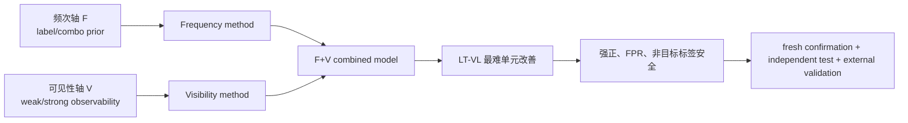
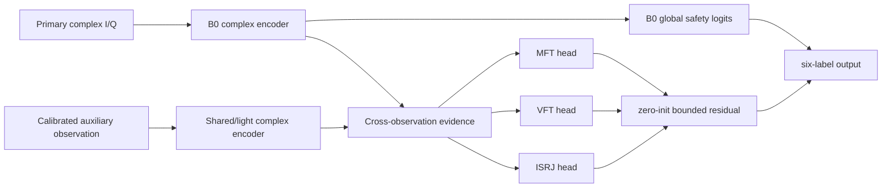

# Route A 双轴长尾复合识别：当前证据差距与长线试验路线图

日期：2026-08-07  
项目：`E:\LJQ_code\CJ_Imbalance_0716`  
环境：`D:\anaconda3\envs\PY10\python.exe`  
性质：证据差距审计和 proposed/not validated 长线规划；本轮未训练新模型、未生成新数据、未访问 test-v3。

封存状态：`test-v3 access_authorized=false`、`analysis_allowed=false`、`used=false`。

## 1. 执行摘要

当前项目已经证明了“双轴问题值得被分开研究”，但尚未证明“一个统一的双轴方法已经解决六类复合干扰长尾识别”。

现有证据中，频次轴已经有较稳定的开发级基线：Base-DB 相对 Base-ASL 在 18 个 tail rotation 上 18/18 为正，平均 macro-AUPR
增量为 `+0.017870`。[A] 可见性轴则只有标签局部闭环：RawSaw 在 SawFM 上具有原始相位/时间顺序机制证据，并在一次性 locked test
中将 SawFM weak recall 从 `0.155255` 提高到 `0.512175`，同时降低 FPR。[F] ISRJ、MFT、VFT 只有窄范围物理可观测性或开发证据，
尚未形成可跨标签、安全接回且战胜 equal-capacity control 的统一 visibility method。[A/N]

更关键的是，双轴创新所要求的正式 `frequency × visibility` 2×2 数据、两种主效应、交互项、组合模型相对两个单轴方法的独立增量、
全新 identity confirmation 和 real/HIL 外部验证均未完成。IP-CVE P0 已明确否定当前单通道 matched residual 路线：三标签 0/3 通过，
0/5 seed 相对 strongest control 为正，后续 adapter 和 2×2 因此未获授权。[N]

按本文透明的 10 项证据成熟度量表，当前统一双轴主张为 `3.0/10`，即约 `30%` 的基础证据成熟度，约 `70%` 的关键证据链仍缺失。
该数值不是模型准确率、统计置信度或论文录用概率。更严格地看，统一双轴方法的六个决定性门槛目前为 `0/6` 完整通过，因此总体差距仍然是**大**。

不同目标的距离并不相同：

- 距离“双轴问题定义与方法边界”论文：中等差距；
- 距离“RawSaw/SawFM 标签特定弱证据方法”论文：小到中等差距；
- 距离“统一六类双轴长尾复合识别方法”论文：大差距；
- 距离可部署、跨接收机、real/HIL 系统：很大差距。

下一阶段的首要任务不是继续扩宽 backbone，而是建立全新的 identity-safe 2×2 数据协议和非 oracle 可见性观测 H0。只有可见性 H0 战胜
信息破坏与 equal-capacity controls，才允许训练 visibility branch；只有 visibility-only 通过后，才允许进入 frequency+visibility 组合和交互验证。

## 2. 双轴主张的精确定义

### 2.1 频次轴 F

频次轴描述训练分布中的统计偏置：

- 单标签正样本频次不平衡；
- 多标签组合共现频次不平衡；
- 由训练先验产生的分类边界和概率偏置。

它可以由重采样、重加权、Distribution-Balanced Loss、ASL、logit/prior correction 等方法处理。根 0716 数据本身平衡，因而所有频次轴实验
必须使用显式派生、可重建、记录 SHA 的 label-LT 或 combination-LT manifest。

### 2.2 可见性轴 V

可见性轴描述“标签确实存在，但其物理分量难以从观测中辨识”：

- 相对功率低；
- 被其他干扰分量遮蔽；
- 接收机噪声和 nuisance 改变局部证据；
- 目标证据在时间、相位、周期或时频结构上稀疏。

它是标签内部 weak/strong 条件差异，不是样本数量意义的“功率长尾”。同一 `receiver_noise_seed` 的多功率视图属于同一 identity，不能跨角色拆分。

### 2.3 统一双轴方法必须证明什么

双轴创新不是“DB 有效 + 某个弱标签专家有效”的结果拼接。它必须在共同协议中证明：

1. 频次方法在 LT 条件产生主要收益；
2. 可见性方法在 VL 条件产生主要收益；
3. 两者作用对象和失败模式可区分；
4. 组合模型在 LT-VL 上优于 best single-axis 和 equal-capacity control；
5. FB-VH、强正、负样本、非目标标签和常见组合不被牺牲；
6. 冻结后在全新 identity 和外部条件复现。

## 3. 当前已经验证的内容

### 3.1 已确认或冻结证据 [F]

#### SawFM 标签特定 RawSaw 系统增量

历史冻结候选 `RawSawCrossSeedFPR15+H2Others` 在已消费的 25,200 样本 locked test 上取得：

| 指标 | H2 基线 | RawSaw 候选 | 差值 |
|---|---:|---:|---:|
| macro-AUPR | 0.861894 | 0.893382 | +0.031488 |
| macro-F1 | 0.755500 | 0.796137 | +0.040636 |
| all-label weak recall | 0.347290 | 0.406554 | +0.059264 |
| SawFM AUPR | 0.759798 | 0.948725 | +0.188927 |
| SawFM weak recall | 0.155255 | 0.512175 | +0.356920 |
| SawFM FPR | 0.190661 | 0.135177 | -0.055484 |
| SawFM ECE | 0.136216 | 0.028077 | -0.108139 |

10/10 预注册门槛通过，证明标签特定的 raw phase/time-order 证据可以安全接入六标签系统。但主要增量来自 SawFM；MFT/VFT/ISRJ
weak recall 仍为 `0.2970/0.3088/0.3177`。因此它是可见性轴的单标签正例，不是六标签统一 visibility method。

#### GradientContrast 的冻结数值结果

`GradientContrastFixed1p5` 在一次性 test-v2 上取得 macro-AUPR `+0.00648`、macro-F1 `+0.01390`、weak recall
`+0.03048`，5/5 seed 为正。这个数值结果必须保留，但后续 specificity、capacity-matched 和作用方向审计没有证明增益来自预设 visibility mechanism，
故不能升级为统一双轴因果证据。

### 3.2 有限、开发级或标签局部证据 [A]

#### 频次轴

Base-DB macro-AUPR 为 `0.826986`，相对 Base-ASL 在 18 个 tail rotation 上平均 `+0.017870`，18/18 为正。
这支持 DB 作为频次轴主要对比基线，但仍缺：共同 2×2 协议、全新 confirmation、组合阶数效应和与 visibility method 的交互。

#### 频次损失与可见性监督的机制边界

解析审计已经证明：在同一标签、同一 logit 的正样本之间，如果 loss 不接收 visibility mask，BCE、pos-weight BCE、Focal、ASL、
CB-BCE、Logit Adjustment 和频次组 SoftF1 不会因为 weak/strong 名称互换而改变损失或梯度。DB 可以因为其他共现标签不同而改变梯度，
但交换 weak/strong 名称后目标仍不变。

该结果支持“频次与可见性具有不同监督接口”的问题定义，却不能证明频次损失绝不会间接改善弱样本，也不能替代 2×2 性能实验。

#### 标签局部物理结构

- SawFM：full/raw AUROC 约 `0.9997`，phase-only `0.9954`，time-shuffled `0.7109`；主要证据是局部相位演化和时间顺序。
- ISRJ：aligned-periodicity B2 相对 B0 的 AUPR `+0.020881`、weak recall `+0.092397`、weak AUROC `+0.070336`，但统一 OOD 候选失败。
- MFT：特定 separated-replica/LFM 条件下 fixed physical AUROC 相对 phase control `+0.407805`，学习 residual 未形成安全增量。
- VFT：staggered-PRI fixed statistic 相对控制 AUROC `+0.115471`，学习模型未战胜 equal-capacity control。

这些结果证明标签之间的弱证据来源具有异质性，也揭示 observability-to-learning gap；不能把四种局部证据直接拼成一个统一专家系统。

#### 当前 B0 研究锚点

B0 macro-AUPR 为 `0.843746`；MFT/VFT/ISRJ 平均 weak AUROC `0.555864`、weak recall `0.237524`、strong recall
`0.771434`、FPR `0.195215`。它足以作为公平主干锚点，但没有充分学习三目标的弱正边际排序。

### 3.3 已得到的负结论 [N]

1. M1-M4 均未达到 weak AUROC `+0.020` 和 weak recall `+0.025` 的晋级门槛；通用 backbone 堆叠不是当前优先方向。
2. 共享弱排序头、共享 Saw 专家和多个统一接回方案未形成稳定收益。
3. GradientContrast 后续审计没有排除 capacity/optimization 和全局任务方向解释。
4. 统一 OOD 候选 H5o 失败，证明开发标签局部收益不能自动运输到联合系统。
5. IP-CVE P0 的 matched weak AUROC 为 `0.550727`，相对 strongest control 为 `-0.007937`，CI 全负，0/5 seed 正向，0/3 标签通过。
6. 当前单通道本地 MFT delay/LFM、VFT staggered-PRI、ISRJ periodic/correlation 机制族按预注册规则关闭；P1 和 2×2 未执行。

### 3.4 尚未验证的提案 [T]

- 正式双轴 `FB-VH/FB-VL/LT-VH/LT-VL` 数据协议；
- 非 oracle 第二物理观测；
- 多观测标签特定 visibility network；
- F+V 有界组合模型；
- 全新 identity confirmation、全新 independent test；
- real/semi-physical/HIL 外部验证。

## 4. 证据成熟度量化

评分只衡量统一双轴主张的证据完整性：完整通过为 1.0，局部/开发/解析证据为 0.5，缺失或失败为 0。它不是性能指标。

| # | 证据模块 | 分数 | 已有证据 | 主要缺口 |
|---:|---|---:|---|---|
| 1 | 双轴操作定义与 identity-safe 协议 | 0.5 | 双轴定义明确；receiver_noise_seed 分组规则明确；频次/可见性解析边界已审计 | 没有正式双轴四单元 manifest 和独立 lineage |
| 2 | 频次轴方法 | 0.5 | Base-DB 18/18 tail rotations 正向 | 缺共同 B0 预算、2×2、confirmation 和组合阶数统计 |
| 3 | 可见性物理/表征可辨识性 | 0.5 | SawFM 强；ISRJ/MFT/VFT 有窄范围 H0 | 三目标统一单通道 P0 失败；缺可部署新观测 |
| 4 | 可见性可学习增量 | 0.5 | RawSaw 在 SawFM locked test 成功 | MFT/VFT/ISRJ 无统一学习增量；多标签泛化不足 |
| 5 | F×V 主效应和机制独立性 | 0.5 | 解析上 loss 接口不同，局部方法作用对象不同 | 没有正式 2×2 性能主效应与交互检验 |
| 6 | F+V 组合增量 | 0.0 | 无合格证据 | 未证明 combined 优于两个单轴及 equal-capacity |
| 7 | 六标签复合识别与安全性 | 0.5 | RawSaw 候选 aggregate 和 FPR 改善 | exact match `0.2680`；其他弱标签和 ISRJ FPR 仍不足 |
| 8 | fresh confirmation 与独立测试 | 0.0 | SawFM 历史候选有已消费 locked test | 统一双轴候选不存在，无法冻结和确认 |
| 9 | OOD/receiver/背景运输 | 0.0 | 少量标签局部复制 | H5o 等联合 OOD 失败；校准运输未建立 |
| 10 | real/semi-physical/HIL | 0.0 | 无 | 仍为合成、单通道为主 |
|  | **合计** | **3.0/10** | **六项具有部分基础** | **约 70% 关键证据链仍缺失** |

严格的统一双轴决定性门槛为：正式四单元协议、频次轴冻结确认、跨目标 visibility method、combined synergy、fresh independent confirmation、
external/HIL。当前完整通过数为 `0/6`。因此“30%”不能被解读为即将完成；当前仍处于问题定义和单轴组件证据阶段。

## 5. 为什么现有正结果不能直接相加成双轴创新

### 5.1 Base-DB + RawSaw 分别有效，不等于双轴独立

Base-DB 的证据来自派生频次长尾轮转；RawSaw 的证据主要来自 SawFM 原始时序与一个已消费 locked test。二者没有在同一新 identity、同一训练预算、
同一四单元协议中比较。当前不知道：

- DB 是否主要在 LT-VH/LT-VL 生效；
- RawSaw 是否只在 FB-VL/LT-VL 生效；
- 二者组合是否优于 best single-axis；
- 组合增益是否只是参数量、选点、校准或标签路由造成；
- DB 是否间接改变 SawFM 或其他标签的阈值分布。

所以“两个单点有效”只是双轴假设的先验支持，不是 interaction 证据。

### 5.2 GradientContrast 有 test-v2 增益，为什么仍不足

一次性测试证明冻结候选在该测试上总体指标上升，但后续 specificity/equal-capacity 审计未证明该方向只作用于 visibility strata，也没有形成清晰的
频次主效应、可见性主效应和交互。若一个全局参数方向同时重新分配多个标签性能，它可能是一般优化方向，而不是双轴解耦机制。
因此数值结果应保留 [F]，机制主张必须降为 [N/A]。

### 5.3 标签局部物理专家不能直接拼接

SawFM 的相位/时间顺序、ISRJ 的周期性、MFT 的匹配延迟和 VFT 的 PRI 结构使用不同数据条件、控制和泛化边界。把它们拼接会同时引入参数量、
阈值、路由和负迁移变量。只有每个标签先在 equal-capacity 和信息破坏控制下成立，再通过统一安全接回与联合 OOD，才能形成系统创新。

## 6. 距离不同研究目标还有多远

| 目标 | 当前距离 | 已具备 | 仍需补齐 |
|---|---|---|---|
| 双轴问题定义/方法边界论文 | 中等 | 解析损失边界、频次基线、弱/强落差、单通道负结果 | 正式 2×2 数据、主效应统计、文献与外部数据支持 |
| RawSaw/SawFM 标签特定方法论文 | 小到中等 | 机制消融、五 seed、一次性 locked test、安全性 | 全新跨生成器/receiver confirmation、real/HIL、主流 raw-IQ baseline 与成本 |
| 统一六类双轴方法论文 | 大 | 若干单轴/标签局部证据、B0 锚点和严格负结果 | 可见性 H0、跨目标 V 模型、2×2、synergy、fresh confirmation、external validation |
| 可部署系统 | 很大 | 有推理成本账本和部分校准/FPR 协议 | 真实接收链、第二观测可部署性、校准运输、延迟/吞吐、HIL 和失效监控 |

当前最接近可靠 SCI 创新的是 SawFM 标签特定弱证据方法；最有理论价值但证据缺口最大的是统一双轴方法。

## 7. 当前最关键阻塞

优先级从高到低为：

1. **观测可辨识性**：当前单通道 high/low/absent matched residual 未战胜控制；没有可靠 V 轴输入，后续结构没有科学准入。
2. **成分归因监督**：BCE/Focal/DB 只看到标签/频次，不知道弱证据相对哪个背景产生。
3. **缺少正式 2×2 数据协议**：现有频次和可见性结果来自不同 lineage，无法估计主效应与交互。
4. **标签异质性与共享负迁移**：M3、H5o 等显示标签局部收益会伤害其他标签。
5. **系统级组合因果控制**：尚未战胜 equal-capacity、threshold-only、路由和信息破坏解释。
6. **新 confirmation/test 缺失**：已消费测试集不能再为新模型背书。
7. **外部有效性缺失**：合成单通道结果不能直接推到真实接收机。

因此当前单点阻塞主要是**数据/观测与归因协议**，其次才是模型结构和损失设计。

## 8. 新双轴数据协议 [T]

### 8.1 数据 lineage

建议新建完全独立的：

- `dual-axis-development-v1`：结构、损失和超参数开发；
- `dual-axis-confirmation-v1`：冻结候选的全新 identity 确认；
- `dual-axis-independent-test-v1`：确认通过后才生成或授权，一次性使用。

三者与 0716 历史 development、locked test、test-v2、test-v3、IP-CVE triples 的 receiver/physical/noise identity 必须零重叠。

### 8.2 2×2 单元

| 训练频次 / 样本可见性 | High visibility | Low visibility |
|---|---|---|
| Frequency-balanced | FB-VH | FB-VL |
| Label/combination-LT | LT-VH | LT-VL |

频次因子由训练 manifest 控制；可见性因子由 matched high/low 观测和固定物理阈值定义。为了避免将九个功率视图当作九个独立样本，同一 receiver 的 VH/VL
必须在同一 role，并在统计时进行 receiver-level paired bootstrap。

建议至少构造两种频次设置：

1. label-LT：明确标签正样本目标计数和 imbalance ratio；
2. combination-LT：按组合频次或组合阶数构造 head/medium/tail，同时保持评估集各组合可解释。

每个 manifest 保存：源 identity、标签、组合、功率/可见性、receiver/noise seed、role、生成器版本、参数、SHA256 和 overlap audit。

### 8.3 正式 estimand

定义：

- `ΔF`：frequency-only 相对 B0，在 LT-VH/LT-VL 上的配对收益；
- `ΔV`：visibility-only 相对 B0，在 FB-VL/LT-VL 上的 weak 指标收益；
- `ΔFV`：combined 相对 best single-axis，在 LT-VL 上的增量；
- `ΔRisk`：FB-VH、强正、负样本 FPR、非目标标签和常见组合的最坏退化。

主结论不能只依赖四单元的简单平均，必须报告 main effects、interaction 和最难 LT-VL 单元。

## 9. 长线模型与训练方案 [T]

### 9.1 公平锚点

保持当前 B0：输入 `[B,2,3000]`，延迟复数融合，多 lag `(1,4,16)` 相位，128 通道多尺度时序块，mean/std 池化，128 维表示，
`Linear(128,6)` 分类器。初始公平训练保持 AdamW、backbone lr `5e-5`、classifier lr `5e-4`、wd `1e-4`、batch `64`、
max epoch `36`、patience `8`、gradient clip `5.0` 和五 seed。

### 9.2 Frequency-only 分支

在完全相同的 B0、数据角色、训练预算、模型选择、calibration 和 threshold 下比较：

- 当前 asymmetric focal；
- ASL；
- DB；
- logit/prior correction；
- equal-budget reweighting/resampling control。

只允许在 development 的预注册指标上选择一个 frequency method；选择后在 confirmation 冻结，不得按 visibility 指标单独重选频次方法。

### 9.3 Visibility-only 分支

只有非 oracle 新观测 H0 通过后才执行。建议结构为：

跨观测证据包括 normalized coherence、magnitude ratio、transfer-corrected complex residual、lagged phase difference 和必要的多尺度局部统计。
三个目标标签使用独立证据头；FMB/SawFM/SinFM 默认走 B0 安全路径。residual gate 初始化为零，并限制 `|delta logit|<=0.2`。

建议损失：

\[
L=L_{classification}+\lambda_r L_{weak-rank}+\lambda_o L_{high>low>absent}
+\lambda_i L_{non-target-invariance}+\lambda_b L_{bounded-risk}.
\]

- `L_classification` 与公平 B0/Frequency-only 保持可比较；
- `L_weak-rank` 只在目标标签存在、visibility mask 有效且 target finite 时计算；
- `L_high>low>absent` 监督同 identity 可见性顺序；
- `L_non-target-invariance` 保护其他标签；
- `L_bounded-risk` 限制接回幅度和强正/FPR 风险；
- 缺失或非活动目标不得零填充进入损失。

训练顺序：冻结 B0，仅训练 evidence head；通过开发门槛后，以不超过 head lr 1/10 的学习率解冻 stage4；再次通过后才考虑 stage3。
若显存要求将 batch 降为 32，应使用梯度累积保持 effective batch 64，并在所有对照中一致。

### 9.4 Frequency+Visibility 组合

组合模型只能在 frequency-only 和 visibility-only 分别通过后启动。频次损失负责标签/组合先验，visibility branch 负责 matched marginal evidence；
禁止使用一个全局权重同时改变全部标签后将其命名为“双轴解耦”。组合必须与以下对照比较：

- B0；
- frequency-only；
- visibility-only；
- equal-capacity MLP/adapter；
- threshold/calibration-only；
- channel-swap、time/component permutation、unmatched identity；
- RawSaw 标签局部参考。

### 9.5 校准与阈值

每标签独立 Platt 校准，calibration role 与 threshold role 分离。阈值仍以负样本 FPR `<=0.20` 下最大化 weak recall 为主，但同时报告固定阈值、
AUROC/AUPR 等阈值无关指标。confirmation 后校准器与阈值完全冻结；independent test 禁止重新拟合。

## 10. 预注册硬门槛 [T]

### 10.1 Visibility H0

- 三目标平均 weak-vs-absent AUROC 相对 strongest control `>=+0.030`；
- receiver-level paired bootstrap 95% CI 下界 `>0`；
- 至少 4/5 seed 正向，任一标签差值不低于 `-0.010`；
- identity binding `>=0.60`，且 matched 显著高于 unmatched；
- high > low > absent 顺序成立；
- confirmation 相对 development 落差 `<0.15`；
- channel swap、transfer perturbation、time/component permutation 不能保留同等收益。

失败：关闭该观测协议，不训练 visibility network。

### 10.2 Visibility model

- 相对 B0 和 equal-capacity，macro-AUPR `>=+0.005` 且 CI 下界 `>0`；
- 三目标平均 weak AUROC `>=+0.020`，weak recall `>=+0.025`；
- 至少 4/5 seed 为正；
- mean target FPR `<=0.20`；
- strong recall 降幅不超过 `0.01`；
- 任一标签 AUPR 降幅不超过 `0.01`；
- FMB/SawFM/SinFM 和常见组合不得系统退化。

失败：不进入双轴组合。

### 10.3 双轴组合

- `ΔF` 在 LT 条件稳定为正，至少 4/5 seed，FB 条件 macro-AUPR 降幅不超过 `0.005`；
- `ΔV` 在 VL 条件通过弱 AUROC/recall 门槛，VH 条件 strong recall 不退化；
- `ΔFV = combined - best single-axis` 在 LT-VL 上 macro-AUPR `>=+0.005` 或三目标 weak recall `>=+0.020`，CI 下界 `>0`；
- equal-capacity、threshold-only 和信息破坏对照不能复现同等增益；
- exact match、Hamming、FPR、ECE、Brier 和逐标签安全同时合格。

若只有两个 main effect、没有 combined 增量，可以保留“双轴评估框架”，不能声称“双轴联合模型创新”。

## 11. 0-12 个月路线图

| 时间 | 主要任务 | 进入门 | 通过门 | 停止门 | 主要产物 |
|---|---|---|---|---|---|
| 0-3 月 | 冻结证据；建立 dual-axis-development-v1；新观测 Stage -1/H0 | 新 identity、非 oracle 观测可获得 | 数据合同和 H0 全部门槛通过 | 无合格新观测或 H0 失败 | manifest/SHA、采集合同、H0 report/receipt |
| 3-6 月 | Frequency-only 公平确认；Visibility-only 冻结头/小 adapter | H0 通过；公平 B0 可复现 | 两个单轴分别过门槛 | visibility 未胜 controls；频次收益不定位于 LT | 五 seed checkpoints、paired stats、ablation |
| 6-9 月 | F×V 2×2、combined、equal-capacity 和破坏控制 | 两单轴均通过 | ΔF、ΔV、ΔFV 与安全门槛通过 | 无交互/无 combined 增量/跨标签退化 | factorial report、interaction、cost benchmark |
| 9-12 月 | fresh confirmation、冻结校准/阈值、一次性 independent test、HIL | 结构与协议完全冻结 | confirmation 和 external/independent test 复现 | confirmation 失败或运输落差超限 | frozen snapshot、terminal receipt、paper evidence bundle |

## 12. 两条论文收口路线

### 路线 S：新观测成功

若 H0、visibility model 和 2×2 均通过，可形成完整主张：

> 通过 identity-safe 的频次—可见性因子协议，将训练先验偏置与标签内观测退化解耦；频次校正与跨观测标签特定边际证据分别作用于对应轴，组合模型在 LT-VL 条件下获得超越两个单轴与等容量对照的安全增益。

该表述仍需 fresh confirmation 和 external/HIL 才可最终使用。

### 路线 R：无法取得或验证新观测

若 H0 失败或没有非 oracle 第二观测，应停止统一模型路线，拆分为：

1. RawSaw/SawFM 标签特定方法论文：以 locked-test、相位/时间顺序机制、跨 receiver/real/HIL 补充为主；
2. 双轴问题定义与方法边界论文：频次损失解析审计、标签局部物理可观测性、M1-M4/IP-CVE 负结果和严格 2×2 评估规范；
3. ISRJ aligned-periodicity 仅作为窄组件或附加实验，不宣称六类统一方法；
4. MFT/VFT 固定统计作为 observability-to-learning gap 的边界证据。

范围收缩不是实验失败掩盖，而是与现有证据最一致、风险最低的 SCI 叙事。

## 13. 禁止操作与证据治理

- 不得把功率视图数量称为样本频次长尾；
- 不得跨 split 拆分同一 receiver_noise_seed；
- 不得复用 locked test、test-v2，或访问未授权 test-v3；
- 不得把开发集、smoke、readiness、confirmation 和 locked test 汇总成一个“总体结果”；
- 不得继续无机制扩宽 backbone、堆叠 attention 或组合 M1-M4；
- 不得用 loss-weight、top-k、Platt 或阈值网格替代 AUROC/可辨识性失败；
- 不得将标签局部专家结果相加后声称统一双轴方法；
- 不得在推理时使用模拟器提供的精确 absent-view；
- 不得将 Route B 参数估计结果并入 Route A 识别证据；
- 所有失败、禁止执行和停止原因必须保留 receipt。

## 14. 最终结论与允许表述

当前允许的最强表述：

> [F/A/N] 现有实验支持将复合干扰的标签/组合频次偏置与标签内弱可见性退化视为不同研究机制；频次损失在派生 LT 条件下具有开发级优势，SawFM 原始相位—时间证据在一次性独立测试中形成安全的标签特定增益，而统一跨标签可见性建模、双轴交互和组合增益尚未建立，单通道反事实路线已被控制实验否定。

未来完整目标表述：[T]

> 在 identity-safe 的 F×V 因子协议下，分别建模训练频次先验和非 oracle 物理观测中的标签内边际证据，并以风险有界的标签特定融合在 LT-VL 条件下稳定超越两个单轴与等容量对照，同时保持强正、FPR、非目标标签和跨接收机安全。

最终裁决：**当前统一双轴证据成熟度约为 3.0/10，六个决定性门槛 0/6 完整通过。下一阶段应把资源集中到新 identity 的正式 2×2 协议和非 oracle 可见性 H0；H0 不通过则收缩为 SawFM 标签特定创新与双轴方法边界，不再继续通用网络堆叠。**
