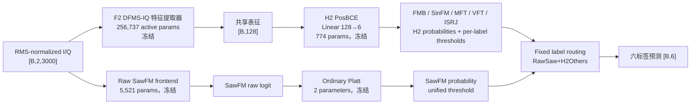

# 路线 A 整体实验情况与当前网络结构审计报告

日期：2026-07-26  
项目：`C:\LJQ_code\CJ_Imbalance_0716`  
证据范围：development  
最终测试状态：`locked_test_used=false`

## 1. 执行摘要

路线 A 已从“在共享六类网络上继续叠加复杂模块”收敛为一个更清晰的标签级解耦方案。0716 根训练集本身平衡；路线 A 通过可复现的 `label_lt` manifest 构造 2400 样本标签长尾训练集，研究标签频率偏置，同时用身份绑定的多功率视图研究弱分量可见度退化。两类问题在实验中保持区分。

当前 development 候选不是单一端到端网络，而是：`F2_DFMS_Full` 提供六类共享复数表征，冻结 `H2_PosBCE` 负责 FMB、SinFM、MFT、VFT、ISRJ 五类；独立的 5521 参数 Raw-IQ SawFM 前端经 Platt 校准后只负责 SawFM；最终通过固定标签级路由组成 `RawSaw+H2Others`。五种子标签路由将 macro-AUPR 从 0.8667 提高到 0.9001，将 macro-F1 从 0.7573 提高到 0.8027，将 SawFM recall 从 0.4870 提高到 0.8813，其他五类最大 FPR 变化为 0，5/5 seeds 通过开发门禁。

此前 PAM-IQ、标签查询、Stage2 专家、C2 固定融合、可见度仿射、ordinal anchor、unknown/reject 和 reliability probe 均提供了重要机制证据，但它们不是当前最终候选的一部分。最关键的失败认识是：Raw SawFM 证据非常强，但把它压缩成 H2 上的最大 0.20 小残差会破坏其排序几何；将 Raw 作为独立标签分类器才成功。

当前方法已经冻结为 development 候选终版。主要剩余风险是 seed 2039 的 ordinary early FPR=0.2806，以及五个 Raw checkpoint 来自两种已审计但不完全相同的训练角色抽样协议。下一步只应审查一次性 locked-test 申请包；未经用户明确授权不得运行最终测试。

## 2. 当前状态卡

| 项目 | 当前状态 |
|---|---|
| 科学任务 | 六类复合干扰多标签识别；分离标签频率偏置与功率可见度退化 |
| 输入 | RMS-normalized complex I/Q，`[B,2,3000]` |
| 标签顺序 | `[FMB, SawFM, SinFM, MFT, VFT, ISRJ]` |
| 根训练数据 | 63 个非空标签组合 × 400，共 25200；本身平衡 |
| Route A 训练协议 | `label_lt`，2400 样本，IF=4，manifest/hash 固定 |
| 当前候选 | `RawSaw+H2Others` |
| 共享主干 | `F2_DFMS_Full`，冻结 |
| 五类共享头 | `H2_PosBCE`，冻结 |
| SawFM 专线 | `RawStage1SawFMFrontend(mode="raw")`，冻结 |
| SawFM 校准 | ordinary Platt，冻结 |
| 最终路由 | SawFM 用 Raw；其他五类用 H2；无训练 gate |
| 五种子开发门禁 | Raw 单标签 4/5 通过；六类路由 5/5 通过 |
| 锁定测试 | 未使用；禁止自动执行 |
| 当前决策 | 冻结方法，准备并审查一次性 locked-test 申请包 |

## 3. 数据协议与证据边界

### 3.1 标签长尾

0716 根数据不是天然长尾。当前审计的路线 A 使用 `cjlt/data/longtail_manifest.py::build_label_longtail`，按多标签组合求解整数保留数，再在组合内部按 seed 抽样和打乱。该过程同时约束总样本数和各标签正样本数，不是逐类独立抽样。

当前审计配置：

- `protocol=label_lt`；
- `target_sample_count=2400`；
- 审计种子示例：`seed=2043`；
- 头到尾顺序：`FMB → SinFM → MFT → VFT → ISRJ → SawFM`；
- 按头到尾顺序 `FMB→SinFM→MFT→VFT→ISRJ→SawFM`，目标/实际计数为 `1600、1213、919、696、528、400`，残差为 0；
- 按固定代码类别顺序 `[FMB, SawFM, SinFM, MFT, VFT, ISRJ]`，manifest 中 `target_label_counts=achieved_label_counts=[1600,400,1213,919,696,528]`。

### 3.2 功率视图

40/45/50 dB 等 power-sweep 视图通过 `receiver_noise_seed` 绑定为同一身份的不同观测。它们用于弱可见度、校准、阈值和泛化评价，不得作为相互独立的训练样本跨角色拆分。

### 3.3 数据角色

现有流程至少区分：训练、head validation、ordinary calibration、ordinary threshold、ordinary early、power fit/scale、power threshold 和 power development。最新汇总中各 seed 的身份交集为 0，checkpoint、split 和选择文件均保存 SHA256。

### 3.4 测试边界

本报告所有性能均来自 development 角色。最新正式 summary 的 `locked_test_used=false`，因此“最终测试性能”“最终论文结果”仍未形成。

## 4. 整体实验演进

不同阶段的数据角色和评价子集并不完全相同。下表用于说明研究演进和因果归因，不应把所有绝对数值拼成无条件排行榜。

| 阶段 | 假设与方法 | 关键结果 | 根因判断 | 决策/下一门禁 |
|---|---|---|---|---|
| A0 基线 | Base-ASL vs Base-DB | 18 组尾类旋转中，DB 的 macro-AUPR 平均 `+0.01787`，18/18 获胜；SawFM 主协议 Base-DB macro-AUPR `0.82699` | DB 对标签频率偏置有效 | Base-DB 保留为历史主基线 |
| A1 损失混合 | Mix75/Mix90 强化 SawFM | SawFM AUPR约 `+0.068～0.069`，但 macro-AUPR约 `-0.047～-0.049` | 尾类提升与总体表示形成 Pareto 冲突 | 不晋级，不继续细扫混合权重 |
| A2 容量对照 | B0 Base-DB、B1 WideCapacity | B1 相对 B0 macro-AUPR `+0.0211` | 参数量本身有收益，结构候选必须与 B1 比 | B1 成为结构级强对照 |
| A3 PAM-IQ | 相位感知、多尺度、注意力池化 | 相对 B0，SawFM AUPR `+0.0425`；相对 B1，macro-AUPR `-0.0119`、weak recall `-0.1283` | 原 PAM-IQ 提升排序，但早期融合和显著性池化偏向强分量 | 不接功率轴，先改结构 |
| A4 PAM-IQ V2 | 无注意力旁路 + 标签查询 | D1 降 Hamming；Q1 恢复少量 weak recall 但增加误报；F2 阈值下部分类别 FPR 接近 1 | 标签查询学到先验/显著性偏置，未形成弱正—负分离 | 第二阶段弱损失停止 |
| A5 DFMS-IQ F2 | 延迟复数融合 + 多滞后相位 | macro-AUPR `0.8562`，Hamming `0.2485`；相对 P0 macro-AUPR `+0.0200`；weak recall仍 `0.3586` | 过早 I/Q 融合确是问题；但 SawFM 是结构例外 | F2 晋级为共享主干，转向分类头/专项证据 |
| A6 冻结头 H2 | 冻结 F2，重训 pos-weight BCE 线性头 | macro-AUPR `0.8670`，weak AUROC `0.6524`，FPR `0.1875` | F2 保留了大量弱证据；原联合 DB 头未充分利用 | H2 成为稳定冻结基线 |
| A7 标签局部/特征充分性 | Q1/Q2/Q3、global/temporal/stage probe、有界残差 | 全局 weak AUROC未稳定超过 H2；SawFM stage2 oracle仅有限增量；所有晋级门失败 | 共享特征上的新读取器缺乏独立证据，不能支持解冻 | `stop_before_unfreeze` |
| A8 Stage2 SawFM 专家 | teacher/student + 组合匹配 hard negative | 45 dB AUROC `0.7972`，AUPR `0.7949`；hard negative 带来 AUROC `+0.1739` | Stage2 可提取 SawFM 证据；匹配负样本比单纯 teacher 更关键 | 允许冻结专家接入研究 |
| A9 C2 固定融合 | `0.20 H2 + 0.80 S2` | 35/40/45/50 dB 平均 AUROC `0.7638`，相对 H2 `+0.2972`；普通 macro-AUPR `0.8749` | 专家主导融合改善排序，但不是可靠决策 | 转向校准/阈值，不立即解冻 |
| A10 校准与路由 | 9 参数 gate、Platt、isotonic、A0 visibility affine | gate近似固定融合；A0 三功率召回 `0.4724`，50 dB仅 `0.1668` | 单标量或低维单视图统计不能吸收跨功率分数平移 | 不晋级，继续验证决策结构 |
| A11 Ordinal/Unknown | 三锚点排序、双阈值拒判 | ordinal pairwise accuracy `0.9755`，但三档召回 `0.0721`；U2 0/3 可行，U3 early 0/3 通过 | 可见度顺序可学，但无法稳定映射为类别风险；unknown 分数也不可靠 | 停止纯校准/拒判路线 |
| A12 Reliability probe | Stage2 时序可靠性探针 | R4 early AUROC `0.7109`，但低于统计基线 R2 `0.7314`；最大选择性风险 `0.329～0.409` | Stage2 reliability 没有独立于既有统计的信息 | 不训练 exist/reliability 双头 |
| A13 早期证据筛选 | Raw、Stage1、Stage2、Stage3 对照 | Raw+Stage1 P6 development AUROC `0.9567`；Raw-only P2 `0.9353`；Stage2降至 `0.7622` | SawFM 证据在输入中很强，在 Stage1→Stage2 被稀释 | 设计小容量 Raw/Stage1 专线 |
| A14 可训练 Raw 前端 | N0 Raw-only、N1 Stage1、N2 Raw+Stage1 | N0 development AUROC `0.9982`；N2 `0.9995`，但 Stage1增量不足 `0.01` | 原始 I/Q 已足够，Stage1不值得增加复杂度 | 选择 5521 参数 Raw-only |
| A15 机制消融 | full、envelope、phase、time-shuffle | 新 split：full `0.9997`，phase-only `0.9954`，envelope `0.7487`，time-shuffle `0.7109` | 主要证据来自局部相位演化和真实时间结构，不是总功率捷径 | Raw 机制成立，可研究接回 |
| A16 有界接回 | Raw 作为 H2 上最大 0.20 残差/救援 gate | mean-power recall仅 `+0.0205`，50 dB recall仅 `+0.0306`，0/3 晋级 | H2 与 Raw 排序冲突；小残差动态范围不足 | 停止 Raw→H2 小残差 |
| A17 Raw 独立分类器 | Raw+Platt / Raw+Isotonic | 三种子 Raw+Platt ordinary AUPR `0.9548`、recall `0.8687`、power mean recall `0.9809` | Raw 应是 SawFM 独立判决器，不是共享头修正器 | 晋级五种子确认 |
| A18 五种子标签路由 | SawFM=Raw+Platt，其余五类=H2 | Raw 门禁 4/5；六类路由 5/5；macro-AUPR `0.9001`，SawFM recall `0.8813` | 标签级隔离保留强专家能力，同时不扰动其他五类 | 冻结 development 候选，准备 locked-test 申请 |

## 5. 当前网络结构

### 5.1 总体结构图



当前系统不训练融合 gate，也不把真实功率、JNR、receiver seed 或生成参数作为输入。历史 S2/C2/A0/ordinal/unknown 模块不在当前最终路径中。

### 5.2 F2：Delayed Fusion Multi-Scale IQ

源码：`cjlt/models/phase_multiscale.py::DelayedFusionMultiScaleIQClassifier`

| 层级 | 结构 | 张量 |
|---|---|---|
| 输入 | real/imag | `[B,2,3000]` |
| Stage1 | ComplexResidualBlock，1→16，k=7 | real/imag 各 `[B,16,3000]` |
| 下采样 | AvgPool，stride=2 | 各 `[B,16,1500]` |
| Stage2 | ComplexResidualBlock，16→32，k=5 | 各 `[B,32,1500]` |
| Stage3 | 三分支 complex conv，k=3/7/15，dilation=1/2/4 | 各 `[B,48,750]` |
| Stage4 | 三分支 complex conv，k=3/7/15，dilation=1/2/4 | 各 `[B,64,375]` |
| 晚期融合 | Cartesian + magnitude + phase lag 1/4/16 | `[B,128,375]` |
| 时序增强 | MultiScaleDepthwiseResidual | `[B,128,375]` |
| 池化 | unweighted mean/std | `[B,256]` |
| 投影 | Linear + LayerNorm + GELU + Dropout | `[B,128]` |
| 原分类器 | Dropout + Linear 128→6 | 当前最终路由不使用 |

关键设计：

- I/Q 到 Stage4 仍保持独立复数流，避免 PAM-IQ 的过早融合；
- 晚期相位支路使用归一化复相位在 lag 1/4/16 上的 cos/sin 关系；
- phase residual 由有界 `tanh(phase_scale)` 加入；
- 不使用注意力池化，保留不会抑制低响应证据的 mean/std 安全路径；
- 总参数 257511，其中原六类分类器 774；当前实际使用的特征提取部分 256737。

### 5.3 H2：冻结共享表示后的六标签头

结构为 `Linear(128,6)`，参数量 774。F2 全部冻结并保持 `eval()`，H2 使用每标签 `pos_weight=negative/positive` 的 BCE 重建分类边界。

H2 的意义不是增加网络容量，而是证明 F2 表示中仍保留可读弱证据。当前路由只使用 H2 的 FMB、SinFM、MFT、VFT、ISRJ 五列；H2 SawFM 保留为对照。

### 5.4 Raw SawFM 专线

源码：`cjlt/models/evidence_readout.py::RawStage1SawFMFrontend`

```text
raw real/imag [B,1,3000]
  -> 6-channel physical descriptors [B,6,3000]
     magnitude mean / max / std / adjacent abs difference
     normalized adjacent phase increment cos / sin
  -> 1x1 Conv 6→16 + GroupNorm + SiLU
  -> depthwise temporal Conv k=7/31/63
  -> concatenate + 1x1 Conv to 16 channels
  -> AvgPool stride=4, [B,16,750]
  -> encoded mean/std/max/top-k = 64 dims
  -> raw-descriptor mean/std/max/top-k = 24 dims
  -> concatenate = 88 dims
  -> Linear 88→32 + GELU + Dropout(0.1) + Linear 32→1
  -> SawFM logit
```

配置：`mode=raw`、`hidden_channels=16`、`topk=16`、总参数 5521。Stage1 分支虽然在类中保留，但当前候选不启用。

### 5.5 Platt 与固定标签路由

Raw 网络冻结后，只在 ordinary calibration 角色上用一维 Logistic Regression 拟合 Raw logit。统一阈值由 ordinary threshold 与 40/45/50 dB power threshold 共同约束，每个 threshold 域 FPR 不超过 0.20。ordinary early 和 power development 仅用于最终开发评价。

最终只替换索引 1 的 SawFM 概率和阈值。其他五类的概率、阈值和预测逐元素保持 H2 原值，因此最新实验中其他五类最大 FPR 变化为 0。

有效执行参数约为：

`256737（F2 feature extractor）+ 774（H2）+ 5521（Raw）+ 2（Platt）= 263034`

该值不计当前不执行的 F2 原分类器。

## 6. 当前训练、校准和推理流程

| 模块 | 数据/角色 | 优化与预算 | 选择规则 | 当前状态 |
|---|---|---|---|---|
| F2 | 2400 label-LT train + development selection | DB Loss；AdamW `3e-4/1e-4`；batch 64；20 epochs；dropout 0.2 | macro-AUPR | 五个 seed 均冻结 |
| H2 | 同 seed manifest；80/20 head fit/validation | pos-weight BCE；AdamW `1e-3/1e-4`；batch 256；60 epochs；patience 12 | validation macro-AUPR，weak AUROC 破同分 | 五个 seed 均冻结 |
| Raw | root 与 40/45/50 dB 配对身份；组合匹配 hard negative | BCE；AdamW `3e-4/1e-3`；batch 64；最多 40 epochs；patience 8 | 独立 power validation mean AUROC，AUPR 破同分 | 五个 checkpoint 冻结 |
| Platt | ordinary calibration | LogisticRegression，`C=1.0`，`lbfgs` | 无 early 参与 | 每 seed 冻结 |
| SawFM threshold | ordinary threshold + power threshold | grid `0.01:0.01:0.99` | 所有域 FPR≤0.20；再最大化 power/ordinary recall | 每 seed 冻结 |
| 最终评价 | ordinary early + power development | 不训练、不调参 | 报告逐 seed 与聚合 | 已完成 |

需要特别说明：seeds 2039/2040 的 Raw checkpoint 来自 `R0_FullPhysics` 新 split 协议；seeds 2041–2043 来自 `N0_RawOnly` 协议。网络结构和优化超参数相同，但训练身份角色抽样协议不同。因此当前五种子结果是“五个已审计 checkpoint 的冻结确认”，不是完全同一训练协议的五次独立重复。

## 7. 最新五种子结果

正式汇总：

`outputs/tapc/route_a_raw_platt_five_seed_label_routing/route_a_raw_platt_five_seed_label_routing_summary.json`

SHA256：

`1C456FF579F0FA2EFCCBA202152F5F2CA117CA215A7D84131447D4086D491EFC`

### 7.1 Raw+Platt SawFM 独立分类器

| 指标 | 五种子均值 | 标准差 | bootstrap 95% CI |
|---|---:|---:|---:|
| ordinary AUROC | 0.9384 | 0.0126 | [0.9276, 0.9473] |
| ordinary AUPR | 0.9547 | 0.0102 | [0.9458, 0.9621] |
| ordinary recall | 0.8813 | 0.0299 | [0.8576, 0.9049] |
| ordinary FPR | 0.1960 | 0.0554 | [0.1535, 0.2444] |
| without-swept recall | 0.8653 | 0.1054 | [0.7798, 0.9447] |
| power mean recall | 0.9879 | 0.0138 | [0.9766, 0.9980] |
| 50 dB recall | 0.9758 | 0.0252 | [0.9540, 0.9941] |
| max power FPR | 0.0760 | 0.0502 | [0.0391, 0.1139] |
| Brier | 0.0977 | 0.0119 | [0.0898, 0.1079] |
| ECE | 0.0504 | 0.0146 | [0.0374, 0.0607] |

逐功率均值：

| 功率 | AUROC | AUPR | recall | FPR |
|---:|---:|---:|---:|---:|
| 40 dB | 0.9992 | 0.9992 | 0.9980 | 0.0760 |
| 45 dB | 0.9989 | 0.9990 | 0.9899 | 0.0385 |
| 50 dB | 0.9983 | 0.9983 | 0.9758 | 0.0221 |

单分类器门禁要求至少 4/5 seeds 通过，实际 4/5。seed 2039 的唯一失败项为 ordinary early FPR `0.2806`；其 AUPR、召回、without-swept、power、Brier/ECE 和身份审计均通过。

### 7.2 六类标签路由

| 指标 | H2All | RawSaw+H2Others | 变化 | 变化 bootstrap 95% CI |
|---|---:|---:|---:|---:|
| macro-AUPR | 0.8667 | 0.9001 | +0.0334 | [0.0281, 0.0384] |
| micro-AUPR | 0.8661 | 0.9022 | +0.0361 | — |
| macro-F1 | 0.7573 | 0.8027 | +0.0454 | [0.0418, 0.0495] |
| Hamming loss | 0.2307 | 0.1959 | -0.0348 | — |
| SawFM recall | 0.4870 | 0.8813 | +0.3943 | [0.3542, 0.4344] |
| exact match | 0.2280 | 0.2747 | +0.0467 | [0.0400, 0.0513] |
| 其他五类最大 FPR 变化 | — | — | 0.0000 | [0, 0] |

五个 seed 均满足：macro-AUPR 不下降、macro-F1 提升、SawFM recall 增益至少 0.20、其他五类最大 FPR 增量不超过 0.01、exact match 不发生实质下降。标签路由门禁为 5/5 通过。

## 8. 已验证、负结果与未验证事项

### 8.1 已验证事实

1. DB Loss 是当前六类标签频率长尾的可靠主基线。
2. PAM-IQ 的过早 I/Q 融合是总体结构缺陷之一。
3. F2 的延迟复数融合和 lag 1/4/16 相位分支改善总体表示、macro-AUPR 和 Hamming。
4. 冻结 F2 后重训线性 H2 即可提升弱证据读取，说明原分类边界是重要瓶颈。
5. SawFM 是 F2 共享全局表示的明确结构例外。
6. SawFM 强证据在原始 RMS-normalized I/Q 中存在，并在 Stage1→Stage2 过程中明显衰减。
7. Raw SawFM 判别主要依赖局部相位演化和时间结构，不依赖简单幅度或总功率捷径。
8. Raw 作为独立分类器有效；作为 H2 小残差无效。
9. 固定标签级替换能提升六类总体指标，同时严格隔离其他五类输出。
10. 当前结论在五个 development seeds 上得到支持，且 locked test 未使用。

### 8.2 历史负结果或停止项

1. ASL-DB 损失混合：SawFM 提升但宏观性能显著下降。
2. 原 PAM-IQ：相对容量匹配 B1 未通过综合门禁。
3. 标签查询/top-k/共享 SawFM 专家：未形成可靠弱正—负排序。
4. 全局/temporal/stage oracle probe：未稳定超过 H2。
5. Stage2 专家的最大 0.20 受限残差：增益过小。
6. 9 参数路由：性能接近固定融合，但没有学到可见度机制。
7. 单 Platt、isotonic、visibility affine：不能稳定解决 50 dB 统一阈值决策。
8. Ordinal anchor：可见度排序成功，但类别概率映射失败。
9. Selective unknown：统一阈值无可行解，oracle 分功率阈值也未通过 early 风险门。
10. Stage2 reliability probe：没有提供超出 visibility 统计的独立信息。
11. Raw→H2 小残差和 hard rescue：无法跨越 H2 错误排序。

### 8.3 尚未验证

1. 当前候选在 locked test 上的最终泛化。
2. seed 2039 的 FPR 跨角色波动是否会在最终测试复现。
3. 用完全统一的 Raw 训练角色抽样协议重新训练五个 seed 后，方差是否进一步降低。
4. Raw 专线能否迁移到 SawFM 以外的其他弱标签。
5. LOCO/LSCO、未见组合、未见功率、载频/带宽/噪声变化和外部数据泛化。
6. 当前系统的 FLOPs、显存、吞吐、延迟和部署触发策略。
7. 单模型、五模型独立报告或预注册 ensemble 的最终论文形式；当前未使用 ensemble。

## 9. 两项必须单独披露的风险

### 9.1 seed 2039 ordinary FPR 风险

seed 2039 的 threshold 角色满足 FPR 约束，但迁移到 ordinary early 后 FPR 上升到 0.2806。由于 ordinary AUPR 仍为 0.9558、recall 为 0.9130，且三功率 recall/FPR、Brier、ECE 均通过，这更像阈值跨身份角色的稳定性问题，而不是特征不可分。

不能用 early 结果重新调 seed 2039 阈值，否则会发生开发集二次选择。该风险应在 locked-test 申请中作为预先披露项，并在最终结果中逐 seed 原样报告。

### 9.2 Raw checkpoint 协议异质性

2039/2040 使用 `R0_FullPhysics`，2041–2043 使用 `N0_RawOnly`。两组实际部署网络均是同一个 `mode=raw` 结构，超参数也一致，但训练角色抽样来源不同。

因此当前结果支持“冻结标签路由在五个已审计 checkpoint 上稳定”，但不能严格支持“完全同协议五次从头训练的方差估计”。这不会否定当前 development 晋级，但会限制论文中关于训练稳定性的表述强度。

## 10. 对论文目标的判断

### 10.1 当前可以支持的创新表述

1. 延迟复数融合与多滞后相位交互改善六类共享表征。
2. 共享表示对 SawFM 存在标签特异信息瓶颈，且瓶颈可定位到早期层级变换。
3. 基于显式幅相描述、多尺度局部卷积、top-k 证据统计和组合匹配 hard negative 的小型 Raw-IQ 专家可恢复 SawFM 弱证据。
4. 标签级固定路由比小残差融合更符合专家与共享头的分数几何，并能隔离地改善总体多标签指标。
5. 完整失败链给出了从“共享表示补丁”转向“标签专属独立判决”的可证伪机制依据。

### 10.2 当前不能支持的表述

1. 已解决所有六类的弱分量问题。
2. 0716 根数据天然是三轴长尾。
3. power views 是独立长尾样本。
4. 当前结果已经在最终测试集验证。
5. Raw SawFM 结构可直接推广到所有标签。
6. 系统具有基于真实功率/JNR 的部署能力。
7. Stage2/C2/A0/unknown 是当前最终网络模块。

## 11. 当前结论与唯一下一动作

路线 A 当前应冻结为：

`F2_DFMS_Full + H2_PosBCE for five labels + RawStage1SawFMFrontend(raw) + Platt for SawFM + fixed label routing`

其 development 名称为：

`RawSaw+H2Others`

当前不应继续增加结构、重扫阈值、重新学习融合权重、为 seed 2039 在 early 上调参，或自动运行 locked test。

唯一下一动作是：审查 `docs/plans/route_a_raw_saw_label_routing_locked_test_request_20260726.md` 中的冻结 checkpoint、配置、阈值、split/identity/hash 和一次性运行规则。只有用户明确批准后，才允许执行一次 locked test；执行后不得依据测试结果修改模型、校准器或阈值。

## 12. 主要产物索引

- 最新结果：`docs/results/route_a_raw_platt_five_seed_label_routing_results_20260726.md`
- 最新汇总：`outputs/tapc/route_a_raw_platt_five_seed_label_routing/route_a_raw_platt_five_seed_label_routing_summary.json`
- 当前 runner：`experiments/run_route_a_raw_platt_five_seed_label_routing.py`
- F2 源码：`cjlt/models/phase_multiscale.py`
- Raw 源码：`cjlt/models/evidence_readout.py`
- locked-test 申请：`docs/plans/route_a_raw_saw_label_routing_locked_test_request_20260726.md`
- 本报告使用的 Prompt：`docs/prompts/route_a_overall_experiment_network_audit_prompt_20260726.md`
