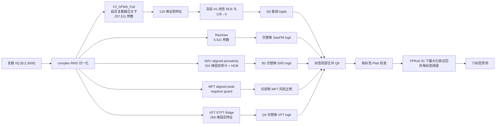

# Route A 前几轮实验专业 Prompt 与当前状态报告

日期：2026-08-05  
项目根目录：`E:\LJQ_code\CJ_Imbalance_0716`  
主要数据目录：`E:\LJQ_code\干扰数据`  
基础 0716 数据：`E:\LJQ_code\干扰数据\复合干扰数据0716`  
主要运行环境：`D:\anaconda3\envs\PY10\python.exe`

> 路径说明：本文所有当前操作路径均按 E 盘书写。冻结清单内部保存的历史绝对路径属于证据字段，不能直接改写，否则会破坏冻结工件的哈希与可追溯性；执行时应使用 E 盘中的同哈希工件。

---

## 第一部分：可复用的专业 Prompt

下面的 Prompt 可用于后续阶段性总结、论文创新审计、模型状态复盘和长线实验规划。

```text
你是一名雷达复合干扰识别、多标签长尾学习、弱分量检测、复数 I/Q 深度学习和科研证据审计专家。请基于项目中的正式代码、配置、冻结清单、实验收据、JSON 汇总和结果报告，对 Route A 的实验状态进行一次可复核的系统审计。

【固定工作环境】
1. 项目根目录：E:\LJQ_code\CJ_Imbalance_0716
2. 主要数据目录：E:\LJQ_code\干扰数据
3. 基础 0716 数据：E:\LJQ_code\干扰数据\复合干扰数据0716
4. 参考程序目录：E:\LJQ_code
5. Python 环境：D:\anaconda3\envs\PY10\python.exe
6. 当前任务只允许读取正式 development、external confirmation、OOD、冻结清单和报告；不得读取或使用密封 test-v3 的样本、标签或预测结果。

【审计原则】
1. 必须区分以下证据角色：历史开发结果、当前 development、冻结候选、新身份外部确认、OOD 压力验证、无训练物理 H0、失败后只读诊断、密封独立测试和未执行方案。
2. 不得把 development、smoke、外部 H0、OOD、历史 locked-test 或提案合并为“最终系统结果”。
3. 对每轮实验按“研究问题—实验任务—控制变量—主要结果—失败原因—结论—禁止继续事项”进行描述。
4. 负结果必须保留；门槛失败后不得通过改名、换阈值、增加容量或在同一验证集继续调参来修复结论。
5. 区分“排序能力改善”和“固定阈值决策改善”；AUROC/AUPR 提升不能自动推导出召回、FPR 或部署可靠性提升。
6. 区分“标签频次长尾”和“标签内部 weak/strong 可见性长尾”。基础 0716 六类源数据本身是平衡数据，正式长尾结论必须依赖可重建、带哈希的派生 manifest。
7. 同一 receiver_noise_seed 的多功率视图必须按身份分组，不得当作独立样本切分。
8. 当前地址统一采用 E 盘；冻结清单中的历史路径只作为不可改写的证据字段。

【必须回答的问题】
1. 前几轮实验分别试图解决什么问题？
2. 哪些结果是真正成立的，成立到什么证据范围？
3. 每条失败路线的直接原因、深层原因和不可继续重复的操作是什么？
4. 原先设想的论文创新点是什么？哪些部分已得到支持，哪些仍未证明？
5. 当前最强候选究竟是单一网络还是冻结组合系统？请给出完整数据流、模块、参数规模和标签路由关系。
6. 给出当前主干、分类头、专家、损失函数、校准器、阈值规则、训练角色、随机种子和关键超参数。
7. 将当前结果与创新点要求逐项比较，给出明确差距和 test-v3 是否可授权的结论。
8. 给出两种后续论文策略：收缩为可证实的窄创新，或更换观测协议继续完整 VTSE-VBF；为每条策略设置不可事后修改的硬门槛。

【输出结构】
1. 执行摘要
2. 数据、角色与证据边界
3. 预设科学问题与创新点
4. 前几轮实验任务、结果与决策表
5. 失败原因的分层归因
6. 当前网络与冻结组合系统结构
7. 损失函数、校准、阈值与超参数
8. 已成立结论、未成立结论和禁止表述
9. 与 SCI 创新点证据链的差距
10. 后续长线研究路线与硬门槛
11. 最终状态判定

【语言与证据要求】
- 使用专业、克制、可写入论文组会或技术报告的中文。
- 所有关键数值注明证据角色和对照对象。
- 对推断使用“说明、支持、提示”，不得把推断写成已证明事实。
- 最终必须明确回答：当前能否称为完整 VTSE-VBF 创新、能否开启 test-v3、最可信的窄创新是什么。
```

---

## 第二部分：按照上述 Prompt 输出的正式报告

## 1. 执行摘要

Route A 当前已经完成了从普通标签频次长尾损失、PAM-IQ 结构、延迟 I/Q 融合主干、冻结分类头、SawFM 专家、ISRJ 周期性专家、MFT 安全门和 VFT STFT 专家，到统一冻结候选及外部验证的一整套研究链条。最重要的进展不是得到一个普遍优胜的端到端网络，而是明确了不同干扰标签的弱证据具有不同物理来源，必须采用标签局部专家和安全路由，不能只依靠一个共享表示、一个统一损失或一个统一阈值解决。

当前最强冻结候选为 `H1_B2_MFTSharedDecision_VFTRidgeFusion_v2`。它在 25,200 个新 receiver/noise identity 的标准生成协议 H3 中通过全部预注册门槛：相对冻结基础 Q0，六类 macro-AUPR 提高 `+0.006878`，macro-F1 提高 `+0.011524`，MFT/VFT/ISRJ 平均弱分量召回提高 `+0.039833`，平均 weak-vs-negative AUROC 提高 `+0.039987`，目标平均 FPR 为 `0.185258`，SawFM 输出保持精确不变。

但是，该候选在联合 OOD 条件 H5o——新身份、高副本 ISRJ 参数区间和 `rho=0.65` proper-complex AR(1) 噪声——未通过确认：平均弱召回增益只有 `+0.017662 < +0.030`，目标平均 FPR 为 `0.213360 > 0.20`，VFT 绝对 FPR 达到 `0.328065`，MFT 弱召回下降 `-0.039929`。这说明 H3 的标准源可复现性成立，但完整候选的参数/噪声联合 OOD 鲁棒性不成立。

更关键的是，原始 C3 VTSE-VBF 与同容量、无可见性机制的 C4 控制相比，macro-AUPR 为 `-0.00290`，目标弱 AUROC 为 `-0.00401`，未能排除“容量或附加分数”解释。因此，目前不能把冻结组合候选的局部收益直接表述为“VTSE-VBF 的统一可见性长尾机制已经被证明”。

当前目标审计仅完成 `3/12` 项，test-v3 的 `access_authorized=false`、`analysis_allowed=false`、`used=false`。结论是：

- 当前不能称为完整、已验证的 VTSE-VBF SCI 创新系统；
- 当前不能开启 test-v3；
- 当前最可信的窄创新是“标签局部、非扰动式的 SawFM Raw-IQ 路由，以及具有多源冻结复现证据的 ISRJ aligned-periodicity 增量”；
- 若坚持完整三目标 MFT/VFT/ISRJ 可见性创新，下一步必须改变观测协议或数据来源，而不是继续在原 0716 单脉冲协议上扩网、调 loss 或调阈值。

## 2. 数据、角色与证据边界

### 2.1 基础数据与输入合同

- 六个标签：FMB、SawFM、SinFM、MFT、VFT、ISRJ。
- 基础 0716 训练源包含 25,200 个样本，63 个非空标签组合，每个组合 400 个样本；它是平衡源，不是天然标签长尾源。
- 模型输入为复数 I/Q，张量形状 `[B, 2, 3000]`，使用 `complex_rms` 归一化。
- weak 分量定义使用相对功率差阈值 `10 dB`。
- 正式标签长尾实验使用带哈希、可重建的 `label_lt` manifest；历史 IF=4 标签目标计数为 `1600/1213/919/696/528/400`，但该频次长尾不能替代标签内部 weak/strong 可见性长尾。

### 2.2 development-v3 角色划分

每个训练 seed 使用相互不重叠的五类开发角色：

| 角色 | 样本数 | 用途 |
|---|---:|---|
| fit | 1,920 | 训练局部可学习模块 |
| validation | 480 | checkpoint/模型选择 |
| early | 2,520 | 开发结果评估，不参与校准和阈值选择 |
| calibration | 2,520 | 每标签 Platt 校准 |
| threshold | 2,520 | 固定 FPR 约束下选阈值 |

五个正式 seed 为 `2039–2043`。所有多功率视图按 receiver identity 约束，不允许跨角色泄漏。

### 2.3 test-v3 边界

密封清单位于 [test_v3_sealed_manifest.json](/E:/LJQ_code/CJ_Imbalance_0716/frozen/20260731_route_a_test_v3_sealed/test_v3_sealed_manifest.json)。当前状态：

- `status=sealed`
- `access_authorized=false`
- `analysis_allowed=false`
- `used=false`
- 仅允许在最终模型、校准器、阈值、代码和报告 bundle 全部冻结后执行一次。

H0v、P1、P2、H3、H5o 均记录 `locked_test_used=false`、`test_v2_used=false`、`test_v3_used=false`。

## 3. 预设科学问题与创新点

### 3.1 核心科学问题

传统多标签长尾方法主要处理标签正例数量、标签共现和正负不平衡，但复合干扰中还存在同一标签内部的可见性长尾：

- strong positive 数量多、证据显著、容易分类；
- weak positive 数量少、局部证据容易被强共存分量压制；
- target-absent hard negative 与 weak positive 在共享表示中相近；
- DB、Focal、ASL 等损失根据标签频次或预测难度加权，但不直接知道某个正样本是 weak 还是 strong。

因此，预设创新问题是：能否在推理阶段只输入 I/Q、不输入真实功率或 weak mask 的条件下，显式建模标签内部 weak/strong/negative 三个层次，并安全地提高弱分量检测能力？

### 3.2 原设 VTSE-VBF 创新点

1. **标签内可见性长尾定义**：将同标签 strong positive、weak positive 与 target-absent negative 分开建模，而不是只按标签频次建模。
2. **VTSE（Visibility Temporal Statistics Expert）**：每个目标标签使用与物理结构相符的局部时间证据专家，寻找 weak positive 与 absent 的差异。
3. **VBF（Visibility-Balanced Fusion）**：对 weak/strong/negative 进行受控学习，通过不确定性门和有界残差接入基础分类器，限制 FPR 与强正召回退化。
4. **标签局部安全性**：某一标签专家只能修改本标签 logit；其他标签概率和决策应精确不变。
5. **完整证据链**：同容量控制、时间/物理信息破坏控制、新身份确认、参数与噪声 OOD、五 seed 配对统计、成本分析和一次性 test-v3。

### 3.3 当前创新实质的变化

实验表明，统一 VTSE-VBF 没有成立，但“标签局部专家 + 安全路由”的工程思想得到部分支持。当前系统已从一个统一可见性网络转变为一个模块化冻结组合：SawFM、ISRJ、MFT 和 VFT 分别使用不同证据机制。这种转变提高了局部效果，却削弱了“一个统一机制解释三类弱分量”的论文主张。

## 4. 前几轮实验任务、成果与决策

### 4.1 从 Base-DB、PAM-IQ 到 DFMS-IQ

| 阶段 | 任务 | 主要结果 | 结论 |
|---|---|---|---|
| Base-DB | 验证标签频次长尾损失 | 历史 18 组尾类旋转中，DB 相对 ASL 的 macro-AUPR 平均 `+0.01787`，18/18 为正 | DB 是标签频次长尾的可靠基线，但不建模同标签 weak/strong |
| ASL-DB 混合 | 尝试以 DB 权重 0.75/0.90 强化尾类 | SawFM AUPR 约 `+0.068～0.069`，但 macro-AUPR 约 `-0.047～-0.049` | 出现明显 Pareto 冲突，停止继续扫混合权重 |
| PAM-IQ | 相位感知、多尺度和注意力池化 | 相对普通窄主干部分标签排序改善，但相对同容量宽基线 macro-AUPR `-0.0119`、weak recall `-0.1283` | 过早 I/Q 融合、共享显著性注意力和全局压缩偏向强分量 |
| PAM-IQ 标签查询/双池化 | 增加标签条件池化与无注意力旁路 | 局部恢复部分弱召回，但 FPR 和跨标签稳定性不满足门槛 | 仅改池化不能弥补可观测性与标签归因不足 |
| F2_DFMS_Full | 延迟 I/Q 融合、多尺度复数分支、多滞后相位 | 历史开发 macro-AUPR `0.8562`，相对 PAM 主干约 `+0.0200`，但弱召回仍约 `0.3586` | “I/Q 过早融合是问题之一”得到支持；F2 晋级为共享主干 |

这一阶段证明：主干提取能力并非完全不足。延迟复数融合后，冻结特征上的简单分类头可以进一步提高 weak AUROC，说明相当一部分弱证据已经保留在 128 维表示中。主要瓶颈逐步从“特征完全缺失”转移为“分类边界、标签局部证据和阈值运输”。

### 4.2 development-v3 普通损失与冻结分类头

#### Focal-36 普通损失强基线

在同一个 `F2_DFMS_Full` 初始化、同一训练 scope 和同一 RawSaw 路由下，Focal、ASL、DB 延长到 36 轮。`E2_Focal_36` 成为最强普通损失基线：

| 指标 | 五 seed 均值 |
|---|---:|
| macro-AUPR | `0.890177` |
| macro-F1 | `0.775232` |
| MFT/VFT/ISRJ 平均弱召回 | `0.314384` |
| MFT/VFT/ISRJ 平均弱 AUROC | `0.600358` |
| 目标平均 FPR | `0.190538` |
| ISRJ AUPR | `0.848732` |
| ISRJ 弱召回 | `0.262067` |
| ISRJ 弱 AUROC | `0.567865` |

Focal 的最佳 epoch 多数达到 35–36，后续 72 轮 cosine 训练与 36 轮实质接近，没有提供可重复的额外收益。因此训练轮数不足不是后续失败的主要原因。

#### 冻结表示上的分类头对照

冻结 Focal-36 的 128 维特征后，比较线性 BCE、线性 DB 和每标签 MLP4-DB。最强通用头是 `H1_Linear_BCE`：

| 指标 | 五 seed 均值 |
|---|---:|
| macro-AUPR | `0.897061` |
| macro-F1 | `0.790526` |
| 目标平均弱召回 | `0.332751` |
| 目标平均弱 AUROC | `0.610842` |
| 目标平均 FPR | `0.192957` |
| ISRJ AUPR | `0.885790` |
| ISRJ 弱召回 | `0.325705` |
| ISRJ 弱 AUROC | `0.602692` |

该结果说明，冻结表征上的简单线性边界已经强于复杂 MLP/DB 头。分类器容量并不是主要限制；更复杂的头容易重新拟合强正模式或标签先验。

#### ISRJ 专家相对不同基线的边界

aligned-periodicity 专家 F3 相对 Focal-36：ISRJ AUPR `+0.013257`、弱召回 `+0.072910`、弱 AUROC `+0.013547`，五 seed 均为正，但 macro-AUPR `-0.005732`。相对更强的 `H1_Linear_BCE`，F3 的 macro-AUPR `-0.012616`、ISRJ AUPR `-0.023802`、ISRJ 弱 AUROC `-0.021280`。因此，F3 是针对特定基础头的局部增量证据，不是总体最强模型。

### 4.3 原始统一 C3 VTSE-VBF

C3 相对普通 C0 的 macro-AUPR 和 macro-F1 有提升，主要来自 RawSaw 与附加专家；但真正的机制对照是同容量、无可见性特定机制的 C4。结果为：

- C3 − C4 macro-AUPR：`-0.00290`
- C3 − C4 目标弱 AUROC：`-0.00401`

关键容量因果门失败。这意味着现有结果不能排除“增加参数、增加分支或附加分数”解释。C3 不得冻结为论文最终模型，也不能用后续 H3 的成功倒推 C3 机制成立。

### 4.4 SawFM Raw-IQ 标签局部路由

RawSaw 使用独立 Raw-IQ 描述符、三个时间尺度卷积分支和 mean/std/max/top-k 统计，只替换 SawFM logit。历史五 seed 开发结果显示，`RawSaw+H2Others` 相对共享头：

- macro-AUPR `0.8667 → 0.9001`
- macro-F1 `0.7573 → 0.8027`
- SawFM recall `0.4870 → 0.8813`
- exact match `0.2280 → 0.2747`
- 其他五类最大 FPR 变化为 0

该证据支持“标签局部替换可以保留专家排序几何并避免跨标签负迁移”。但它是 SawFM 专项结论，不证明 MFT/VFT/ISRJ 的统一可见性机制。

### 4.5 ISRJ aligned-periodicity 专家

ISRJ 专家从复数 ACF、包络 ACF、频谱分箱和周期峰值中构造 310 维固定特征，并使用 aligned HGB 与 block-shuffled HGB 对照。冻结 B2 相对 B0 在联合外部 H0s 中得到：

- ISRJ AUPR `+0.11677`
- ISRJ 弱召回 `+0.07285`
- ISRJ 强召回 `+0.19070`
- ISRJ 弱 AUROC `+0.09709`
- macro-AUPR `+0.01946`
- macro-F1 `+0.02644`
- SawFM 输出精确不变
- 五 seed 均为正，外部门槛通过

这是一条当前最扎实的局部机制证据：在若干官方生成器参数外推与 AR(1) 噪声源上，时间顺序对 ISRJ 排名确有作用。然而，它仍是训练并冻结后的窄专家证据，不能等同于“原始标量周期统计在任意复合背景中都可直接归因弱 ISRJ”。

### 4.6 H3 冻结统一候选的新身份标准源确认

冻结候选 `H1_B2_MFTSharedDecision_VFTRidgeFusion_v2` 在新身份标准源上不重新训练、不重新校准、不重新选阈值。H3 结果：

| 端点 | Q6 − Q0 或绝对值 |
|---|---:|
| macro-AUPR | `+0.006878` |
| macro-F1 | `+0.011524` |
| 三目标平均弱召回 | `+0.039833` |
| 三目标平均弱 AUROC | `+0.039987` |
| 三目标平均 FPR | `0.185258` |
| 三目标平均强召回 | `+0.024309` |
| MFT/VFT/ISRJ AUPR | `+0.004308 / +0.013549 / +0.023409` |
| SawFM AUPR、弱召回 | 精确不变 |

VFT aligned Ridge 相对 Q2、同容量 Q3 和 shuffled Q5 均通过；MFT shared decision 降低 hard-negative FPR `-0.02950`，但付出弱召回 `-0.00922` 的可控代价。H3 证明同标准生成器的新身份可复现性，不证明未知噪声、未知生成器或最终独立测试泛化。

### 4.7 H5o 联合 OOD 失败

H5o 保持网络、专家、校准器和阈值完全冻结，在新 identity、高副本 ISRJ 参数与 `rho=0.65` AR(1) 噪声联合条件下验证。结果：

| 端点 | H5o Q6 − Q0 或绝对值 |
|---|---:|
| macro-AUPR | `+0.023760` |
| macro-F1 | `+0.033492` |
| 三目标平均弱召回 | `+0.017662`，未达 `+0.030` |
| 三目标平均弱 AUROC | `+0.044064` |
| 三目标平均 FPR | `0.213360`，超过 `0.20` |
| VFT FPR | `0.328065` |
| MFT 弱召回变化 | `-0.039929` |
| ISRJ AUPR | `+0.122036` |

H5o 的失败不是所有专家都失效：ISRJ 排序仍然很强，SawFM 和非目标标签保持不变。失败集中在决策运输：VFT 的相对排序改善没有转化为可接受的绝对 FPR；MFT 的安全门在 OOD 下过度保守，牺牲过多弱正召回。H5o 已被消费，不能在其上重新调阈值、融合系数或校准器。

### 4.8 单脉冲可观测性审计 H0v、P1 和 P2

#### 原始 0716 物理限制

- 有效 LFM 脉冲约 `100 us`、1,000 点。
- MFT 延迟约 `30–50 us`，副本最大间距约 `20 us`，与 100 us 主脉冲重叠至少约 80%。
- VFT 频偏约 `1–7 kHz`，在 100 us 窗口中只跨 0.1–0.7 周，相对 10 kHz Fourier bin 仅约 0.6 bin。
- 没有跨脉冲相干孔径。

这不证明原始任务绝对不可分类，但说明继续靠局部 ROI、更多层、loss 或阈值恢复未被观测的信息缺乏物理依据。

#### H0v：自然可见图

新建 1,800 对 absent/weak 样本，每个目标 600 对，不训练参数。真实 AUROC 与时间置换控制相比：

- MFT：`0.5078`，控制 `0.5114`，差 `-0.0036`
- VFT：`0.5013`，控制 `0.5107`，差 `-0.0094`
- ISRJ：`0.5166`，控制 `0.5254`，差 `-0.0089`

三类均失败。自然可见图统计不具备可用的标签归因能力，路线永久关闭。

#### P1：观测充分的外部多脉冲协议

P1 使用 10 MHz complex I/Q、6 脉冲、500 us PRI、3 ms 孔径、MFT 非重叠延迟和 VFT 20–60 kHz 偏移。无训练 H0 结果：

- MFT AUROC `0.8027`，控制 `0.5501`，通过；
- VFT AUROC `0.9981`，控制 `0.5592`，通过；
- ISRJ AUROC `0.5775`，控制 `0.4953`，weak>absent 比例 `0.44`，失败。

#### P2：加强 ISRJ 副本和周期统计

P2 保留 P1 的 MFT/VFT 观测条件，将 ISRJ 提升到 9 副本、25–30 us slice，并固定 ACF lag 与 block-shuffle 控制：

- MFT AUROC `0.8111`，控制 `0.5459`，通过；
- VFT AUROC `0.9983`，控制 `0.5374`，通过；
- ISRJ AUROC `0.5551`，控制 `0.4990`，weak>absent 比例 `0.5133`，失败。

因为 P1/P2 的全目标门均要求三类同时通过，所以没有进入 C0/C3/C4 模型训练。

## 5. 失败原因的分层归因

### 5.1 数据和可观测性层

1. **原始 0716 单脉冲孔径不足**：MFT 副本大面积重叠，VFT 相位积累不足，主干无法凭空恢复未形成稳定统计差异的信息。
2. **弱 ISRJ 标签归因失败**：P1/P2 中，ISRJ weak−absent 平均分数增量只有约 `+0.0240/+0.0258`。当 nuisance 标签数为 1 时增量约 `+0.0913/+0.1038`；当 nuisance 标签数达到 2 及以上时，增量接近 0 或变为负值。问题不是完全没有周期结构，而是弱 ISRJ 的周期结构无法从多个共存背景中可靠归因。
3. **平衡源与长尾主张存在边界**：基础 0716 是平衡组合源；如果没有正式派生 manifest，就不能把低功率困难自动写成标签频次长尾。

### 5.2 表征层

1. PAM-IQ 的早期 I/Q 融合、单套全局注意力和显著性门控会偏向强分量。
2. DFMS-IQ 解决了部分过早融合问题，并证明 128 维冻结表示中仍有较多弱证据。
3. 但共享全局表示无法同时承担 SawFM 的局部复位、ISRJ 的长周期、MFT 的多副本安全与 VFT 的细频偏证据。继续扩宽共享主干不会自动得到标签归因能力。

### 5.3 分类器与损失层

1. DB、Focal、ASL 等损失不直接区分同标签 weak/strong；同标签同 logit 样本的梯度不会因为 weak 标记不同而改变。
2. 冻结表示上的线性 BCE 头强于线性 DB 和 MLP4-DB，说明增加分类器容量不是主要解法。
3. Focal-36 是最强普通损失，但 aligned-periodicity 对 ISRJ 的增益会伴随整体 macro-AUPR 代价，说明局部目标与全局目标存在冲突。
4. 原始 C3 未战胜同容量 C4，说明当前可见性损失/专家不能排除容量解释。

### 5.4 校准和阈值层

1. H3 中固定 Platt 与 FPR 约束阈值可以运输到同标准源新身份。
2. H5o 中 VFT 排序改善仍存在，但绝对 FPR 达到 `0.3281`，说明分数尺度与冻结阈值在联合 OOD 下不匹配。
3. MFT 门控降低 hard-negative FPR 的能力真实存在，但 OOD 下过度保守，弱召回损失超过允许上限。
4. 这些是冻结候选的泛化失败，不能在 H5o 上事后重校准来改写结果。

### 5.5 研究设计层

1. 局部组件的成功不能自动证明统一创新机制。
2. H3 是新身份标准源确认，不是完整 OOD 或独立 test。
3. 已失败的 H1u、H2v、H1t、H3/H4 投影、H0v、P1/P2 全目标门均应保持关闭；换名称、换 ROI、换 loss、换阈值或增大网络不构成新科学机制。

## 6. 当前网络与冻结组合系统结构

### 6.1 当前系统不是单一端到端网络

当前最强候选的数据流如下：



### 6.2 F2_DFMS_Full 详细结构

输入：`[B,2,3000]`，宽度 `width=16`，dropout `0.2`。

| 层级 | 实部/虚部通道 | 时间长度 | 结构 |
|---|---:|---:|---|
| Stage 1 | 1→16 | 3000 | 复数残差块，kernel 7 |
| Downsample | 16 | 1500 | AvgPool 2 |
| Stage 2 | 16→32 | 1500 | 复数残差块，kernel 5 |
| Stage 3 | 32→48 | 750 | 复数多尺度分支：kernel/dilation 为 3/1、7/2、15/4；残差投影 |
| Stage 4 | 48→64 | 375 | 同样三尺度分支，分支通道 24，输出 64 |

Stage 4 前一直保持实部和虚部的复数耦合流。之后进行延迟融合：

- Cartesian 分支：`[real, imag]` 128 通道，经 1×1 卷积映射到 128；
- Magnitude 分支：64 通道幅度映射到 128；
- Phase 分支：使用 lag `1/4/16` 的 cos/sin 相位差，共 384 通道，经 `384→32→128`；
- 相位残差初始尺度 `0.1`，以 `tanh(scale)` 有界加入；
- 三分支相加后进入 SiLU。

融合后的 `[B,128,375]` 特征进入深度可分离多尺度时间块：

- kernel/dilation：`3/1、7/2、15/4`；
- 三分支拼接后 `384→128`；
- residual connection；
- Dropout1d `0.2`。

最后使用无注意力全局 mean/std 池化：`128×2=256`，再经过 `256→128 + LayerNorm + GELU + Dropout(0.2)`，分类器为 `Dropout(0.2) + Linear(128,6)`。完整 F2 参数量为 `257,511`。

### 6.3 RawSaw

RawSaw 只使用原始 I/Q，不依赖 F2。每个时间点构造 6 类描述符：幅度均值、幅度最大、幅度标准差、幅度差分、相位 cos 增量和相位 sin 增量。结构为：

- `6→16` 的 1×1 stem；
- 三个 depthwise 分支，kernel `7/31/63`；
- 三分支融合回 16 通道；
- 平均下采样 4；
- 对卷积特征和原描述符分别计算 mean/std/max/top-k mean；
- 88 维统计进入 `88→32→1` 分类器；
- top-k=`16`，dropout=`0.1`，参数量 `5,521`。

RawSaw 的成功点是整列替换 SawFM logit，而不是把其压缩成共享头上的小残差。

### 6.4 ISRJ、MFT 与 VFT 模块

**ISRJ aligned-periodicity**：

- 复数 ACF 1–1200 lag，池化为 120 维；
- 包络 ACF 1–1200 lag，池化为 120 维；
- 频谱 60 维；
- 周期峰值、峰位置和 top-8，共 10 维；
- 总特征 310 维；
- HGB：200 iterations，learning rate `0.05`，max leaf nodes `7`，L2=`1.0`；
- 25 点 block shuffle 作为时间顺序破坏对照；
- 与基础 ISRJ logit、专家 z-score、不确定性交互和 `tanh(base)×z` 组成 4 维融合特征；
- LogisticRegression `C=0.1`，weak positive 权重 `4.0`。

**MFT shared decision guard**：

- 使用 matched-filter/peak-count 类 aligned evidence；
- residual cap=`0.75`；
- 只允许降低或保持已有 MFT 决策，不允许 negative→positive 翻转；
- H3 中降低 hard-negative FPR，但 H5o 中弱召回损失过大。

**VFT aligned Ridge fusion**：

- 固定 STFT/相位物理统计，共 268 维；
- RidgeClassifier alpha=`10.0`，正负类各占总权重 0.5；
- Ridge 分数 z 标准化后与基础 VFT logit组成 4 维交互特征；
- LogisticRegression `C=0.1`，weak positive 权重 `4.0`；
- aligned、base-only 同容量和 shuffled 三种头用于机制控制。

## 7. 损失函数、训练方式、校准、阈值与超参数

### 7.1 F2/Focal-36 基础表征

Focal 元素损失采用：

\[
L_{focal}=-y(1-p)^{\gamma_+}\log p-(1-y)p^{\gamma_-}\log(1-p),
\]

其中 `gamma_pos=0`、`gamma_neg=3`。训练总损失为：

\[
L=L_{FMB,SinFM,MFT,VFT,ISRJ}^{mean}+0.2L_{SawFM}.
\]

训练时冻结大部分 F2，只解冻最后一个 `temporal_backbone` 多尺度块和六类分类器：

| 项目 | 设置 |
|---|---|
| optimizer | AdamW |
| epochs | 36 |
| patience | 8 |
| batch size | 64 |
| classifier learning rate | `5e-4` |
| 最后时间块 learning rate | `5e-5` |
| weight decay | `1e-4` |
| gradient clip | `5.0` |
| LR schedule | constant |
| checkpoint key | validation common macro-AUPR；同分时看 target weak AUROC |
| seeds | 2039–2043 |

### 7.2 冻结 H1 线性 BCE 头

Focal-36 的 128 维特征先用 fit 均值/标准差归一化，主干完全冻结，只训练 `Linear(128,6)`：

| 项目 | 设置 |
|---|---|
| loss | 普通 BCE；五个非 SawFM 标签均值 + `0.2×SawFM BCE` |
| optimizer | AdamW |
| epochs | 60 |
| batch size | 128 |
| learning rate | `1e-3` |
| weight decay | `1e-4` |
| gradient clip | `5.0` |
| scheduler | cosine，最低 LR 比例 `0.01` |
| model selection | validation macro-AUPR；同分时看 target weak AUROC |

线性 BCE 比线性 DB 和每标签 MLP4-DB 更强，成为冻结组合系统的基础头。

### 7.3 RawSaw 训练

| 项目 | 设置 |
|---|---|
| loss | pos-weight BCE，权重为 fit 中 negative/positive 比 |
| optimizer | AdamW |
| epochs | 30 |
| patience | 5 |
| batch size | 64 |
| learning rate | `1e-3` |
| weight decay | `1e-4` |
| gradient clip | `5.0` |
| selection | validation SawFM AUPR；同分时看 SawFM weak AUROC |

### 7.4 专家训练和融合

| 模块 | 训练/拟合方式 | 关键参数 |
|---|---|---|
| ISRJ periodicity HGB | 类别平衡 sample weight | 200 iter，lr 0.05，leaf 7，L2 1.0 |
| ISRJ fusion | LogisticRegression | C 0.1，weak positive weight 4.0 |
| VFT Ridge | RidgeClassifier | alpha 10.0，正负质量各 0.5 |
| VFT fusion | LogisticRegression | C 0.1，weak positive weight 4.0 |
| MFT guard | 冻结规则/证据头 | residual cap 0.75，禁止 negative→positive |

### 7.5 校准与阈值

1. 每个标签在独立 calibration 角色上拟合 Platt LogisticRegression：`C=1e6`、solver=`lbfgs`、max_iter=`1000`。
2. 在独立 threshold 角色上搜索每标签阈值，网格为 `0.05–0.95`，步长 `0.01`。
3. 目标是在 `negative FPR≤0.20` 的约束下最大化 weak-positive recall；并列时依次选择 F1 更高、离 0.5 更近的阈值。
4. 最终仅在 early 或冻结外部源上评估；不得用评估角色反向调阈值。
5. 冻结候选中，MFT 使用 Q1 H1+B2 的校准器和阈值，其他标签使用 Q4 VFT-aligned 组合的校准器和阈值。

## 8. 已成立、未成立和禁止表述的结论

### 8.1 当前可以成立的结论

1. 延迟 I/Q 融合和多尺度复数编码优于原 PAM-IQ 的过早融合方案，F2 是合理共享主干。
2. F2 的 128 维特征保留了较多弱证据；冻结表示上的简单线性 BCE 边界可以显著利用这些信息。
3. SawFM 需要独立 Raw-IQ 专家，标签级替换比小残差融合更可靠，且可保证其他标签精确不变。
4. ISRJ aligned-periodicity 在多个冻结外部条件中具有稳定的局部排序增量，时间顺序破坏控制支持其不是纯容量效应。
5. 完整冻结组合在同标准生成器的新 identity 上可复现 H3 收益。
6. H5o 证明当前固定校准/阈值和 MFT/VFT 决策不能在联合 OOD 下保持门槛。
7. P1/P2 证明在观测充分的多脉冲协议中，MFT/VFT 具有清晰物理可辨识性；弱 ISRJ 在复杂共存背景中的标签归因仍失败。

### 8.2 当前不能成立的结论

1. 不能称 VTSE-VBF 已经统一解决六类或三目标的可见性长尾。
2. 不能称 C3 优于同容量无机制控制 C4。
3. 不能称完整候选具有参数/噪声联合 OOD 鲁棒性。
4. 不能把 H3 写成 test-v3、真实数据、未知生成器或部署验证。
5. 不能把基础平衡 0716 的低功率困难直接写成标签频次长尾。
6. 不能把 H0s 的训练后 ISRJ 专家增量解释成任意复合背景下原始标量周期统计天然可归因。
7. 不能在 H5o、P1、P2 或任何已消费角色上重新调阈值并继续作为独立验证。

### 8.3 应避免的论文表述

- “提出的统一网络在所有弱干扰上均显著优于现有方法。”
- “物理专家在未知噪声和参数条件下具有普遍鲁棒性。”
- “实验验证了三轴长尾学习的完整闭环。”
- “H3 是独立测试结果。”
- “调整阈值即可修复 H5o。”

## 9. 与 SCI 创新点证据链的差距

当前目标审计完成 `3/12`。主要缺口如下：

| 创新证据要求 | 当前状态 | 差距 |
|---|---|---|
| C3 战胜同容量 C4 | 失败 | 不能排除容量/附加分数解释 |
| 最新外部多标签长尾基线 | 未完成 | LabelCoRank 等只能做适配版，尚无完全同协议官方复现 |
| 完整候选参数/噪声 OOD | 失败 | H5o 弱召回和 FPR 门失败 |
| 最终候选五 seed 配对统计 | 部分 | H3 有统计，尚无通过全门槛的最终候选 bundle |
| 工程成本 | 未完成 | 缺统一参数、MACs、延迟、显存和专家预处理成本对照 |
| MFT/VFT/ISRJ 三层机制 | 未完成 | ISRJ 局部充分，MFT/VFT 原协议受可观测性限制 |
| 所有开发晋级门 | 未通过 | C3/C4 与 H5o 是主要阻塞项 |
| 最终冻结 bundle | 未完成 | 当前候选不能作为完整创新 final bundle |
| 一次性 test-v3 | 禁止 | 前置证据未完成，授权为 false |

从论文创新角度，当前最大的逻辑缺口不是“再提高几个点”，而是尚未形成一条同时满足以下条件的因果证据链：

1. 新机制优于同容量控制；
2. 改善发生在预定义 weak-positive 端点；
3. 强正和负类安全不退化；
4. 校准/阈值可跨 identity 和 OOD 运输；
5. 对 MFT/VFT/ISRJ 至少有清楚的共性机制，或诚实拆分为多个标签专用贡献；
6. 最终系统优于强外部基线并完成一次性独立测试。

## 10. 后续长线研究路线与硬门槛

### 路线 I：收缩为可证实的窄创新

论文主张收缩为“安全的标签局部专家路由”，重点保留 RawSaw 与 ISRJ aligned-periodicity，不再宣称统一 VTSE-VBF。

需要补充：

1. 在全新 development-v4 或真实/半实物来源上冻结确认 RawSaw 与 ISRJ 两个模块；
2. 与同参数标签局部 MLP、随机/置换专家、普通 Focal/ASL/DB、两阶段 decoupling 比较；
3. 报告每标签 AUPR、weak AUROC、FPR、strong recall、macro-F1；
4. 报告参数量、MACs、CPU/GPU 推理时间、特征预处理时间和峰值显存；
5. 做 identity-grouped paired bootstrap，并控制多重比较；
6. 若新来源中任一模块的 weak AUROC 增益下界不大于 0，或 FPR 超过预注册上限，则删除该模块，不做同源修复。

建议硬门槛：

- weak AUROC 增益均值 `≥0.030`，95% CI 下界 `>0`；
- AUPR 增益 `≥0.010`；
- 至少 4/5 seed 为正；
- 绝对 FPR `≤0.20`；
- strong recall 下降不超过 `0.02`；
- 非目标 logits、概率和决策精确不变。

### 路线 II：继续完整 VTSE-VBF

若坚持 MFT/VFT/ISRJ 统一 weak/strong/negative 创新，必须先更换观测协议或数据来源：

1. MFT 使用非重叠 delayed-copy 或更长 delay aperture；
2. VFT 使用明确多 PRI/相干孔径，使频偏产生多个可解析周期；
3. ISRJ 需要额外可归因观测，例如多通道、参考通道、半实物标定或能与共存周期背景分离的条件信息；
4. 新协议必须生成同 identity 的 absent/weak/strong 三臂，并保留 hard negatives；
5. 先做零训练 H0，只有三目标都通过物理可辨识门，才允许训练新 VTSE；
6. H1 必须与同容量信息破坏控制比较；只有 H1 通过后，才进入六标签融合和新 OOD。

建议 H0 硬门槛：

- 每目标 true AUROC `≥0.75`；
- true−control AUROC `≥0.10`，bootstrap CI 下界 `>0`；
- paired weak>absent 比例 `≥0.65`；
- strong 可见性不得显著低于 weak；
- 三目标必须全部通过，不允许用平均值掩盖单目标失败。

建议 H1 硬门槛：

- 学习模型相对同容量信息破坏控制的 weak AUROC `≥+0.030`，AUPR `≥+0.025`；
- 两项 95% CI 下界均 `>0`；
- 至少 4/5 seed 为正；
- strong recall 和非目标 AUPR 下降不超过 `0.01`；
- 未通过即关闭机制，不进入阈值和统一融合。

### test-v3 授权条件

只有以下条件全部满足后才可讨论授权：

1. 一个明确、不可再修改的最终候选；
2. 同容量因果控制通过；
3. 全新 identity 开发确认通过；
4. 参数与噪声 OOD 通过；
5. 外部强基线公平比较完成；
6. 五 seed 配对统计和工程成本完整；
7. 模型、专家、校准器、阈值、代码、数据哈希和运行命令形成最终冻结 bundle；
8. 明确一次性执行和失败后不重跑规则。

## 11. 最终状态判定

### 当前模型做到了什么

- 建立了一个能力较强、结构合理的延迟复数融合 F2 主干；
- 证明简单冻结线性头可以利用主干中保留的弱证据；
- 建立了可靠的 SawFM 标签局部 Raw-IQ 专家；
- 建立了具有多次冻结外部复现的 ISRJ aligned-periodicity 局部专家；
- 构造了一个在同标准生成器新 identity 上通过的模块化冻结组合；
- 通过 H5o、H0v、P1、P2 明确找到了当前系统的泛化边界和物理归因瓶颈。

### 当前模型还没有做到什么

- 没有证明统一 VTSE-VBF 相对同容量控制的因果优势；
- 没有解决 MFT/VFT/ISRJ 三目标在同一协议下的共同 weak 机制；
- 没有通过完整候选的联合参数/噪声 OOD；
- 没有完成最新外部 MLLT 基线、工程成本和最终 bundle；
- 没有获得 test-v3 使用授权。

### 一句话结论

当前 Route A 已经从“继续堆叠网络寻找分数提升”进入“科学边界已明确、需要选择论文收缩或更换观测协议”的阶段：作为模块化局部专家系统已有可发表的窄证据，但作为统一 VTSE-VBF 创新仍缺少关键因果、OOD 和独立测试证据。

---

## 12. 主要可复核工件

- 当前冻结候选：[frozen_manifest.json](/E:/LJQ_code/CJ_Imbalance_0716/frozen/20260801_route_a_h1_b2_mft_vft_shared_policy_v2/frozen_manifest.json)
- H3 新身份确认：[summary.json](/E:/LJQ_code/CJ_Imbalance_0716/outputs/tapc/route_a_h3_frozen_unified_confirmation/summary.json)
- H5o 联合 OOD：[summary.json](/E:/LJQ_code/CJ_Imbalance_0716/outputs/tapc/route_a_h5o_frozen_unified_ood/summary.json)
- 目标完成审计：[audit.json](/E:/LJQ_code/CJ_Imbalance_0716/outputs/tapc/route_a_goal_completion_h3/audit.json)
- Focal-36 汇总：[route_a_development_v3_loss_convergence_audit_summary.json](/E:/LJQ_code/CJ_Imbalance_0716/outputs/tapc/route_a_development_v3_loss_convergence_audit/route_a_development_v3_loss_convergence_audit_summary.json)
- 冻结分类头汇总：[route_a_development_v3_frozen_head_capacity_baselines_summary.json](/E:/LJQ_code/CJ_Imbalance_0716/outputs/tapc/route_a_development_v3_frozen_head_capacity_baselines/route_a_development_v3_frozen_head_capacity_baselines_summary.json)
- H0v 可见图：[formal_summary.json](/E:/LJQ_code/CJ_Imbalance_0716/outputs/tapc/route_a_h0v_visibility_graph_observability/formal_summary.json)
- P1 物理 H0：[formal_summary.json](/E:/LJQ_code/CJ_Imbalance_0716/outputs/tapc/route_a_p1_observability_adequate_h0/formal_summary.json)
- P2 物理 H0：[formal_summary.json](/E:/LJQ_code/CJ_Imbalance_0716/outputs/tapc/route_a_p2_full_target_h0/formal_summary.json)
- P1/P2 ISRJ 失败诊断：[summary.json](/E:/LJQ_code/CJ_Imbalance_0716/outputs/tapc/route_a_p1_p2_isrj_h0_failure_diagnosis/summary.json)
- 当前主干实现：[phase_multiscale.py](/E:/LJQ_code/CJ_Imbalance_0716/cjlt/models/phase_multiscale.py)
- RawSaw 实现：[evidence_readout.py](/E:/LJQ_code/CJ_Imbalance_0716/cjlt/models/evidence_readout.py)
- 校准和阈值实现：[thresholding.py](/E:/LJQ_code/CJ_Imbalance_0716/cjlt/engine/thresholding.py)
- test-v3 密封清单：[test_v3_sealed_manifest.json](/E:/LJQ_code/CJ_Imbalance_0716/frozen/20260731_route_a_test_v3_sealed/test_v3_sealed_manifest.json)
