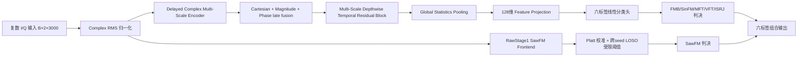

# 路线 A 整体实验、网络结构与最近三轮闭环报告（2026-07-31）

## 一、可复用专业 Prompt

> 你是一名雷达复合干扰多标签识别、长尾学习与实验审计专家。请基于项目正式配置、结果 JSON、运行 receipt、模型代码和预注册计划，对“路线 A”进行证据分层总结。要求：
>
> 1. 先说明研究问题、数据角色与证据边界，严格区分 smoke、development、独立测试和历史 locked-test；
> 2. 给出当前端到端网络结构、各模块输入输出、冻结/训练范围以及标签级路由方式；
> 3. 按时间顺序总结最近三轮正式实验，逐轮列出假设、对照、关键指标、成功项、失败项和根因；
> 4. 不把“未执行的设计”写成实验结果，不把代码链路通过写成方法有效，不因接近门限而修改预注册门限；
> 5. 对成功结果给出机制解释，对失败结果区分表示能力、损失耦合、校准、阈值、安全裕量和证据不足；
> 6. 明确回答“是否可以只训练其他五类”：区分删除 SawFM 样本、屏蔽 SawFM 损失、冻结表示层和开放共享表示层四种情形；
> 7. 最后给出创新点当前可支持的最强结论、仍不可支持的结论、正式产物和下一道实验闸门。

## 二、执行摘要

路线 A 的历史主线已经在一次性 locked-test 上验证成功：`F2_DFMS_Full` 负责六类公共表征和其他五类判决，`RawStage1SawFMFrontend + Platt + 跨 seed LOSO 阈值` 专门接管 SawFM。相对 H2 baseline，历史 locked-test 的 macro-AUPR 从 0.8619 提升到 0.8934，macro-F1 从 0.7555 提升到 0.7961；SawFM AUPR 从 0.7598 提升到 0.9487，Recall 从 0.5151 提升到 0.8352，同时 FPR 从 0.1907 降到 0.1352。该 locked-test 已消耗，禁止重跑、调参或重新校准。

因此，当前问题已不是“路线 A 完全识别不了 SawFM”，而是：SawFM 在共享训练中的梯度是否会妨碍 MFT、VFT、ISRJ 等公共标签，以及隔离该梯度能否进一步提高五类性能。

最近三轮 development-v2 结果形成了清晰递进关系：

1. 冻结 F2、只删 SawFM 输出头完全无效，证明独立线性输出行不存在可利用的竞争；
2. 开放最后共享时序块后，屏蔽 SawFM 损失在 5/5 seed 上提高目标弱分量召回，验证了共享表示负迁移机制；
3. 沿 C6→M5 的配对更新方向做 validation 选择的梯度对比强化，五个 seed 均选择 α=1.5，使 macro-F1 提升 +0.01233、目标弱召回提升 +0.02597。

新创新点“标签选择性的共享梯度隔离/对比强化”已获得 development-v2 机制和一致性证据，但完整晋级门仍未通过：目标弱分量召回增益要求 +0.030，实际为 +0.02597。故 test-v2 继续封存，不能宣称独立验证或部署晋级。

## 三、证据边界

| 数据/证据 | 当前状态 | 可支持结论 |
|---|---|---|
| 历史 0716 locked-test，25,200 样本 | 已一次性使用并冻结 | 支持原始 Raw-Saw 标签级专家路由的最终历史结论 |
| development-v2 train，25,200 样本 | 本轮用于优化、验证、校准、阈值和 early-stop | 支持新梯度机制的开发证据 |
| test-v2，25,200 样本 | 未打开，`test_v2_used=false` | 当前不支持任何 test-v2 指标或独立结论 |
| smoke | 仅验证代码链路 | 不支持方法有效性 |

development-v2 文件 SHA256：`f05a7e30253b0c0fdf10d5040487cb6a6f089abcd48f9cbd6f9e467624498801`。五个 seed 均在 optimization 内构造完全相同规则的 2400 样本 label-LT 清单，标签目标计数按 `[FMB,SawFM,SinFM,MFT,VFT,ISRJ]` 为 `[1600,400,1213,919,696,528]`。每个 seed 的角色规模为 fit 1920、validation 480、early-stop 2520、calibration 2520、threshold-selection 2520。

## 四、当前网络结构

`F2_DFMS_Full` 的核心表征维数为 128。历史最终路线使用标签级路由：F2/H2 保留其他五类输出，Raw 专家只替换 SawFM 判决，不重训主干。

本轮共享梯度实验保持复杂编码器、late fusion、全局池化和 feature projection 冻结，仅训练：

- 最后一个共享时序多尺度块：53,376 个参数；
- 六输出分类头：774 个参数；
- 合计可训练参数：54,150。

这使 SawFM 损失可以通过共享时序块影响其他标签，同时把实验范围限制在可审计的小规模适配层。

## 五、最近三轮正式实验

### 第 1 轮：冻结 F2 的 H5 五输出头

研究假设：删除 SawFM 输出竞争，可能直接改善其他五类。

控制方式：F2 表征完全冻结；C6 与 H5 的五个公共输出行严格配对初始化；保留所有 SawFM 共现样本，只屏蔽 SawFM 输出/损失。

| H5 - C6 | 均值 |
|---|---:|
| macro-AUPR | -0.000000011 |
| macro-F1 | -0.000018 |
| MFT/VFT/ISRJ 平均弱召回 | -0.000231 |

结果：晋级门失败，实际等价于零效应。

根因：冻结特征后的 BCE 线性头按输出行独立优化；SawFM 行的梯度不会进入其他五个输出行。删除第六行只能改变无关参数，不能验证共享表示负迁移。该轮成功排除了“仅把六输出改成五输出”这一无效方案。

### 第 2 轮：共享表示层 M5 梯度隔离

研究假设：开放最后共享时序块后，SawFM 损失会与困难标签发生梯度冲突；屏蔽 SawFM 损失可改善公共五类。

控制方式：C6 与 M5 从同一 F2 checkpoint、相同初始化、相同 minibatch 顺序出发；C6 损失为 `common-five loss + 0.2 × SawFM loss`，M5 只保留 common-five loss；SawFM 样本及复合背景全部保留。

初始共享块梯度余弦：

| SawFM 对目标标签 | 五 seed 平均余弦 | 负余弦 seed 数 |
|---|---:|---:|
| MFT | -0.04850 | 4/5 |
| VFT | +0.06764 | 0/5 |
| ISRJ | -0.01321 | 4/5 |

| M5 - C6 | 均值 | 95% bootstrap CI |
|---|---:|---:|
| macro-AUPR | +0.00387 | [0.00271, 0.00513] |
| macro-F1 | +0.00861 | [0.00621, 0.01117] |
| 目标弱召回 | +0.01412 | [0.00627, 0.02333] |
| SawFM-present 五类 macro-F1 | +0.01214 | [0.00886, 0.01588] |
| SawFM-absent 五类 macro-F1 | +0.00524 | [0.00297, 0.00779] |

成功点：目标弱召回在 5/5 seed 上均为正；MFT、VFT、ISRJ AUPR 均值全部提高；有 SawFM 和无 SawFM 子组同时提高，排除了“只对某一背景偶然有效”。梯度诊断与下游增益方向一致，支持共享表示负迁移机制。

失败点：macro-F1 +0.00861 未达到 +0.010，目标弱召回 +0.01412 未达到 +0.030。普通损失屏蔽方向正确，但效应强度不足。

### 第 3 轮：配对梯度对比强化

研究假设：C6→M5 的稳定配对更新方向包含冲突移除信息，沿该方向适度外推可增强效应。

控制方式：固定候选 `α∈{1.0,1.5,2.0,3.0}`，其中 `θ(α)=θ_C6+α(θ_M5-θ_C6)`；只在 validation 选择 α，随后分别在 calibration、threshold-selection 和 early-stop 角色完成评估。α=3 出现非有限 logits 时按预注册规则判为不合格候选。

五个 seed 均独立选择 α=1.5。

| 指标 | C6 | Gradient Contrast | 差值 |
|---|---:|---:|---:|
| common-five macro-AUPR | 0.86918 | 0.87561 | +0.00643 |
| common-five macro-F1 | 0.75522 | 0.76754 | +0.01233 |
| MFT/VFT/ISRJ 平均弱召回 | 0.32227 | 0.34824 | +0.02597 |
| 目标标签平均 FPR | 0.19823 | 0.19839 | +0.00016 |
| SawFM-present macro-F1 | 0.70391 | 0.72135 | +0.01744 |
| SawFM-absent macro-F1 | 0.80924 | 0.81657 | +0.00733 |

目标标签 AUPR 增益：MFT +0.00765、VFT +0.01227、ISRJ +0.00911；目标弱召回仍为 5/5 seed 正增益。

成功点：macro-F1、宏 AUPR、三个目标 AUPR、两个 SawFM 背景子组和 seed 一致性门均通过；统一选择 α=1.5 表明方向具有跨 seed 稳定性，而非某个 seed 的偶然插值。

失败点：8 项完整门中通过 7 项，唯一失败为目标弱召回 +0.02597 小于 +0.030。不能因为只差 0.00403 而降低门限，也不能据此打开 test-v2。

## 六、成功与失败的统一原因分析

### 已证实的成功机制

1. SawFM 的影响发生在共享表示层，而不是冻结线性头的输出竞争；
2. SawFM 对 MFT、ISRJ 的共享梯度在多数 seed 上为负，VFT 则总体兼容，说明冲突具有标签选择性；
3. 屏蔽 SawFM 梯度后，五个 seed 的困难标签弱召回一致改善；
4. C6→M5 更新方向适度强化后，宏 F1 和三个目标 AUPR 继续提高；
5. SawFM-present 与 SawFM-absent 子组都改善，表明收益不是通过删除 SawFM 场景获得。

### 仍未完全成功的原因

1. 当前方法是整体屏蔽/整体对比，不能只消除 MFT、ISRJ 的冲突而保留 SawFM 对 VFT 的兼容梯度；
2. 仅适配最后一个时序块，容量和可移动范围受限；
3. 目标弱召回受 0.20 FPR 约束，排序增益不能全部转化为阈值后的召回增益；
4. α=3 已不稳定，说明继续无约束放大该方向不是安全改进；
5. development-v2 的 early-stop 角色已经用于多轮开发读出，后续新结构不应继续把它当作全新独立证据。

## 七、对“用其他五类训练是否可行”的正式回答

可以，但正确做法不是删除所有含 SawFM 的样本。

- 删除 SawFM 样本：不建议。会破坏真实复合共现背景，使模型在部署时缺少 SawFM 干扰下识别其他标签的能力；
- 冻结 F2 后改成五输出头：可以运行，但本轮五 seed 已证明几乎无效；
- 保留全部样本，只把 SawFM loss 置零，并开放少量共享表示层：可行，且已获得一致正向 development-v2 证据；
- 当前更优版本：使用 C6 与 M5 的配对梯度对比方向进行受控强化，α=1.5 在五个 seed 上一致被选择。

因此，五类训练应定义为“保留 SawFM 背景、隔离 SawFM 对共享表示的有害梯度”，而不是把数据集物理裁成不含 SawFM 的五类数据。

## 八、创新点当前证据结论

### 现在可以支持

路线 A 的新机制创新是：**在复合干扰共现样本不变的情况下，通过标签选择性的共享梯度隔离，并利用配对 C6/M5 更新方向进行受控对比强化，缓解 SawFM 对困难标签的负迁移。**

该结论具有以下 development-v2 支撑：

- MFT、ISRJ 梯度冲突在 4/5 seed 出现；
- M5 的目标弱召回在 5/5 seed 正提升；
- 对比强化的 macro-F1 +0.01233，95% CI 为正；
- MFT/VFT/ISRJ AUPR 均提高；
- 有/无 SawFM 两个背景子组均提高；
- 五个 seed 均选择 α=1.5。

### 现在仍不能支持

- 不能称为完整 development 晋级，因为目标弱召回效应门未通过；
- 不能称为 test-v2 独立验证；
- 不能重新使用历史 locked-test；
- 不能宣称已经取代历史 Raw-Saw 最终候选；
- 不能宣称简单五输出头本身是创新或有效方法。

## 九、下一步实验闸门

下一轮不应继续在同一 early-stop 角色上调 α。应生成身份隔离的 development-v3，预注册“标签选择性冲突投影”：

1. 对 SawFM 与 MFT、ISRJ 的负梯度分量执行投影或正交化；
2. 保留 SawFM 与 VFT 的兼容梯度分量；
3. C6、M5、冲突投影三者使用相同初始化、清单和 minibatch；
4. 保持当前八项门和 FPR 0.20 上限不变；
5. 只有 development-v3 通过后，才冻结模型、α/投影规则、校准和阈值，并一次性打开 test-v2。

## 十、正式产物

- H5 预注册：`docs/plans/route_a_development_v2_h5_plan_20260731.md`
- H5 执行器：`experiments/run_route_a_development_v2_h5.py`
- H5 五 seed summary：`outputs/tapc/route_a_development_v2_h5/route_a_development_v2_h5_summary.json`
- 共享梯度预注册：`docs/plans/route_a_development_v2_shared_gradient_plan_20260731.md`
- 共享梯度执行器：`experiments/run_route_a_development_v2_shared_gradient.py`
- 共享梯度 summary：`outputs/tapc/route_a_development_v2_shared_gradient/route_a_development_v2_shared_gradient_summary.json`
- 梯度对比预注册：`docs/plans/route_a_development_v2_gradient_contrast_plan_20260731.md`
- 梯度对比执行器：`experiments/run_route_a_development_v2_gradient_contrast.py`
- 梯度对比 summary：`outputs/tapc/route_a_development_v2_gradient_contrast/route_a_development_v2_gradient_contrast_summary.json`
- 聚焦单测：`tests/test_route_a_development_v2_h5.py`，6 项通过。

所有本轮正式 summary 均记录 `locked_test_used=false`、`test_v2_used=false`。
