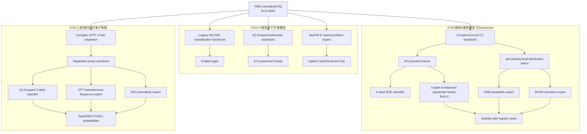

# 复合干扰识别与参数联合感知：当前实验状态及长线规划

> 审计日期：2026-07-26  
> 项目范围：`CJ_Inbalance_0724` 与 `CJ_Imbalance_0716`  
> 结论类型：代码与现有结果产物审计，不将不同数据角色或不同项目的指标混为同一最终模型

## 1. 执行摘要

当前已经形成三条相互关联但尚未统一的技术链：

1. **路线B有监督参数联合感知主线（0716）**：C2六类联合模型、FMB/SinFM局部参数专家和可见性安全软路由已经冻结，并在2026-07-26完成一次性locked test。六种子locked-test分类Macro-AUPR为`0.974025±0.000848`，Macro-F1为`0.928996±0.001939`；安全路由将全部12目标Macro-NMAE从`0.538270`降低到`0.528689`，相对降低`1.773%`，6/6 seeds为正。FMB带宽和SinFM频偏两目标合并相对改善`15.192%`。
2. **六类双骨干多任务开发线（0724）**：MLCNN负责分类、IQ-Grouped负责12参数提取，并可接SawFM周期专家。该路线具有完整六类输出和参数输出，但仍是root-train内部开发证据，没有使用0724路线的locked test。
3. **三类弱扫频分离线（0724）**：复数STFT U-Net分离扫频端点，VFT使用瞬时频率轨迹专家，ISRJ使用周期/自相关专家。三类tune指标达到Macro-AUPR `0.9409`、Macro-Recall `0.7830`、Macro-FPR `0.0953`，但它只输出SawFM/VFT/ISRJ三个存在性标签，不输出六类标签和12个物理参数，也未接入六类主系统。

因此，当前**不存在一个同时包含六类识别、12参数估计、U-Net弱分量分离、VFT/ISRJ存在性专家和安全参数路由的一体化端到端模型**。

当前最成熟、可以作为论文最终结果使用的是0716路线B已经消费的一次性locked-test结果。最新U-Net专家线属于有潜力的第二创新模块，但只能标记为开发集证据。

## 2. 数据与证据边界

- 六类顺序：`[FMB, SawFM, SinFM, MFT, VFT, ISRJ]`。
- 输入：复数RMS归一化I/Q，形状`[B,2,3000]`。
- 根训练集：25,200个样本、63种非空标签组合、每组合400个样本，是平衡数据，不是长尾数据。
- 九档功率视图：10至50 dB，同一`receiver_noise_seed`代表同一物理身份；不得作为九个独立样本重新划分。
- 0724完整开发角色：train 18,900、early 2,520、calibration 1,260、tune 1,260、confirm 1,260。
- 0716路线B locked test：`closedset_6class_test.mat`，25,200样本，已于2026-07-26执行一次，`rerun_permitted=false`。
- 0724 U-Net后续专家是在历史confirm已被查看后设计的，因此VFT/ISRJ专家结果是`tune-only`自适应开发证据。

## 3. 当前三套网络

### 3.1 0716路线B C2与安全参数路由

C2使用ComplexConv1d时序骨干，池化后得到约64维全局特征。分类头输出六个独立logit；LabelConditionedFeatureBank为每个类别生成条件嵌入，六个参数头各输出两个参数。

最终locked-test模型只对两个参数增加冻结局部专家：

- FMB `interference_bandwidth`；
- SinFM `frequency_deviation`。

局部专家读取池化前时序激活的均值、标准差、最大值、top-k均值及lag=1/4/16差分，形成448维局部分布特征。标准化逻辑回归路由器预测“局部专家是否优于C2”，通过时执行：

`p_final = p_C2 + alpha × (p_local - p_C2)`，其中`alpha≤0.75`；否则完全回退C2。

分类输出和其余10个参数完全不变。

### 3.2 0724双骨干六类多任务模型

分类路径为Legacy MLCNN：I/Q分别经过共享权重的四层Conv1d，通道32/64/128/256，核大小9；分别映射为256维后拼接，经过`512→256`适配器和六标签分类头。

参数路径为IQ-Grouped：`2→48→96→192`分组卷积保持早期I/Q分离，随后`1×1 Conv 192→96`跨路融合、全局池化、`96→256`适配器，再经共享`256→64`层和六个`64→32→2`类别参数头。

输出形状是分类`[B,6]`和参数`[B,6,2]`。该结构是真正的六类多任务网络，但尚未包含U-Net、VFT存在性专家或ISRJ存在性专家。

### 3.3 三类弱扫频U-Net子系统

U-Net对输入进行`n_fft=128, hop=32`的STFT，将实部、虚部和对数幅度拼为6通道。编码器宽度12/24，瓶颈48，通过两级跳连解码，输出两路幅度掩膜和两路相位残差，经ISTFT获得分离波形。

部署时只需要当前单视图I/Q；训练时用同identity的50 dB和10 dB差分构造oracle扫频端点教师。该子系统目前只处理SawFM、VFT和ISRJ的存在性识别。

## 4. 损失函数

### 4.1 六类多任务损失

`L_total = BCEWithLogits(y_hat,y) + λ_param L_param`，通常`λ_param=0.1`。

参数先用train角色有效正样本拟合z-score。Smooth L1只在：

`valid = (label=1) AND (parameter_mask=1)`

的位置计算。非活动NaN参数不得填0。

### 4.2 U-Net损失

`L = L_BCE + 0.5×(L_cos + 0.2L_time + 0.25L_multires-STFT + 0.1L_negative-energy)`。

其中BCE训练三类识别；余弦、时域L1和多分辨率STFT约束分离波形；negative-energy抑制无扫频正类时的虚假输出。

### 4.3 VFT/ISRJ专家

VFT和ISRJ存在性专家是冻结神经网络后的传统分类器：HistGradientBoosting拟合存在标签，early角色拟合LogisticRegression堆叠器，calibration角色按FPR上限0.10选阈值。

## 5. 主要训练超参数

| 模块 | 优化与调度 | Epoch/Batch | 其他规则 |
|---|---|---|---|
| 0716 C2 | AdamW，lr `3e-4`，weight decay `1e-4`，无scheduler | 40 epochs，batch 64 | AMP，clip 5；early macro-AUPR选点，Hamming破同分 |
| 0724双骨干 | AdamW，lr `1e-4`，wd `1e-4`，2 epoch warmup+Cosine | 20 epochs，batch 63 | patience 20，dropout 0.2，head 256，parameter hidden 64，AMP，clip 5 |
| U-Net | AdamW，lr `3e-4`，wd `1e-4`，Cosine | 8 epochs，batch 126 | clip 5；early macro-AUPR优先、分离余弦次优 |
| ISRJ HGB | 200 iter，lr 0.05，leaf 7/15，L2=1 | train拟合 | stacker Logistic C=1，balanced |
| VFT HGB | 200 iter，lr 0.05，leaf 7/15，L2=1 | train拟合 | trajectory leaf15+U-Net logit堆叠 |

分类阈值必须在calibration角色拟合；tune只能选择候选；confirm不能参与调参。0716一次性locked test已经消费，不能重新运行。

## 6. 实验演进与主要结论

| 阶段 | 结果 | 根因/决策 |
|---|---|---|
| 半监督/Power-SSL | 修复后覆盖率约24%，仍比B0_CONT低约0.02 AUPR | 目标错配、阈值漂移和低可见性伪负样本；停止扩展 |
| C1→C2 | 参数NMAE `0.61669→0.54183`，约12.1%，3/3正向；分类基本不变 | 参数监督有效，但不能宣称分类提升 |
| 统一骨干 | IQ-Grouped与Complex1D性能接近 | IQ-Grouped更轻；大骨干在短预算下不公平 |
| Legacy改造 | MLCNN分类最好；EfficientNet接近随机；ConvNeXt较弱 | BN/训练预算失配；停止同类超参网格 |
| MLCNN参数输入 | 类别条件NMAE最低；浅层多尺度相关性和稳定性较好；全局头失败 | 参数需要局部多尺度证据，单一全局语义不足 |
| 双骨干路由 | AUPR约0.9780，参数NMAE约0.5379 | 分类与参数需要不同归纳偏置 |
| 旧物理参数专家 | SawFM period通过；MFT count和VFT Doppler失败 | 周期信号可辨；复合峰和微小频移未被正确分离 |
| 0716局部参数专家 | FMB/SinFM通过冻结探针及安全路由 | 成熟C2+冻结专家优于从头端到端局部头 |
| 0716 locked test | 两目标合并改善15.192%；12目标改善1.773%；6/6正向 | 机制泛化成立，但FMB仍有少量组合级负增益 |
| oracle扫频端点 | oracle三类Recall约0.942 | 信息存在，主要瓶颈是单视图分离 |
| 局部STFT掩膜 | Recall 0.394 | 感受野和跨尺度结构不足 |
| 复数U-Net | Recall 0.649，AUPR 0.899 | 多尺度分离有效 |
| ISRJ周期头 | Recall `0.541→0.721`，3/3正向 | 通用CNN弱化长周期重复结构 |
| VFT频率头 | Recall `0.671→0.924`，3/3正向 | 分离后瞬时频率轨迹高度可辨 |

## 7. 当前定量结果

### 7.1 0716一次性locked test

- 分类Macro-AUPR：`0.974025±0.000848`；
- 分类Macro-F1：`0.928996±0.001939`；
- C2全部12参数NMAE：`0.538270±0.010704`；
- 安全路由12参数NMAE：`0.528689±0.009094`；
- 12参数相对改善：`1.773%±0.576%`，6/6正向；
- FMB带宽：`0.434373→0.363681`，相对改善14.959%；
- SinFM频偏：`0.309050→0.264764`，相对改善14.186%；
- 两目标合并相对改善15.192%，6/6正向。

### 7.2 0724双骨干开发结果

- Macro-AUPR：`0.97798±0.00118`；
- 固定阈值Macro-F1：约0.92433；
- oracle参数NMAE：`0.53791±0.00238`；
- 参数Pearson：`0.6450±0.0037`；
- 预测门控参数NMAE：`0.52948±0.00175`；
- 漏检惩罚NMAE：`0.56422±0.00559`。

任务路由相对IQ-Grouped的paired-bootstrap差值：AUPR `+0.01849 [0.01611,0.02082]`，预测门控NMAE `-0.04974 [-0.05430,-0.04538]`。

计算代价：12.891M参数、459.43M MACs、约918.87 MFLOPs；batch=1约1.315 ms。相对MLCNN-global参数仅增加0.66%，但延迟增加约31%、吞吐下降约30%。

### 7.3 三类弱扫频开发结果

- Macro-AUPR：0.9409；
- Macro-Recall：0.7830；
- Macro-FPR：0.0953；
- SawFM/VFT/ISRJ Recall：0.7031/0.9245/0.7214；
- 三个seed的系统Macro-Recall：0.7885/0.7646/0.7958。

该结果是tune-only开发证据，不能与0716 locked-test结果拼成一个“最终系统指标”。

## 8. 成功与失败机制

### 已验证成功

1. 有监督参数梯度能显著改善参数估计，但不显著改善分类。
2. 任务解耦的双骨干优于强迫单一共享特征同时服务分类和回归。
3. 局部参数专家必须建立在成熟冻结主干上，并通过可回退的优势路由安全接入。
4. 弱扫频信息并未消失；正确的分离和物理序列表示能显著提高识别。
5. VFT收益同时通过标签打乱、原始波形和全局统计对照，未发现直接标签泄漏。

### 仍然失败或未完成

1. MFT count尚无可靠专家；复合成分制造额外自相关峰。
2. 0724双骨干在九档功率上的参数映射仍严重漂移，50 dB oracle NMAE曾达到2.040。
3. 最新U-Net只在10 dB弱扫频场景验证，没有九档安全路由证据。
4. U-Net/VFT/ISRJ存在性专家尚未接入六类分类输出，也没有连接参数头。
5. VFT选中头平均FPR恰为0.10，单seed最高0.108，阈值裕量不大。
6. 0716 locked test已经消费，任何后续方法都必须在新独立数据或新外部测试集上验证，不能回看后调参再重测。

## 9. 创新点及证据强度

| 创新点 | 证据等级 | 当前可写表述 |
|---|---|---|
| 有效参数掩码的有监督联合感知 | 已locked-test | 参数监督在保持分类性能时改善物理参数估计 |
| 参数特异局部专家+安全软路由 | 已locked-test | 两个局部可辨参数取得6/6 seeds正向泛化 |
| 异构分类/参数双骨干 | 强开发证据 | 显著改善参数估计，代价已量化，但未独立locked-test |
| 物理专家晋级门槛 | 强开发证据 | 防止不可辨专家被盲目接回 |
| 复数U-Net弱扫频分离 | 开发证据 | 明显缩小raw与oracle之间差距 |
| VFT瞬时频率与ISRJ周期专家 | 自适应tune证据 | 机制对照充分，但缺新独立确认 |
| 一体化physics-routed joint perception | 尚未实现 | 只能作为未来方法，不可作为当前完成创新 |

## 10. 长线实验规划

### P0：冻结与分流

- 将0716 locked-test路线永久归档，不再修改或重跑。
- 将0724双骨干和U-Net三类专家分别冻结代码、角色哈希、checkpoint和阈值。
- 论文中分开报告最终证据与开发证据。

### P1：六类主网与三类专家的有界集成

假设：U-Net专家只应在弱扫频低可见性样本上修正MLCNN的SawFM/VFT/ISRJ输出。

最小改动：冻结六类MLCNN和U-Net，训练标准化逻辑回归优势门控；只允许有界残差，不直接替换六类logit。

评价：九档AUPR、三类Recall/FPR、六类Macro-AUPR、subset accuracy、门控覆盖率以及identity overlap。

晋级：10/50 dB三类平均Recall至少提高0.10；六类Macro-AUPR下降不超过0.005；每类FPR不超过0.10；3/3 seeds同方向。

### P2：预测标签门控下的完整参数评价

将改进后的六类标签门控用于12参数输出，同时报告oracle NMAE、预测门控NMAE、覆盖率、假阳性参数率和miss-penalty NMAE。若分类Recall提升不能转化为miss-penalty改善，则停止复杂集成。

### P3：MFT count机制重新隔离

按单成分高JNR→两成分→完整复合逐级验证参考匹配、延迟峰显著性、峰间距序列和ordinal头。任何前一级Pearson<0.3或MAE改善<10%时停止升级。

### P4：跨功率和组合泛化

使用identity-safe九档开发身份；再建立LOCO/LSCO或新生成外部组合集。禁止使用已消费的0716 locked test作为新方法评价。

### P5：计算与部署

测量集成系统参数量、MACs、FLOPs、batch=1/64延迟、显存和吞吐；增加与相同计算量单骨干的公平控制。

### P6：论文统计

对同身份样本做paired bootstrap；报告3至6 seeds均值、标准差、CI、组合最坏分位数和功率最坏分位数。避免只报告宏平均掩盖少数组合退化。

### P7：外部确认

新方法只能使用新的独立开发划分或新外部测试集确认。0716 locked test不得再次使用，也不得用于重新定义阈值、白名单或选择seed。

## 11. 建议的论文主线

### 主论文A：成熟参数联合感知

题目方向：**Visibility-Safe Parameter-Specific Routing for Supervised Compound Jamming Joint Perception**。

核心创新控制在三项：

1. 严格有效参数掩码的六类有监督联合感知；
2. 从池化前时序分布恢复参数特异证据；
3. 具有回退能力的优势预测软路由。

该论文可以使用0716一次性locked-test结果作为最终表格。

### 长线论文B：弱分量分离与物理识别

题目方向：**Single-View Physics-Routed Separation for Weak Components in Compound Jamming**。

核心创新候选：复数U-Net单视图端点分离、VFT瞬时频率轨迹、ISRJ周期机制专家及六类安全残差接入。当前缺少六类集成、九档泛化和独立确认。

## 12. 唯一推荐的下一步

下一步只执行一项实验：

> **冻结六类MLCNN主分类器与现有U-Net/VFT/ISRJ专家，在九档identity-safe开发视图上训练并验证三标签有界优势路由。**

不重新训练U-Net，不修改已有专家，不访问任何locked test。先回答三类专家能否安全转化为六类系统的弱分量Recall和端到端参数覆盖率收益。只有该实验通过，才值得进行端到端联合训练或扩展到新外部测试集。

建议入口：新增`cj0724/integrate_swept_experts_with_six_class.py`。输出必须包含逐样本主网概率、专家概率、路由概率、最终概率、身份、功率、标签、阈值、六类指标和参数门控指标。

