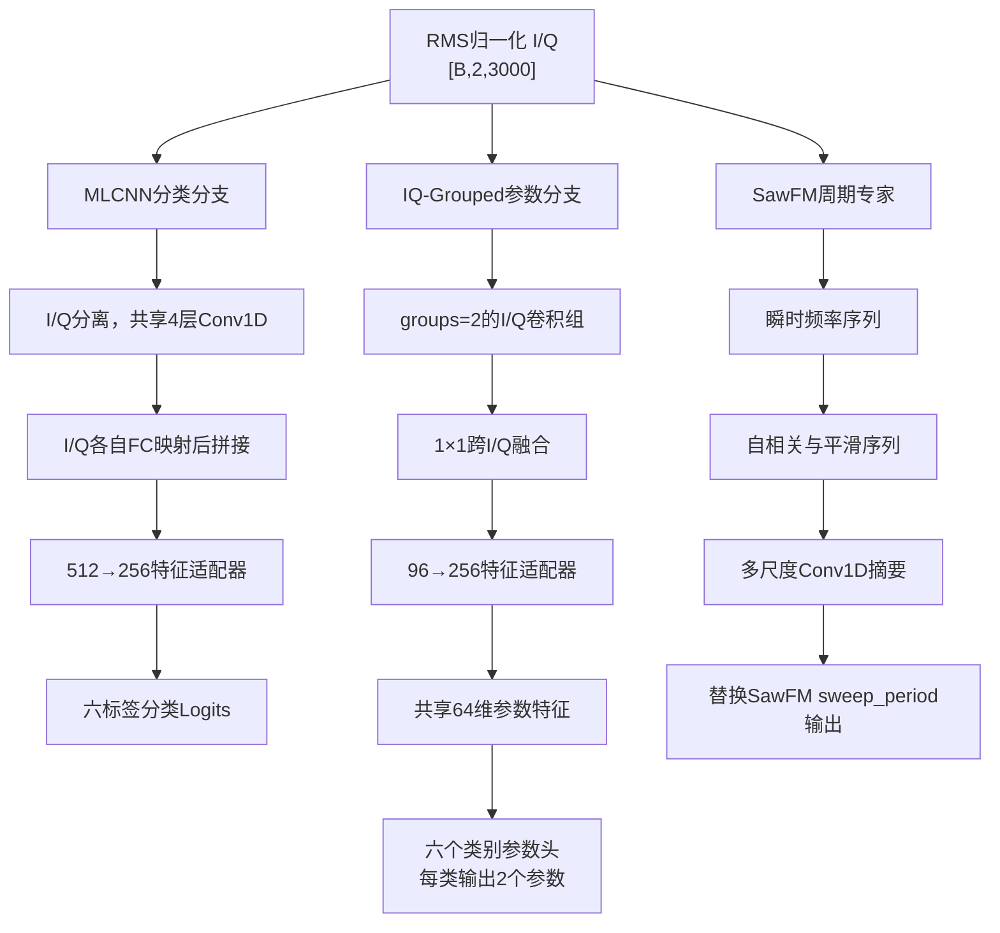

# 路线B复合干扰识别与参数联合感知：当前进展、网络结构、试验结果与失败机制审计

> 审计日期：2026-07-25  
> 当前项目：`C:\LJQ_code\CJ_Inbalance_0724`  
> 证据阶段：开发阶段，所有结果均为 `locked_test_used=false`

## 1. 执行摘要

路线B目前已经完成开发阶段的主要研究闭环：

1. 半监督与功率自监督路线已经按停止规则终止。
2. 有监督分类—参数联合感知已经验证有效。
3. 多种I/Q骨干和MLCNN参数头输入方式已经完成比较。
4. 已形成“MLCNN分类 + IQ-Grouped参数提取”的双骨干任务路由。
5. 已补充预测标签门控后的端到端参数指标，避免只报告oracle-positive结果。
6. 已完成任务路由与两个强基线之间的paired bootstrap置信区间比较。
7. 已测量参数量、MACs、FLOPs、峰值显存和推理延迟。
8. SawFM、MFT、VFT三个物理参数专家已完成3-seed筛选。
9. 只有SawFM周期序列专家通过晋级门槛并接入当前候选。
10. 已完成基于`receiver_noise_seed`的九档identity-safe功率及弱分量泛化验证。
11. 模型定义、训练规则、统计规则和主要结果产物已经哈希冻结。

当前冻结候选为：

> MLCNN分类分支 + IQ-Grouped参数分支 + SawFM周期序列专家输出替换。

当前还没有达到一次性使用locked test的条件。主要阻碍不是30 dB主域分类性能，而是极端功率条件下的弱分量漏检和参数分布漂移。

需要特别说明：SawFM专家当前采用独立oracle-positive训练，随后替换任务路由中的SawFM `sweep_period`输出；它尚未与整个双骨干系统重新进行端到端联合训练。

---

## 2. 研究问题与数据协议

### 2.1 权威数据

训练数据：

`C:\LJQ_code\干扰数据\复合干扰数据0716\closedset_6class_train.mat`

九档功率配对数据：

`C:\LJQ_code\干扰数据\复合干扰数据0716\power_sweep_9level_v1`

六类干扰固定顺序为：

| 索引 | 类别 |
|---:|---|
| 0 | FMB |
| 1 | SawFM |
| 2 | SinFM |
| 3 | MFT |
| 4 | VFT |
| 5 | ISRJ |

### 2.2 输入形式

输入统一为经过复数RMS归一化的I/Q序列：

$$
\mathbf{x}\in\mathbb{R}^{B\times2\times3000}
$$

两个通道分别为I路和Q路。归一化尺度为：

$$
rms=\sqrt{\operatorname{mean}(I^2+Q^2)}
$$

### 2.3 数据平衡性

0716根训练数据包含63种非空标签组合，每种组合400个样本，共25,200个样本。该数据是均衡数据，当前试验没有使用长尾采样，不能将这一阶段结果描述为长尾学习结果。

### 2.4 功率视图身份规则

九档功率为：

$$
10,15,20,25,30,35,40,45,50\ \mathrm{dB}
$$

这些视图不是独立样本，而是相同物理身份在不同相对功率条件下的配对观测。身份键为`receiver_noise_seed`。不得将同一身份的不同功率视图拆分到不同数据角色，也不得把九个视图计为九个独立样本。

---

## 3. 路线B试验演进

## 3.1 阶段一：半监督与功率自监督

早期尝试包括：

- B0_CONT；
- B1/B2；
- EMA teacher；
- pseudo-label；
- SameViewAug；
- NaivePower；
- MultiPositive；
- 跨功率一致性或power SSL。

伪标签覆盖率最初为0，经实现修复后达到约24%，且被选伪标签具有较高审计精度。但修复后B1/B2仍比监督基线B0_CONT低约0.02 macro-AUPR。

因此，失败不能简单归因于“伪标签代码错误”。更可能的失败链为：

> 类别覆盖不均衡 → 阈值和类别先验漂移 → 低可见性视图被误当成负样本 → 强增强上的硬BCE放大伪标签错误 → 表征或探针收益不能转化为最终多标签性能。

该方向已经按预注册停止规则终止。除非提出新的、可证伪的机制并完成匹配的下游验证，否则不应恢复原有半监督扩展。

## 3.2 阶段二：有监督分类—参数联合感知

停止半监督后，路线切换为有监督C0/C1/C2/C3消融。

历史C2相对C1：

- 参数NMAE：约`0.61669 → 0.54183`；
- 相对改善：约12.1%；
- 3/3 seeds同方向；
- 分类macro-AUPR只有轻微变化，没有形成稳定显著提升。

因此，历史C2的正确结论是：

> 联合监督改善了参数估计，但没有证明分类性能显著提高。

这一阶段确立了参数损失的核心规则：

$$
valid=(label=1)\land(parameter\_mask=1)
$$

非活动参数槽包含NaN，不能填0后参与回归，否则模型会学习“类别不存在时参数等于0”的虚假规律。

## 3.3 阶段三：骨干网络和Legacy兼容

当前代码中实现或兼容的骨干包括：

- Complex1D；
- IQ-Grouped；
- EfficientNet-B0 1D；
- EfficientNet-B1 1D；
- ConvNeXt-Tiny 1D；
- EfficientNet-B1 MoE3；
- EfficientNet-B1 VFT residual MoE；
- Legacy MLCNN；
- Legacy ResNet34；
- Legacy ShuffleNetV2；
- Legacy MobileNetV2；
- Legacy EfficientNet V1/V2/V3；
- Legacy 2D EfficientNet I/Q/magnitude。

所有骨干通过适配器统一接收`[B,2,3000]`输入，并支持分类和参数输出。

训练侧已经完成：

- AdamW优化；
- 学习率线性预热；
- Cosine调度；
- ReduceLROnPlateau候选；
- learning rate和weight decay小范围筛选；
- 按类别自适应阈值；
- joint、classification和parameter三种checkpoint目标比较。

早期统一骨干比较中，Complex1D和IQ-Grouped性能接近；后续参数提取比较表明，IQ-Grouped更适合作为轻量参数骨干。

## 3.4 阶段四：固定MLCNN分类骨干，比较参数头输入

已实现并比较：

- 全局共享特征参数头；
- 浅层多尺度参数头；
- 类别条件参数头；
- 浅层多尺度detached参数头；
- 独立IQ-Grouped参数骨干；
- MLCNN分类 + IQ-Grouped参数任务路由。

强确认结果为：

| 方案 | macro-AUPR | 参数NMAE |
|---|---:|---:|
| MLCNN-global | 0.9795 | 0.5920 |
| MLCNN-shallow | 0.9794 | 0.5945 |
| IQ-Grouped单骨干 | 0.9593 | 0.5831 |
| MLCNN + IQ-Grouped任务路由 | 0.9780 | 0.5379 |

其含义是：

1. MLCNN更适合承担分类任务。
2. IQ-Grouped单独分类较弱，但其参数特征更有效。
3. 共享MLCNN特征不能同时充分满足组合判别和精确参数估计。
4. 将分类和参数特征提取解耦后，参数NMAE明显下降，同时基本保留MLCNN分类性能。

---

## 4. 当前冻结网络总体结构

---

## 5. MLCNN分类分支

Legacy MLCNN将I、Q分别送入共享权重的卷积路径。

| 层 | 通道 | 核大小 | 后续操作 |
|---|---:|---:|---|
| Conv1 | 1→32 | 9 | BN、ReLU、MaxPool2 |
| Conv2 | 32→64 | 9 | BN、ReLU、MaxPool2 |
| Conv3 | 64→128 | 9 | BN、ReLU、MaxPool2 |
| Conv4 | 128→256 | 9 | BN、ReLU、MaxPool2、Dropout |

I、Q分别展平后：

- 各自经过`47872→256`线性层；
- 拼接为512维；
- 特征适配器为`512→256 + LayerNorm + GELU`；
- 分类头为`Dropout(0.2) + Linear(256,6)`。

输出是六个独立标签logit，训练时使用BCEWithLogits，不使用互斥Softmax。

---

## 6. IQ-Grouped参数分支

参数分支先保持I、Q路径相对独立，再进行显式跨I/Q融合。

| 层 | 通道 | 核大小 | groups |
|---|---:|---:|---:|
| Grouped Conv1 | 2→48 | 7 | 2 |
| Grouped Conv2 | 48→96 | 5 | 2 |
| Grouped Conv3 | 96→192 | 3 | 2 |

每层后接BatchNorm、GELU和MaxPool1d(2)。随后使用：

- `1×1 Conv：192→96`；
- BatchNorm；
- GELU；
- 全局平均池化；
- `96→256`特征适配器。

参数头结构为：

$$
256\rightarrow64\rightarrow
\begin{cases}
64\rightarrow32\rightarrow2 & \text{FMB}\\
64\rightarrow32\rightarrow2 & \text{SawFM}\\
\cdots\\
64\rightarrow32\rightarrow2 & \text{ISRJ}
\end{cases}
$$

最终参数输出形状为`[B,6,2]`。

---

## 7. 当前提取的12个参数

| 类别 | 参数 | MAT列 | 单位 |
|---|---|---:|---|
| FMB | JNR | 0 | dB |
| FMB | interference bandwidth | 2 | Hz |
| SawFM | JNR | 11 | dB |
| SawFM | sweep period | 14 | s |
| SinFM | JNR | 16 | dB |
| SinFM | frequency deviation | 18 | Hz |
| MFT | JNR | 27 | dB |
| MFT | num targets | 28 | count |
| VFT | JNR | 48 | dB |
| VFT | Doppler | 49 | Hz |
| ISRJ | JNR | 52 | dB |
| ISRJ | sample width | 53 | s |

当前任务路由中最弱的三个参数为：

| 参数 | NMAE | Pearson r |
|---|---:|---:|
| SawFM sweep period | 0.881 | 0.101 |
| MFT num targets | 0.834 | 0.198 |
| VFT Doppler | 0.843 | 0.137 |

这三个参数分别对应周期、延迟峰数量和微小频移，因此后续采用了物理序列专家进行针对性筛选。

---

## 8. 物理参数专家结构

## 8.1 SawFM周期序列专家

处理过程：

1. 根据相邻复采样点计算归一化相位增量，即瞬时频率序列。
2. 对瞬时频率去均值。
3. 使用FFT计算最大1000 lag的归一化自相关序列。
4. 使用9点平均池化得到平滑相关序列。
5. 将原始相关序列和平滑序列组成两个通道。
6. 经过三层一维卷积、平均池化和最大池化。
7. 使用LayerNorm和线性层回归SawFM周期。

该专家的物理假设是：SawFM调制周期会在瞬时频率序列的自相关结构中形成稳定周期峰。

## 8.2 MFT延迟峰ordinal专家

处理过程：

1. 将I/Q恢复为复信号。
2. 通过FFT计算复信号自相关幅度。
3. 提取最大1500 lag的延迟相关序列。
4. 通过7点平均池化形成平滑峰序列。
5. 使用一维卷积提取延迟峰结构。
6. 通过5个有序阈值预测3至8个目标的期望计数。

其失败表明自相关中可能有计数信息，但复合干扰产生的额外峰使目标峰不可稳定分离。

## 8.3 VFT瞬时频率专家

输入包含：

- 相邻采样点的相位增量；
- 局部平均幅度；
- 幅度变化量。

三通道时间序列经过一维卷积摘要后回归VFT Doppler。该通用瞬时频率表示没有完成参考波形对齐和dechirp，最终没有通过可辨识性门槛。

---

## 9. 损失函数

主任务路由使用：

$$
L_{total}=L_{cls}+0.1L_{param}
$$

分类损失为：

$$
L_{cls}=\operatorname{BCEWithLogits}(\hat{\mathbf y},\mathbf y)
$$

参数先使用训练角色中的有效正参数拟合均值和标准差：

$$
z_{c,p}=\frac{y_{c,p}-\mu^{train}_{c,p}}{\sigma^{train}_{c,p}}
$$

参数损失为：

$$
L_{param}=\operatorname{SmoothL1}(\hat z_{c,p},z_{c,p}),\quad(c,p)\in valid
$$

其中：

$$
valid=parameter\_mask\land(label>0.5)
$$

代码还会检查有效位置是否为有限值。如果有效位置包含NaN会直接报错，而不是静默填0。

### 9.1 专家损失

- SawFM period：归一化标量Smooth L1；
- VFT Doppler：归一化标量Smooth L1；
- MFT count：五个有序阈值的累计二元交叉熵；
- 分类损失关闭；
- 只训练`label=1 AND parameter_mask=1`的oracle-positive样本。

---

## 10. 训练方式和超参数

## 10.1 主任务路由

| 项目 | 当前冻结值 |
|---|---|
| Optimizer | AdamW |
| Learning rate | `1e-4` |
| Weight decay | `1e-4` |
| Scheduler | 2 epochs线性预热后Cosine |
| Epochs | 20 |
| Patience | 20 |
| Batch size | 63 |
| Seeds | 2041、2042、2043 |
| Split seed | 20260724 |
| Dropout | 0.2 |
| Head dimension | 256 |
| Parameter hidden dimension | 64 |
| Parameter loss weight | 0.1 |
| Gradient clipping | 5.0 |
| 训练AMP | CUDA AMP启用 |
| 当前checkpoint目标 | early角色参数NMAE最小 |

三个seed的最佳参数checkpoint均位于第20 epoch。这说明在当前20轮上限内还没有观察到明显的参数损失平台期，因此不能把“20轮已经充分收敛”作为已验证结论。

## 10.2 自适应分类阈值

在calibration角色上逐类别搜索：

$$
0.05,0.06,\ldots,0.95
$$

选择类别F1最大的阈值；并列时优先选择距离0.5最近的候选。

## 10.3 物理专家

| 项目 | 配置 |
|---|---|
| Optimizer | AdamW |
| Learning rate | `3e-4` |
| Weight decay | `1e-4` |
| Epochs | 20 |
| Patience | 5 |
| Batch size | 64 |
| Width | 16 |
| Train positives | 最多2,048 |
| Early positives | 最多256 |
| Confirm positives | 每目标640 |
| Gradient clipping | 5.0 |
| 分类损失 | 关闭 |
| AMP | 未使用 |

## 10.4 计算性能测试

性能测试配置不同于训练配置：

- NVIDIA RTX 5080；
- PyTorch 2.11.0+cu128；
- CUDA 12.8；
- FP32；
- 不使用AMP。

---

## 11. 开发数据角色

| 角色 | 样本数 | 用途 |
|---|---:|---|
| Train | 18,900 | 网络参数优化 |
| Early stop | 2,520 | checkpoint选择和早停 |
| Calibration | 1,260 | 分类阈值校准 |
| Tune | 1,260 | 方法和超参数选择 |
| Confirm | 1,260 | 开发阶段最终确认和bootstrap |
| Locked test | 未使用 | 最终一次性评估 |

每个开发角色都覆盖全部63种标签组合。Confirm是独立开发确认角色，不是真正的最终测试集。

---

## 12. 当前任务路由总体结果

三种子均值±标准差：

| 指标 | 结果 |
|---|---:|
| macro-AUPR | `0.97798 ± 0.00118` |
| 固定阈值macro-F1 | 约`0.92433` |
| 自适应阈值macro-F1 | 约`0.92613` |
| oracle参数NMAE | `0.53791 ± 0.00238` |
| 参数macro Pearson | `0.64503 ± 0.00367` |
| 预测门控参数覆盖率 | `0.92656 ± 0.00774` |
| 预测门控参数NMAE | `0.52948 ± 0.00175` |
| 漏检惩罚参数NMAE | `0.56422 ± 0.00559` |
| 假阳性门控率 | `0.07679 ± 0.00849` |
| 精确标签集合准确率 | `0.65529 ± 0.00751` |

预测门控NMAE略低于oracle NMAE，不代表门控提高了全部参数预测。原因是门控NMAE只在成功识别的类别上计算，容易排除困难漏检样本。因此必须同时报告覆盖率和漏检惩罚NMAE。

---

## 13. 各参数结果

| 类别 | 参数 | NMAE | Pearson r |
|---|---|---:|---:|
| FMB | JNR | 0.496 | 0.772 |
| FMB | interference bandwidth | 0.312 | 0.859 |
| SawFM | JNR | 0.431 | 0.824 |
| SawFM | sweep period | 0.881 | 0.101 |
| SinFM | JNR | 0.447 | 0.821 |
| SinFM | frequency deviation | 0.332 | 0.883 |
| MFT | JNR | 0.452 | 0.812 |
| MFT | num targets | 0.834 | 0.198 |
| VFT | JNR | 0.464 | 0.794 |
| VFT | Doppler | 0.843 | 0.137 |
| ISRJ | JNR | 0.476 | 0.797 |
| ISRJ | sample width | 0.486 | 0.742 |

JNR类参数以及FMB带宽、SinFM频偏和ISRJ采样宽度已经形成相对稳定的相关性。SawFM周期、MFT计数和VFT Doppler仍是主要薄弱参数。

---

## 14. 复合复杂度分析

随着样本中有效干扰成分数量增加，参数估计持续变差：

| 成分数 | 参数NMAE | Pearson r |
|---:|---:|---:|
| 1 | 0.4233 | 0.7255 |
| 2 | 0.4764 | 0.7083 |
| 3 | 0.5217 | 0.6715 |
| 4 | 0.5655 | 0.6140 |
| 5 | 0.5851 | 0.5850 |
| 6 | 0.6095 | 0.5462 |

该结果支持“复合成分之间的特征混叠是当前参数估计的重要瓶颈”，而不是单纯训练样本不足。

---

## 15. Paired bootstrap置信区间

统计规则：

- 每个seed内部对相同confirm样本配对重采样；
- 对3个seed的差值取平均；
- 2,000次bootstrap；
- percentile 95%置信区间；
- bootstrap seed为20260725。

## 15.1 相对IQ-Grouped

| 指标 | 平均差值 | 95% CI | 结论 |
|---|---:|---:|---|
| macro-AUPR | +0.01849 | [0.01611, 0.02082] | 任务路由更好 |
| oracle参数NMAE | -0.04567 | [-0.04963, -0.04203] | 任务路由更好 |
| 门控覆盖率 | +0.03750 | [0.03179, 0.04313] | 任务路由更好 |
| 门控参数NMAE | -0.04974 | [-0.05430, -0.04538] | 任务路由更好 |
| 漏检惩罚NMAE | -0.05971 | [-0.06431, -0.05531] | 任务路由更好 |
| 假阳性门控率 | -0.04328 | [-0.04971, -0.03705] | 任务路由更好 |

## 15.2 相对MLCNN-global

| 指标 | 平均差值 | 95% CI | 结论 |
|---|---:|---:|---|
| macro-AUPR | -0.000973 | [-0.001391, -0.000585] | 存在很小分类代价 |
| oracle参数NMAE | -0.05668 | [-0.06229, -0.05084] | 任务路由更好 |
| 门控覆盖率 | +0.00373 | [0.00120, 0.00622] | 略高 |
| 门控参数NMAE | -0.05747 | [-0.06363, -0.05157] | 明显更好 |
| 漏检惩罚NMAE | -0.05541 | [-0.06114, -0.04976] | 明显更好 |
| 假阳性门控率 | +0.00896 | [0.00600, 0.01205] | 存在代价 |

任务路由的统计结论是：用非常小的分类AUPR下降和假阳性率上升，换取稳定且显著的参数估计改善。

---

## 16. 三个物理专家筛选

固定晋级门槛为：

- 相对训练中位数常数基线，MAE至少降低10%；
- Pearson相关系数至少达到0.3；
- MAE改善和相关性均要求3/3 seeds同方向。

| 专家 | MAE改善 | Pearson r | 正方向 | 晋级 |
|---|---:|---:|---:|---|
| SawFM周期序列 | 19.05% | 0.502 | 3/3 | 通过 |
| MFT延迟峰ordinal | 1.79% | 0.179 | 3/3 | 拒绝 |
| VFT瞬时频率 | -1.36% | -0.015 | 未满足 | 拒绝 |

## 16.1 SawFM接回收益

相对原任务路由SawFM-period参数头：

- SawFM-period NMAE平均下降18.67%；
- Pearson相关系数从约0.101提高至0.502；
- 总体oracle参数NMAE降低0.01371；
- 总体预测门控参数NMAE降低0.01559；
- 漏检惩罚参数NMAE降低0.01408；
- 3/3 seeds同方向；
- 分类输出完全不变。

因此，SawFM周期专家具备明确的局部机制收益。

---

## 17. 计算代价

| 模型 | 参数量 | MACs/sample | 约FLOPs | Batch=1延迟 | Batch=64显存 | Batch=64吞吐 |
|---|---:|---:|---:|---:|---:|---:|
| MLCNN-global | 12.807M | 413.47M | 826.94M | 1.002 ms | 163.13 MB | 22,162/s |
| IQ-Grouped | 0.115M | 45.99M | 91.98M | 0.697 ms | 124.83 MB | 40,126/s |
| 任务路由 | 12.891M | 459.43M | 918.87M | 1.315 ms | 174.24 MB | 15,467/s |

任务路由相对MLCNN-global：

- 参数量增加约0.66%；
- MACs增加约11.12%；
- batch=1单样本延迟增加约31%；
- batch=64吞吐下降约30%；
- batch=64显存增加约6.8%。

参数量增长很小而延迟增长更明显，是因为第二骨干增加了实际卷积计算和GPU kernel调度。权重数量不是推理时间的唯一决定因素。

---

## 18. Identity-safe功率及弱分量泛化

九档功率严格按`receiver_noise_seed`配对，只评估root confirm角色的1,260个身份，没有使用任何power test文件。

| 功率 | 分类AUPR | 弱分量召回 | 基础oracle NMAE | 接入Saw后 | Saw period前/后 |
|---:|---:|---:|---:|---:|---:|
| 10 dB | 0.904 | 0.165 | 0.748 | 0.732 | 0.873 / 0.672 |
| 15 dB | 0.946 | 0.564 | 0.627 | 0.611 | 0.874 / 0.678 |
| 20 dB | 0.968 | 0.862 | 0.709 | 0.694 | 0.875 / 0.694 |
| 25 dB | 0.981 | 0.950 | 0.772 | 0.761 | 0.879 / 0.746 |
| 30 dB | 0.989 | — | 0.904 | 0.896 | 0.884 / 0.785 |
| 35 dB | 0.992 | 0.986 | 1.171 | 1.164 | 0.889 / 0.803 |
| 40 dB | 0.992 | 0.974 | 1.493 | 1.487 | 0.892 / 0.823 |
| 45 dB | 0.987 | 0.923 | 1.784 | 1.779 | 0.893 / 0.839 |
| 50 dB | 0.972 | 0.688 | 2.040 | 2.037 | 0.892 / 0.847 |

核心发现：

1. 分类在中间功率档相对稳定。
2. 10 dB时弱扫频类召回只有0.165，端到端门控严重失败。
3. 50 dB时固定调制类成为弱分量，弱分量召回下降至0.688。
4. 参数NMAE随功率产生明显的系统性漂移。
5. SawFM专家在九档均有正收益，但只能修复一个参数。
6. 分类AUPR较高不等于参数估计跨功率稳定。
7. RMS归一化只能消除整体幅度尺度，不能消除复合成分之间的相对功率变化。

---

## 19. 成功点与证据强度

## 19.1 已验证结论

1. 任务路由在参数估计上优于IQ-Grouped和MLCNN-global两个强基线。
2. 相对MLCNN-global，任务路由存在很小但统计显著的分类AUPR代价。
3. SawFM周期专家通过3-seed晋级门槛。
4. MFT和VFT专家未通过晋级门槛。
5. 双骨干具有明确且可量化的延迟、吞吐和显存代价。
6. 九档功率下存在显著参数分布漂移。
7. 极端功率下，预测标签门控是端到端参数输出的关键瓶颈。
8. locked test尚未使用。

## 19.2 有限证据

1. MFT自相关延迟峰中包含部分计数信息，但不足以支持完整复合场景。
2. SawFM专家具有跨功率正收益，但尚未经过真正locked test验证。
3. 双骨干任务解耦可能缓解分类与参数估计之间的梯度竞争，但目前主要证据来自性能对比，还缺直接梯度或表示分析。

## 19.3 尚未验证的假设

- 功率条件归一化；
- 可见性条件参数头；
- MFT参考匹配和峰显著性监督；
- VFT参考辅助dechirp；
- 分类标签、功率状态和参数专家的联合门控；
- SawFM专家端到端联合训练是否优于当前输出替换。

## 19.4 已停止或否决的方向

- 当前形式的半监督/power-SSL继续扩展；
- 未过门槛的MFT/VFT专家直接接回；
- 继续盲目搜索普通STFT参数；
- 在当前功率泛化证据下直接申请locked test。

---

## 20. 失败原因分析

## 20.1 半监督失败

**现象：** 伪标签通路修复后仍未超过监督基线。

**排除项：** 不是伪标签入口完全失效，也不是覆盖率仍为0。

**主要机制：** 低可见性与负样本混淆、类别覆盖不平衡、阈值漂移和强增强硬监督共同造成目标错配。

**下一项可证伪实验：** 如果恢复半监督，必须引入positive/negative/unknown三态监督，并将同身份信息与单视图可见性分离；但该方向当前优先级低于有监督功率鲁棒性。

## 20.2 共享参数头失败

**现象：** MLCNN全局、浅层和类别条件参数头均不如独立IQ-Grouped参数路径。

**机制：** 分类需要复合组合语义和判别边界，参数估计需要局部周期、延迟和频率细节。共享表示存在任务目标竞争。

**下一项可证伪实验：** 记录分类与参数梯度余弦相似度，或比较冻结分类骨干、只训练参数分支与完全联合训练的差异。

## 20.3 MFT专家失败

**现象：** 3/3 seeds均有正方向，但平均MAE只改善1.79%，相关系数只有0.179。

**机制：** 自相关中确实存在延迟信息，但多种复合成分也会产生额外延迟峰；ordinal头无法弥补前端峰不可分离。

**下一项可证伪实验：** 加入参考脉冲匹配滤波、峰显著性和峰间距监督，并按照高JNR单成分、一至二成分、完整复合场景逐级验证。

## 20.4 VFT专家失败

**现象：** 瞬时频率专家弱于常数基线。

**机制：** 1–7 kHz Doppler相对10 MHz采样率和单PRI观测窗口过小，同时受到LFM本体、到达时延、其他干扰分量和噪声影响。

**下一项可证伪实验：** 停止普通STFT搜索，改做时延估计、参考LFM对齐、dechirp和残余相位斜率回归。

## 20.5 功率泛化失败

**现象：** oracle参数NMAE从10 dB的0.748漂移到50 dB的2.040。

**机制：** 参数分支拟合了根训练分布下的特征—参数关系，但没有显式建模相对功率或可见性状态。功率变化改变的是复合成分的可辨识性，而不仅是总体幅度。

**下一项可证伪实验：** 依次比较线性输出校准、功率条件参数头、条件归一化和identity-paired一致性正则。

## 20.6 预测标签门控失败

**现象：** 10 dB弱分量召回只有0.165。

**机制：** 当类别漏检时，即使参数专家在oracle-positive条件下有效，也不能进入最终输出。因此低功率下的首要瓶颈是弱分量检测，其次才是回归误差。

**下一项可证伪实验：** 在保持参数专家不变的条件下单独改善弱分量召回，并同时审计假阳性率、门控参数覆盖率和miss-penalty NMAE。

---

## 21. 当前创新点与论文支撑程度

### 21.1 已形成较强支撑的创新点

1. **异构任务路由：** 分类与参数估计分别采用更适合的骨干，而不是强迫一个共享特征承担全部任务。
2. **参数有效性约束：** 通过`label AND parameter_mask`严格屏蔽不存在的参数。
3. **端到端参数评价：** 同时报告oracle、预测标签门控、覆盖率和漏检惩罚指标。
4. **物理专家晋级制度：** 使用常数基线、相关系数和3-seed一致性决定是否接回。
5. **身份安全功率评价：** 使用`receiver_noise_seed`完成九档同身份功率泛化验证。
6. **性能—计算联合评价：** 同时报告统计置信区间和部署计算代价。

### 21.2 仍需补充的论文证据

1. 功率鲁棒性方法必须在独立development身份上通过冻结门槛。
2. SawFM专家需要进一步说明独立训练后替换与端到端联合训练的差异。
3. 需要验证任务路由收益是否来自任务解耦，而不只是额外计算量。
4. 需要补充更直接的表示或梯度冲突证据。
5. 最终只能在所有规则冻结后进行一次locked-test评估。

---

## 22. 下一阶段试验计划

## P0：功率漂移来源分解

保持MLCNN分类器、IQ-Grouped参数骨干和SawFM专家冻结，比较：

1. 当前冻结候选；
2. 按功率档进行线性输出校准；
3. 输入估计功率或可见性状态的条件参数头；
4. 功率条件归一化；
5. identity-paired多功率一致性约束。

判定逻辑：

- 如果线性校准已能显著改善，主要问题是输出标定；
- 如果必须修改特征，说明存在真正的表示分布漂移；
- 如果分类召回仍低，则必须先修复门控而不是继续优化参数回归。

## P1：弱分量门控

目标是改善10 dB和50 dB弱分量召回，同时报告：

- macro-AUPR；
- per-class recall；
- false-positive gate rate；
- predicted-gate参数覆盖率；
- predicted-gate参数NMAE；
- miss-penalty参数NMAE。

不能只降低分类阈值换取召回，而忽略假阳性参数输出。

## P2：MFT机制验证

按照难度递增进行：

1. 高JNR单成分sanity check；
2. 一至二成分复合场景；
3. 参考脉冲匹配滤波；
4. 峰显著性和峰间距序列；
5. 完整复合场景ordinal计数。

## P3：VFT机制验证

按照物理处理链进行：

1. 到达时延估计；
2. 参考LFM对齐；
3. dechirp；
4. 残余相位斜率回归；
5. 多脉冲或扩大Doppler范围的数据边界试验。

---

## 23. Locked-test申请状态与门槛

当前不具备申请条件。

下一候选至少需要满足：

1. 九档平均预测门控参数NMAE相对当前候选下降至少10%；
2. 3/3 seeds同方向；
3. 10 dB和50 dB弱分量召回均达到0.80；
4. 两个极端档的miss-penalty参数NMAE均不高于1.0；
5. 30 dB分类AUPR下降不超过0.005；
6. 模型、归一化、分类阈值、checkpoint和统计脚本重新进行哈希冻结；
7. 获得用户显式批准后才进行一次locked-test运行；
8. locked test之后禁止调参、筛选seed或重新定义指标。

---

## 24. 最终结论

路线B已经从“探索是否可行”进入“冻结主模型、补足泛化证据”的阶段。

当前最可靠的研究成果是：

> 使用MLCNN承担复合干扰分类、IQ-Grouped承担参数提取，可以用很小的分类代价换取稳定且显著的参数估计改善；针对具有明确周期序列结构的SawFM周期参数，专门的瞬时频率自相关专家还能进一步改善端到端参数结果。

当前最主要的失败机制是：

> 极端功率改变了复合成分的相对可见性，使分类门控和参数映射同时发生分布漂移。SawFM局部专家能够修复单个参数，但不能解决系统级功率鲁棒性。

因此，下一阶段不应继续横向增加普通骨干或盲目扩大专家数量，而应优先完成：

> 功率漂移来源分解 + 弱分量分类门控改进。

---

## 25. 主要证据产物

- `configs/paper_candidate_freeze_20260725.json`
- `docs/route_b_frozen_evidence_and_locked_test_gate_20260725.md`
- `outputs/paper_candidate_freeze_receipt_20260725.json`
- `outputs/paper_core_evidence/paper_core_evidence.json`
- `outputs/paper_core_evidence/efficiency.json`
- `outputs/physics_parameter_specialists/summary.json`
- `outputs/physics_parameter_specialists/saw_attachment_results.json`
- `outputs/identity_safe_power_parameter_eval/identity_safe_power_results.json`
- `outputs/paper_evidence/parameter_complexity.json`
- `cj0724/multitask.py`
- `cj0724/physics_parameter_specialists.py`
- `cj0724/tuned_multitask_sweep.py`

上述冻结产物均标记`locked_test_used=false`。
